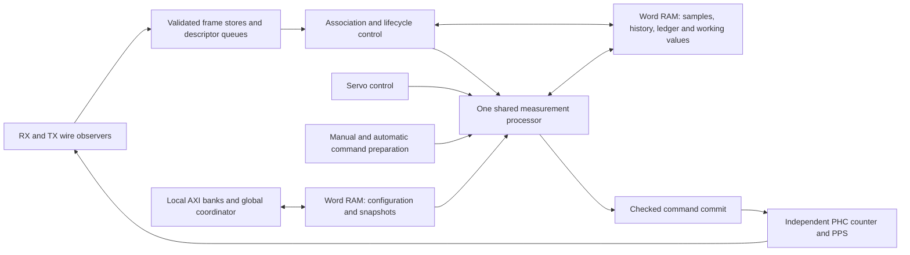

# Shared compute and word RAM implementation brief

October 12, 2026. Execution handoff for the complete PTP area redesign.
The maintainer wants the architecture below implemented, including its storage
and packet paths. **Halving LUT usage was motivation, not a hard requirement.**
Measure the completed design and report the result; do not sacrifice behavior
or spend time chasing an arbitrary percentage or 19,000-LUT threshold.
The [optimization analysis](lut-optimization.md) owns the rationale, arithmetic
audit and historical resource estimates. This brief owns the implementation work.

## Start here

Read the repository and nested `AGENTS.md`, [VHDL conventions](../../vhdl-conventions.md),
[endpoint contract](autonomous-endpoint.md), [timing contracts](rtl-readability.md),
[register ownership](register-map.md) and [test-selection guide](../../../tests/ethernet/PtpCore/README.md#selecting-tests).
Apply the conventions' RTL review checklist. Use checked-out SURF interfaces,
registered forward boundaries and the normal ruckus source manifests.
Do not stage, commit, push, change dependency pins or discard pending work without
the user's instruction. This handoff does not authorize those actions.

The starting SURF commit is `8ff8333b0`, plus pending servo divisor-width,
fixture and documentation changes. Inspect the actual working tree before
editing and carry those changes forward. The preceding `3f0daa750` shares
protocol timestamp conversion. `PtpCompute` has standalone arithmetic/ownership
tests but **no production client**; adding it alongside the old engines does
not implement this brief. The [review record](rtl-review.md) identifies the
checks already run and remaining limits.

Implement the whole connected design, making reviewable changes and running
focused checks as useful. Do not stop at another isolated prototype or a wide
adapter around the existing clients. Use the dependencies below to organize
work, without a separate approval or synthesis checkpoint for every module.
Unavailable Vivado results remain outstanding evidence, not a reason to stop
independent RTL and simulation work.

## Expected design

Each endpoint has one measurement processor and word-addressed working state.
Its PHC counter, PPS, physical timestamp capture and wire-rate validation remain
independent. The two KCU105 endpoints retain separate clocks, processors and PHCs.
Software remains outside the autonomous timing loop.

Keep protocol admission, association, wire-fate tracking and configuration
ownership recognizable in their current modules. Their arithmetic requests
become narrow descriptors and word accesses. Small sequencers retain control,
indices and ownership; wide working values reside in RAM. One authoritative
stored value should feed its consumers, instead of accumulating copies at
every module boundary. Necessary physical capture and output-holding registers
are legitimate; include them in the resource accounting.

### Shared arithmetic and storage

- Instantiate one production compute service from `PtpEndpoint`. Use four
  logical owners: protocol rate, E2E, servo and PHC command preparation. Route
  the protocol's rate/E2E requests through its hierarchy to that service;
  do not instantiate an engine inside each client. Standalone fixtures should
  compose the same service with the real client under test.
- Start from `PtpCompute`'s 32-bit carry/borrow ALU, RAM scratch and shared
  partial-product multiplier. Keep exact iterative division. Add only operations
  needed by the clients, including wordwise comparison, rounding and constant
  format shifts; avoid parallel arithmetic shortcuts and runtime power-of-two
  detection. Extra cycles are acceptable within the derived service contract.
- Define private directional request/response records, named operations and
  word layouts in a compute package if that clarifies the composition. Carry
  addresses, owner, operation, rounding and provenance, not separate 128-bit
  operand/result banks. Keep the public endpoint and software interfaces stable
  except for a documented, necessary timing-limit change.
- Extend the prototype's scratch-only layout into persistent client workspaces.
  Its current interface requires all eight operand words before each job and
  releases result storage on acknowledgement. Solve result-to-next-operand
  reuse in RAM: addressed sources/destinations or a word-copy operation with
  explicit ownership. Do not read an intermediate into four registers merely
  to write it straight back. Define cancellation and reuse before changing the
  loaded/completed semantics; test those changes against the existing oracle.
- Arbitrate the shared word and descriptor ports, including response ownership.
  Hold grants/payloads correctly across stalls and give eligible clients bounded
  service. A blocked result consumer must not lock the arithmetic engine or
  prevent another context from retiring. Define storage lifetime separately
  from arithmetic-slot lifetime; command ACK waits must release the engine.
- Use SURF synchronous RAM primitives and registered access strobes. Size depth
  from the actual layouts, not the prototype's incidental 128-word allocation.
  Keep valid, busy, generation and bank ownership in registers; invalidate RAM
  contents through ownership on reset. Separate banks/ports where concurrent
  wire capture, compute and AXI access require them. No fictitious multiport RAM.
- Preserve supported reset polarity/asynchronous-reset behavior when connecting
  the prototype, which currently exposes only its simple active-high reset.
  AXI-only reset must not cancel compute or accepted coordination. Per-client
  cancellation must not reset unrelated work. Tags supplement lifecycle checks;
  they do not replace generation, identity and cancellation ownership.

### Production clients and protocol working state

| Owner | Required replacement |
| --- | --- |
| `PtpProtocolEngine` rate estimator | Remove `U_RateMath`, `rateA`/`rateB` staging and redundant wide intermediates. Keep normalized anchor/current sample values in word storage; form differences, the fixed scale shift and ratio through the shared service. Preserve anchor-update behavior, minimum span, range rejection, ratio filtering/qualification and raw-capture provenance. |
| `PtpE2e` | Remove its private `U_Math`, duplicate capture/sample copies and wide `elapsed`/`correctedSync`/`delayValue` scratch. Sequence timestamp conversion, elapsed-time product, calibration and final arithmetic through shared storage/compute. Preserve each capture's increment when a RATE change falls between RX and TX. Zero calibration still omits its work. |
| Pair/history storage in `PtpProtocolEngine` | Replace wide pair/history RAM ports and their full-row write/read staging with addressed fields/words. Keep current logical capacities, nearest-Sync selection and tie rules, expiry boundaries, replacement and pending measurement ownership. Reuse normalized timestamps; do not recreate conversion at each use. |
| `PtpServo` | Remove the private math engine and wide operand/correction staging that RAM replaces. Store median history/scratch, retained frequency and PI intermediates as words; share comparison and arithmetic. Preserve median results, bootstrap/tracking behavior, intermediate rounding/overflow, clamps, anti-windup, lock hysteresis and stale/holdover cancellation. Commit retained frequency only on the accepted command's successful acknowledgement. |
| `PtpPhc` command preparation | Remove private phase-normalization math and redundant command preparation copies. Share normalization for both manual and automatic commands. Keep counter increment, rollover, PPS, generation, capture inhibition, command admission and commit checks local and clock-by-clock. Prepare a command against its defined operands, not a stale prediction of future PHC time. |

Route timestamp conversion through the same arithmetic resource where its
wide multiply/add would otherwise remain duplicated. Preserve full seconds and
fractional range. Follow the [divide/multiply audit](lut-optimization.md#divide-and-multiply-audit-october-12):
the raw-clock ratio is genuinely variable; constant unit conversions need exact
quotients/remainders and existing rounding. The general processor reports checked
overflow, while some existing E2E additions intentionally use modulo signed128
arithmetic. Classify every operation and preserve its actual contract; blindly
rejecting every shared-ALU overflow would also change behavior.

Use storage handles between producers/consumers where useful, with explicit
release and invalidation. Preserve any required full-record public boundary with
one stable publication register, not additional working copies at both ends.
Do not retain the legacy engines in the production hierarchy after migration.
Keep an old source revision for comparison; avoid a permanent runtime-selectable
legacy/compact implementation and its extra control.

### Configuration and coherent snapshots

Move wide shadow/candidate/active configurations and diagnostic payloads in
protocol, servo and PHC into local word banks. Cache only fields required every
clock. Keep the local AXI banks and endpoint coordinator as the owners; this is
not a new central register block or a software-controlled timing algorithm.

Prepare freezes an immutable candidate. Later shadow writes target the next
candidate, including preservation of untouched words and byte-strobe behavior.
Use bank ownership plus a bounded copy or copy-on-write scheme; simply swapping
to an uninitialized shadow bank loses prior settings. Validate the frozen bank
sequentially and switch all active banks on the same apply edge. The current
coordinator samples Boolean validation votes after a fixed prepare interval:
extend its private completion handshake for sequential preparation/validation,
so an unfinished bank is not mistaken for an invalid one. Preserve atomicity,
ConfigBusy/error/sequence behavior and the apply-to-restart register boundary.

Snapshots must still represent the same common **pre-edge** state and sequence
across all banks. A serial read of live words is not a coherent snapshot. Pin
immutable result/record banks and latch genuinely changing scalars at capture;
copy those frozen sources if needed. Retain the old published snapshot until
the complete new cohort is readable. If publication takes longer, extend the
coordinator's private completion handshake and document SnapshotBusy/sequence
timing together. Preserve previous snapshot contents during the copy and verify
capture coincident with command commit, config apply and invalidation.

Preserve addresses, field widths, access responses, defaults, sequences and
accepted operations through AXI-only reset. Mirror any necessary externally
visible timing-limit/capability change in RTL, PyRogue, register documentation
and tests. Do not reset entire RAM arrays to reproduce register defaults;
use a bounded initialization/validity scheme with defined bus/startup behavior.

### Ledger and packet paths

- Convert `PtpTxLedger`'s complete 636-bit entry transfers into field/word reads
  and updates. Retain ownership/key flags and small scan state in registers.
  Preserve depth support, logical occupancy, simultaneous response/completion
  handling, timeout multiplicity, duplicate retirement, sequence exhaustion and
  unknown-wire-fate quarantine. A logical restart never proves a queued frame
  vanished. Avoid rebuilding a full entry in registers during every scan.
- Replace `PtpTxTimestampTap`'s use of the full receive parser with a dedicated
  Delay_Req wire observer. Emit the identity/sequence/domain and complete capture
  metadata needed by the ledger, retaining actual post-MAC observation, physical
  timestamp location, FCS/length/framing checks and the two-entry logical queue.
  Preserve late completion across logical restart/PHC generation changes;
  physical reset completion retains its separate meaning.
- Stream RX fields into a compact frame store instead of retaining the complete
  78-byte prefix and decoded copies. Keep only validation metadata/counters
  required as bytes arrive; publish a descriptor only after complete validation.
  Preserve Announce data, one-/two-step bodies, TLVs, correction/flag checks,
  four-entry logical capacity and the existing overflow/abort accounting.
- Physical input cannot be backpressured. GMII receives one byte and XGMII up to
  eight bytes per clock; a single shared 32-bit compute port cannot be their
  capture sink. Use dedicated streaming write bandwidth/banks and bounded
  capture staging. Prove service at minimum frame spacing, including writes,
  registered FIFO heads and frames arriving while prior descriptors are held.
  A deeper primitive FIFO must not silently increase the published capacity.
- Keep `EthMacCore`, FCS generation, pause handling and primary-traffic protection
  intact. The checksum-disable experiment is explicitly deferred. Do not replace
  passive physical observation with AXI acceptance or introduce MAC frame-token
  integration as part of this rewrite.

## Scheduling and numerical requirements

Use the proposed 10 Hz sustained Sync envelope for resource planning, with 8 Hz
as the initial encoded master interval. It is not a new packet rejection rule.
Account for bursts, reordered Follow_Up/Delay_Resp, TX completions, servo work,
manual commands and snapshot/configuration traffic. Keep accelerated regression
traffic supported through an explicit bounded admission/overflow contract.

Derive a worst-case sequence bound including operand movement, queueing,
calibration, computation, publication and command preparation. Isolated observed
prototype latency (up to 4,443 clocks for divide) is not a bound on a measurement.
The existing 2,048-clock association minimum cannot be treated as a guaranteed
processing window. Derive and document the new supported minimum and change its
validation/readback/tests consistently when necessary; keep the two-second
default unless the actual derivation requires otherwise. Preserve the meaning
of age checks rather than extending capture freshness invisibly.

Under indefinitely stalled consumers, bounded successful completion is impossible:
specify held ownership, expiry/cancellation and recovery instead. Ensure ongoing
rejected RX traffic cannot starve E2E publication, and a servo waiting for PHC ACK
cannot block the PHC compute request needed to produce that ACK. Restart, loss
of validity and physical abort take effect while arithmetic is busy.

Keep signed128 arithmetic semantics, full epoch/fractional range, exact rounding,
per-capture calibration and both supported PHY modes. No shortened timestamps,
restricted gains, changed controller, reduced diagnostics or protocol-mode removal
is needed to satisfy an area number. Those remain separate possible studies.

## Execute and demonstrate the result

Start by connecting the endpoint-owned service and migrating rate and E2E with
their actual word-resident state. Carry that same design through servo, PHC
preparation, configuration/snapshots, ledger and packet storage/observation.
This is an implementation dependency, not a request to pause after each client.
Extend internal interfaces and their real production wrappers together. Update
`ethernet/PtpCore/ruckus.tcl` for new source organization; its directory loading
already includes RTL and simulation wrappers. Keep public generic order stable.

Use these existing fixtures as independent behavioral references, adapting their
latency expectations to the derived contract without weakening numerical checks:

| Changed behavior | Focused checks |
| --- | --- |
| Compute/storage interfaces | `test_ptp_compute.py`; add mixed-client arbitration, chained results, cancellation at every transfer phase, stalled readers and reset/reuse tests |
| Rate, E2E, association/history | `test_ptp_port_samples.py`, `test_ptp_e2e.py` (zero/ingress/egress/both), relevant `test_ptp_protocol_ram.py` and exchange cases; retain independent timestamp/rate oracles |
| Servo and PHC | `test_ptp_servo.py`, `test_ptp_phc.py`, relevant reference cases; verify all supported clock/reset cases, overflow, holdover, command ACK and uninterrupted counter behavior |
| Configuration and snapshots | `test_ptp_reg.py`, `test_ptp_register_map.py`; add prepare/copy/publication races, concurrent byte writes, common snapshot edge and AXI-only-reset survival |
| Ledger word storage | `test_ptp_tx_ledger.py` storage/key/reuse/cancellation/counter scenarios, including depths one, three and four and supported RAM settings |
| RX/TX observers | `test_ptp_rx_rtl.py`, wire/specification fixtures, `test_ptp_rx_mac.py`, `test_ptp_mac_association.py`; both physical widths and malformed/paused/late traffic |
| Complete integration | `test_ptp_endpoint.py` and `test_ptp_endpoint_mac.py` across affected PHY and one-/two-step cases; add simultaneous-client congestion/deadlock coverage |

The current E2E fixture explicitly assumes `130*OPERATIONS+6` clocks and some
association fixtures program 2,048; update those assumptions with their boundary
assertions. Do not merely raise timeout loops until tests pass. Preserve tests
of the exact admission/publication/expiry edges that define behavior.
Run the smallest relevant checks during editing; reserve the full PTP suite for
the completed integrated rewrite. Run VSG on edited VHDL and appropriate Python
lint. Record actual selections and outcomes in `rtl-review.md`.

Measure the final implementation against a reproduced baseline with matching
FPGA part, Vivado version, linked IP, constraints, generics, strategy and flow
stage. The retained October 12 reports are historical orientation and include
three PHY black boxes; do not compare them directly with a newly linked design.
Preserve source revisions and any dirty patch with the comparison evidence.
Report total LUTs (including LUTRAM/SRL), FFs, carry, BRAM, DSPs and timing for
each complete lane, the pure endpoint and the changed hierarchy. Count shared
compute, arbitration, RAM and boundary staging once, even if hierarchy moves.
DSP/BRAM are available tradeoffs; lower LUT use is the preference, not faster math.

Completion means the described shared-compute/word-storage design is connected,
superseded production engines/copies are removed, behavior and scheduling checks
pass, and the area/timing comparison is reported or explicitly awaiting the build
host. Report remaining large contributors honestly; no percentage determines
success. If measured control/mux cost defeats the intended sharing, examine the
dominant structures, including fixed ROM-based sequencing, without abandoning
correctness or quietly removing features. Synthesis does not establish routed
timing, hardware accuracy or standards conformance; keep those acceptance items
distinct. Fold enduring interfaces into the owning guides and update this brief's
status so the next agent can resume without reconstructing the chat.
