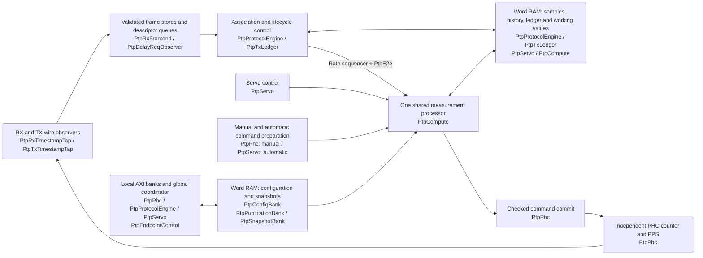

# Shared compute and word RAM implementation

October 13, 2026. Implementation record for the October 12 area-redesign brief,
against clean SURF baseline `75a49f427`. The complete production design is
recorded in SURF `52dfa266f`. The original
brief is retained at that baseline revision. This record replaces its completed
execution checklist; enduring interfaces and procedures live in the guides below.

**Halving LUT usage was motivation, not an acceptance threshold.** The first
[synthesis screenshot](lut-optimization.md#october-13-connected-implementation-synthesis)
shows the copper endpoint at 18,483 LUTs, 13,618 registers, 0.5 BRAM tile and
four DSPs, using Vivado 2025.2 and the implementation revision above. Full reports,
a matched comparison and timing remain outstanding. Vivado/VCS are unavailable
locally on `PC100431`; synthesis evidence comes from the maintainer's build.

## Implemented architecture

Each endpoint has one shared word processor with persistent rate, E2E, servo
and PHC-command workspaces. Production private math engines and their duplicate
wide operand/result staging are removed. PHC counting, PPS and wire capture
remain independent of shared arithmetic. KCU105 endpoints retain separate clocks,
processors and PHCs; software remains outside the autonomous timing loop.

Module names refer to the corresponding `.vhd` files in
[PtpCore/rtl](../../../ethernet/PtpCore/rtl).
[PtpEndpoint](../../../ethernet/PtpCore/rtl/PtpEndpoint.vhd) connects the core
modules and routes their AXI banks through `AxiLiteCrossbar`. Boxes group
responsibilities: repeated names refer to the same module, and the storage boxes
collect separate local RAM instances. Arrows show functional relationships;
compute results and configuration words pass through their owning sequencers.
`PtpE2e` and `PtpTxLedger` are children of `PtpProtocolEngine`.
[EthMacPtpEndpoint](../../../ethernet/PtpCore/rtl/EthMacPtpEndpoint.vhd) combines
`PtpEndpoint` with the MAC and both timestamp taps. Each tap uses
`PtpRxTimestampAdapter` for physical capture; `PtpRxTimestampTap` contains
`PtpRxFrontend`, and `PtpTxTimestampTap` contains `PtpDelayReqObserver`.

| Contract | Maintained source |
| --- | --- |
| Arithmetic ownership, cancellation, RAM timing, queue service and configuration/snapshot handshakes | [Timing and record contracts](rtl-readability.md) |
| Protocol, numerical ranges, admission and autonomous behavior | [Endpoint contract](autonomous-endpoint.md) |
| Register addresses, defaults, byte writes and coherent readback | [Register map and ownership](register-map.md) |
| Production modules, wrappers, composition and source manifest | [PtpCore guide](../../../ethernet/PtpCore/README.md) |
| Test selection, independent oracles and fixture procedures | [PTP test guide](../../../tests/ethernet/PtpCore/README.md) |
| Actual check outcomes and remaining acceptance | [Connected implementation review](rtl-review.md#october-13-connected-compute-and-word-storage) |
| Design rationale, arithmetic audit and historical area evidence | [Optimization analysis](lut-optimization.md) |

The [shared-service derivation](rtl-readability.md#shared-service-bound) includes
word movement, arbitration, calibration, computation and publication. It defines
a 70,347,776-raw-tick minimum association window, validated and exposed through
`MinimumAssociationTicks` at global address 0x20F8. The two-second endpoint default
is retained. The working sustained Sync envelope is 10 Hz, initially encoded at
8 Hz; finite queues retain their documented overflow and cancellation behavior.
This is a source-derived bound and deployment assumption, not measured hardware
performance or a new packet-rejection rule.

## Implemented storage inventory

This is source geometry, not synthesized utilization. Primitive depth rounds up
to a power of two; inference and constant pruning require build-host evidence.

| Owner | Addressed payload storage per endpoint |
| --- | --- |
| Shared compute | 208 persistent + 26 scratch words; 256x32 physical RAM. |
| Protocol pair/history | Four 20-word pair rows and four 25-word history rows; each RAM is 128x32. History includes eight normalized words per sample. |
| TX ledger | Four 22-word rows; 128x32 RAM. Depth generic retains 1–255 logical slots. |
| Servo median | Five two-word history samples in 16x32 RAM; padded sorting scratch uses compute slots. |
| Local configuration | Three banks of 48 protocol, 34 servo and 10 PHC operand words, including address-map holes; physical RAMs are 256x32, 128x32 and 32x32. |
| Immutable result snapshots | Protocol records have 12 Announce body/metadata and 20 exchange words; servo records have 4 offset, 4 median and 2 rate words. Five versions per record require 256x32 and 64x32 physical RAMs. |
| Changing-scalar snapshots | Two banks of 7 protocol counter, 10 PHC and 1 servo words; scalar cohorts are latched together before copying. |
| RX stream | Eight 64x8 lane RAMs at depth four, a separate 8x293 capture RAM and a narrow bank/length descriptor FIFO. Five frame banks include the active physical frame. |
| Dedicated TX stream | Eight 8x8 lane RAMs, separate 4x293 capture RAM and a narrow descriptor FIFO. Three frame banks preserve two logical completed entries. |

The subsequent [candidates 1–4 pass](lut-optimization.md#october-13-candidate-implementation)
selects block RAM for pair/history, ledger, protocol/servo configuration and
protocol publication. The six selected stores retain their geometry and one-cycle
read interfaces; the smaller banks remain distributed. These are local mapping
selections awaiting synthesis, separate from the screenshot of `52dfa266f`.

Necessary full-width state remains visible in the public protocol/servo diagnostic
records, held measurement/command outputs, physical capture staging, the selected
E2E producer records and TX packet/beat ownership. Per-clock identity, admission
and timer caches also remain. Snapshot changing-scalar latches are intentionally
retained. These are part of the completed-design resource accounting; moving
working values to RAM does not imply that every wide register disappears.

## Verification and next step

All 171 regression configurations passed across focused batches, including all
four endpoint and four real-MAC lifecycle configurations and eight raw/normalized
E2E calibration configurations. VSG passes for all 25 changed/new VHDL files;
Python lint, changed links/anchors and diff whitespace pass. The
[review record](rtl-review.md#october-13-connected-compute-and-word-storage)
records selections, reruns, tool settings and evidence, including the distinction
between passing scenarios and deliberately interrupted duplicate runs.

The first screenshot and its provisional comparison are recorded in the
[optimization analysis](lut-optimization.md#october-13-connected-implementation-synthesis).
The next implementation-evidence task is to retain full reports and obtain a
matched baseline/current Vivado comparison. Reproduce FPGA part, linked IP, constraints, generics, tool version,
strategy and flow stage; retain source revisions and the working-tree patch.
Report total LUTs including LUTRAM/SRL, FFs, carry, BRAM, DSPs and timing for each
complete lane, the pure endpoint and changed hierarchy. Count compute, arbitration,
RAM and retained boundary staging once. The October 12 reports contain three PHY
black boxes and cannot be compared directly with a newly linked design.

Use measured hierarchy costs to decide whether control/mux structures merit
further work; the [consolidated exploration list](lut-optimization.md#next-optimization-candidates)
records candidates and the GMII netlist finding. No percentage or 19,000-LUT
threshold determines success. Shared Ethernet MAC/checksum changes remain
deferred. Routed timing, physical CDC,
calibrated accuracy and external-master interoperability remain separate
[acceptance work](rtl-review.md#outstanding-acceptance).
