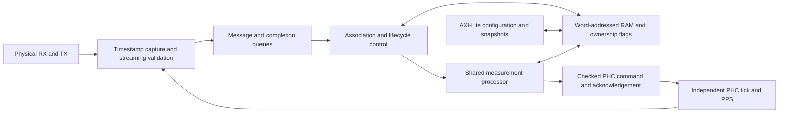

# PTP logic and storage optimization

## Proposed architecture for substantial LUT reduction

October 12 design proposal, implemented October 13, 2026.
**Connected implementation and behavioral checks are complete; the first synthesis
screenshot is recorded below. A matched comparison and timing remain outstanding.**
The architecture changes how the endpoint computes and stores its state.
The maintainer clarified that **halving LUT usage is motivation, not a hard
requirement**. Implement the shared processor and word-storage design, then
measure how much it saves. Preserve both independent endpoints and autonomous
FPGA control. The earlier 19,000-LUT allocation below remains an illustrative
planning exercise, not an acceptance threshold, predicted saving or conformance
claim. Count complete lanes, including MAC and wrapper logic.

The [implementation record](lut-implementation.md) describes the connected
architecture, storage inventory and next build-host comparison; the
[review record](rtl-review.md#october-13-connected-compute-and-word-storage)
records all 171 passing regression configurations across focused batches.
The completed design supersedes the staged rollout and hard numeric area gates
previously proposed here. This analysis retains the proposal reasoning and
dated evidence; the October 12 increment/prototype sections describe earlier
revisions, not the current production hierarchy.

### Execution status and working assumptions

The maintainer authorized beginning implementation on October 12. The first
retained increment is shared protocol timestamp conversion. The checksum-offload
experiment was subsequently deferred at the maintainer's request: keep
EthMacCore unchanged unless measured benefits justify extending the shared
Ethernet configuration/verification scope. Its source changes, tests, capability
register and KCU105 selections were reverted together and preserved as patches in
the consuming project's `docs/history/ptp-checksum-offload-2026-10-12/`.

Both independent ports, autonomous control, one-/two-step reception, E2E,
numerical precision, the current servo and full diagnostics remain the reference
behavior. Additional BRAM/DSP use is acceptable within the allocation below.
The maintainer authorized committing this preparatory checkpoint on October 12;
it is SURF `3f0daa750`, recorded by consuming-project commit `e79b730`.
The October 13 implementation connects one measurement processor per endpoint
and word-addressed working/configuration/snapshot storage. Rate, E2E, servo and
PHC command preparation have migrated, together with protocol tables, the ledger,
compact RX and the dedicated TX observer. The
[service derivation](rtl-readability.md#shared-service-bound) replaces the old
association floor with 70,347,776 raw ticks. The
[October 13 synthesis screenshot](#october-13-connected-implementation-synthesis)
shows the connected copper hierarchy; full reports, matched attribution and
hardware timing remain outstanding.

The maintainer proposed a **10 Hz maximum sustained Sync rate**. Use that as
the working deployment envelope, with **8 Hz (`logSyncInterval = -3`)** as the
initial advertised master setting because the interval encoding uses powers of
two. This is a planning assumption awaiting timing-performance qualification,
not a new receive rejection rule or a claim of profile compliance. Two-step
Follow_Up messages add traffic; Delay_Req/Delay_Resp and Announce cadences remain
independent. Queue and scheduling analysis must include short bursts/reordering,
not infer 100 ms of spacing between every received message. The service contract
accounts for the finite queue capacities, stalled consumers and cancellation;
deployment performance still needs qualification. Accelerated regression traffic
remains covered.

Local focused simulations and structural checks precede synthesis on the
maintainer's build host. Vivado is unavailable on this local host. Record
actual mapped area/timing before claiming savings; the earlier allocation
remains an unmeasured planning example, not a requirement.

### First implementation increment: October 12

`PtpProtocolEngine` now selects remote/local timestamp operands before a single
`ptpTimeQ16` call. Two registered states prepare the corrected remote and local
forward difference. The rate anchor holds normalized remote time and raw
tick/phase, and the forward result survives the rate divide. Full epoch,
correction and fractional widths remain intact. Association age is checked on
the original completion edge; conversion adds two clocks to publication, with
RX admission held during conversion. Reset, generation/config changes and port
cancellation retire pending conversion work.

Focused verification on local GHDL 6.0.0 / cocotb 2.1.0:

| Selection | Result |
| --- | --- |
| Direct protocol samples, distributed tables (1 configuration, 4 cocotb scenarios) | Passed: exact full-range conversion/correction, rate qualification, retained publication, new-stage cancellation and inclusive completion age |
| History/pair RAM scenarios, distributed tables (4 configurations) | Passed in 98.10 s: selection, cancellation, publication priority and expiry |
| Four real-MAC integration cases with the now-deferred checksum option | Interrupted before any completed result when that work was reverted; no passing integration claim |

`PtpProtocolEngine` passes VSG; changed Python passes flake8. No full-suite or
block-table rerun was selected because the memory implementations did not change.
The timestamp converter has no new manifest entry or public interface. The
checksum experiment's independent validation is recorded with its archived
patches; it is not evidence of a retained optimization.

No FIFO remapping, shared word ALU, configuration/snapshot RAM migration or
parser redesign is implemented in this increment. Those remain part of the
implementation brief. A matched synthesis comparison and a default-MAC integration
check remain outstanding; include total lane LUTs, LUTRAM/SRLs and timing.
Vivado is unavailable locally. Integrated area remains unmeasured.

### Shared word processor prototype: October 12

`rtl/PtpCompute.vhd` implements the first arithmetic/storage foundation of the
new architecture. It is a standalone synthesizable unit in the normal ruckus
source inventory, **not yet instantiated by `PtpEndpoint`**. No production
`PtpMath` instance, timestamp converter, configuration bank or snapshot bank
has been removed by this prototype. The PHC tick path is unchanged.

Four contexts share one 128-by-32 `surf.SimpleDualPortRam`, a 32-bit data ALU
with carry/borrow and a single 32-by-32 partial-product multiplication site.
The latter is intended for DSP mapping; actual primitive mapping is unmeasured.
Operands, full 256-bit multiplication scratch, division trials, quotient and
remainder live in RAM. Only word-sized working registers, a 64-bit partial
product and small ownership/descriptor fields remain in registers. There are
no 128-bit arithmetic operand/result ports; the wide tag port carries four
independent 32-bit provenance tags. The final production storage layout and
client adapter interfaces are still to be designed.

| Word locations | Ownership and meaning |
| --- | --- |
| `16*client + 0..3` | Signed128 operand A, least-significant word first |
| `16*client + 4..7` | Signed128 operand B, least-significant word first |
| `16*client + 8..11` | Wrapped signed128 result |
| `16*client + 12..15` | Signed truncation remainder, zero for non-division |
| `64..89` | Shared magnitude/product/remainder/trial scratch; inaccessible to clients |
| `90..127` | Unused physical depth padding |

Operation codes 0/1/2/3 select add/subtract/multiply/divide. All eight operand
words must be written before job admission. Signed128 overflow reports error
and retains the wrapped result. Divide by zero reports zero result/remainder
and error. Optional division rounding is nearest with ties away from zero;
remainder always refers to the unrounded, truncated quotient, matching `PtpMath`.
Precision/range have not been reduced to make the word datapath smaller.

Each context admits one queued or completed job. A round-robin scheduler shares
the nonpreemptive arithmetic engine. Word accesses and jobs alternate when both
are eligible; the RAM port is serviced between arithmetic jobs. A completed
context can hold its result while other contexts progress. Result acknowledgement
releases unread result words; an accepted read still completes and prevents slot
reuse until its held response is consumed. Reset and per-context cancellation
invalidate ownership without resetting RAM. Cancellation wins over transfers,
and tags/result-valid/read-valid are registered. Client adapters must provide
the correct generation/cancellation association; tags alone do not enforce it.

The focused `test_ptp_compute.py` fixture exercises the real unit with block and
distributed RAM. Its independent integer oracle covers 185 arithmetic requests
per configuration, including full signed128 extrema, carries across words,
overflow, zero divisors, both rounding modes and signed remainders. Additional
scenarios check four queued clients, held result/read responses, partial operand
admission, tags, continuous memory contention, reset and cancellation during
queued/active/completed work and result-word writes. Both memory configurations
pass all three scenarios. VSG and Python lint pass. These are standalone checks,
not equivalence of a migrated endpoint or evidence of mapped LUT savings.
GHDL synthesis completes and recognizes the 32-bit-by-128 RAM; it ignores
vendor memory attributes, so Vivado RAM/DSP mapping and area remain unmeasured.

| Operation | Largest observed admission-to-result latency, isolated context |
| --- | ---: |
| Add / subtract | 26 clocks |
| Multiply | 196 clocks |
| Divide, including optional rounding | 4,443 clocks |

The test bounds are 7,000 clocks per isolated job and 28,000 for a four-job
batch; the observed maxima are from directed/seeded vectors, not an exhaustive
proof. At 125 MHz, 4,443 clocks is 35.544 microseconds and the four-job test bound
is 224 microseconds. These conversions exclude operand transfer, complete
measurement instruction sequences and packet bursts. A divide alone exceeds
the existing 2,048-clock minimum association setting; migration must derive
the compact service/timeout contract instead of silently preserving that floor.
The default two-second timeout and proposed 10 Hz sustained Sync ceiling do not
remove the need to bound burst load and measurement-to-command latency.

**Next implementation:** connect protocol-rate/E2E operations to one shared
instance through word accesses and test their existing numerical/provenance
contracts. Measure engine **plus adapters**, compare the existing-width divider
alternative, and budget complete operation sequences. Then migrate servo and
PHC command preparation while leaving PHC ticks independent. Move actual
working records, configuration banks, coherent snapshots, median history and
ledger entries to word storage in the owning migrations; do not recreate four
wide operand/result staging banks around this RAM. The standalone foundation
does not complete the production integration or storage redesign.

### Divide and multiply audit: October 12

The maintainer requested avoiding divisions wherever practical before migrating
the clients. The shared word processor is the architectural foundation; its
general divide operation permits exact results with serialized hardware.
Preserve intermediate overflow rejection, nearest/ties-away rounding and signed
truncation remainders. **LUT reduction is the objective; lower cycle count is
only useful when required by the service deadline.** Skipping an operation does
not save its hardware when other operations still need that shared resource.
Extra detection, muxes, barrel shifters and dispatch states can increase area.

IEEE 1588-2019 clause 11.3.2 specifies E2E delay arithmetic, including division
by two; clause 12.3 leaves the synchronization mechanism to the implementation.
Neither mandates general signed128 divider hardware. This audit used the
maintainer's local standard and the production RTL at `8ff8333b0`.

| Owner / operation | Denominator | Required implementation or optimization |
| --- | --- | --- |
| E2E mean path delay | 2 | Already a rounded shift; keep signed/fractional behavior. |
| Protocol raw-clock rate | Measured raw tick/phase span | Genuinely variable. Retain shared exact division initially; a nominal 8 Hz Sync source does not make captures exactly periodic. Default minimum span is 0.5 s, so at most about two rate updates per second. |
| E2E calibration, each nonzero plane | That capture's PHC increment, shifted to Q48 | Already removed for zero calibration. Evaluate reciprocal caching keyed to the captured increment; RX/TX may straddle RATE, so the current increment cannot replace either historical value. |
| Servo bootstrap | Constant nominal Q32 increment | At 125 MHz this is `8*2^32 = 2^35`: a signed rounded shift is exact. Implement only if integrated area falls; bypassing a retained shared divider alone is insufficient. Other clocks require their actual elaborated constant. |
| Servo integral interval | `1_000_000_000` | Exact constant division candidate; preserve the existing interval rounding before the later integral product. |
| Servo ppb-to-addend | `1_000_000_000*2^16` | Exact constant conversion candidate. At 125 MHz, algebra reduces the complete conversion to `round(ratePpbQ16*1024/1953125)`. The validated +/-200000 ppb numerator fits signed45. |
| Servo acquisition / PHC manual phase | `1_000_000_000*2^16` | Share a constant quotient/remainder operation outside the PHC tick path. Preserve full epoch range and truncation toward zero. |
| Generic-derived clock/timeout constants | Elaborated constants | No runtime divider; do not count these as recoverable logic. |

The protocol ratio is master nanoseconds per unsteered local cycle, not a
dimensionless rate. It reconstructs elapsed time independently of numerical
PHC steering. Removing it requires a different error/control derivation.
The PHC tick/PPS path already uses addition, comparison and conditional
subtraction; it does not wait for a divider.

Constant division can use precomputed integer reciprocals, multiplication,
shifts and correction; see the primary
[LLVM constant-division implementation](https://llvm.org/doxygen/DivisionByConstantInfo_8cpp_source.html)
for the arithmetic technique. This is not evidence of FPGA area. Bound the
approximate quotient error and correct it before deriving the exact remainder
and rounding decision. A fixed-point reciprocal without that proof does not
establish equivalence. Compare mapped cost with a small shared iterative path.

Multiplication deserves the same operation-by-operation treatment:

| Product | Exact opportunity and constraint |
| --- | --- |
| Servo elapsed ticks times nominal increment | A constant shift is exact at power-of-two nominal increments, but the shared multiplier remains for other jobs. Defer bypass logic without net area evidence. The accepted interval is below `2^62` ticks; preserve the full product. |
| Servo clamped ppb times nominal increment | Same area gate as interval scaling. The clamped ppb term is signed35; a proposed shifted product must still fit signed128. |
| Shared word-engine products with a power-of-two operand | Defer runtime detection and shift paths: the general multiplier remains and new control/shifters cost LUTs. Any later proposal must preserve overflow, negative signs and `abs(MIN_SIGNED128)`. |
| Offset times configurable Kp/Ki | Gains are runtime unsigned Q30, not generally powers of two. Favor proven operand-width reductions over runtime shortcuts; never reinterpret units or silently restrict allowed gains. |
| Integral gain product times elapsed interval | Preserve the signed128 intermediate overflow rejection before the final shift. Factoring/reordering rounded stages can change behavior even when the real-valued equations are equal. |
| Seconds times one billion and fixed ppb scales | Factor powers of two and evaluate constant DSP/shift-add implementations using the shared multiplier. Do not duplicate a wide adder tree at every call site. |
| General word products | Skip provably zero high limbs and exploit known operand widths only with exact overflow checks; compare control overhead with the existing 16 partial products. |

Bootstrap conversion is currently recomputed during tracking, although tracking
normally uses retained frequency plus integral feedback. Skipping it is a later
candidate: first check expiry/reacquisition transitions during an admitted job,
as well as rejection and diagnostics. Likewise, precomputing gains in PHC-addend
units could remove more ppb/seconds conversions, but requires separate
quantization, saturation, anti-windup and closed-loop validation.

**Area-first implementation decision:** leave the shared processor's iterative
operation paths unchanged and remove the unmeasured servo arithmetic bypasses.
Bound the existing servo divider at elaboration to its actual constant operands:
46 bits at 125/156.25 MHz, expanding for lower-frequency standalone instances.
This reduces the remainder register and subtraction widths without adding
states or changing latency, dividend/result precision or rounding. Validate
the clock-dependent bound, cancellation, held commands and overflow behavior.
Mapped net LUT savings remain unmeasured until Vivado synthesis.

The architectural priority remains one shared measurement processor and narrow
word-addressed state. Prefer removing duplicated engines, wide register banks
and their muxes. An arithmetic specialization must reduce integrated engine
plus adapter/control LUTs, not merely shorten a simulation or reduce the number
of issued jobs. Constant shifts can be useful when they replace physical logic;
do not add parallel paths to accelerate an already adequate shared datapath.
The prototype's 196-cycle multiply and observed 4,443-cycle divide are service
budget inputs, not performance targets. End-to-end burst/timeout analysis is
still required. This local width change does not complete the architecture.

The focused servo regression passed all three clock configurations (six cocotb
scenarios) in 213.43 s. VSG and Python lint pass; see the
[divisor-bound review and evidence](rtl-review.md#october-12-servo-divisor-bound).
No mapped-area or full endpoint result is claimed for this increment.

### Feedback rate estimator study: October 13

**Decision: deferred at the maintainer's request, October 13.** Retain the
current quotient-based rate estimator and shared divider. The inquiry and
reproducible study below are preserved for possible future work, not an active
implementation task. LUT savings are unproven and may be small: other clients
still require the divider, while feedback adds state, admission and gain control.
It would change acquisition/convergence, noise filtering, transient response and
rate-valid qualification, with consequences for E2E error. That tradeoff is not
justified by the current area evidence. Revisit if resource measurements show
meaningful net savings or a separately motivated estimator-performance need;
define the behavioral requirements and validation before adopting a replacement.

Exploration against production `52dfa266f`; no estimator RTL or register
behavior changed. The question is whether to estimate master nanoseconds per
raw cycle without explicitly forming each timestamp-difference quotient.
Keep this independent of numerical PHC steering: feeding the steered PHC offset
directly into this estimator would mix oscillator error with our own actuator
commands. The existing servo remains a separate consumer of the rate estimate.

The smallest candidate retains the same observations and output units. For
accepted timestamp differences `D = delta master ns` and `H = delta raw cycles`,
predict `Dhat = Rhat*H`, then update:

```text
e = D - Rhat*H
Rhat_next = Rhat + e / 2**s
```

Here the gain has units of inverse raw cycles. For constant true rate and no
packet-delay variation, rate error contracts by `1 - H/2**s`. A fixed shift is
stable only for `0 < H/2**s < 2`; a sufficiently long packet gap breaks that
condition. Choose `s = ceil(log2(H)) + g` instead. The effective gain is then
between `2**(-g-1)` (exclusive) and `2**(-g)` (inclusive). With `g=2` it is
between 1/8 and 1/4; with `g=0` acquisition is monotonic with gain above 1/2
and at most one. This is a gain approximation, not an approximation to a single
quotient: in the constant/noiseless case the fixed point is still the true rate,
subject to fixed-point rounding. Gains change at power-of-two span boundaries.

For our actual fixed-point formats, implement the candidate as:

```text
S = delta raw tick-phase units                  # cycles times 8
q = retained Rhat in Q48
A = delta corrected master timestamp Q16 << 35
E = A - q*S                                    # signed, scaled by 2**51
m = ceil(log2(S))
q_next = q + round_ties_away(E >> (m + g))
```

This needs the existing multiplier, subtract/add, shift/round and span-exponent
selection. It does not require a variable-denominator quotient. Avoid a new
wide parallel leading-zero detector if a word scan can supply the exponent.
Prove the signed intermediate widths before RTL integration; Python integers
in the exploration do not model overflow. Preserve timestamp validation,
anchor advancement, range rejection, freshness and generation handling.

Range checking need not reintroduce division. For positive `A,S`, the condition
`L <= round_ties_away(A/S) <= U` is exactly:

```text
(2*L - 1)*S <= 2*A < (2*U + 1)*S
```

The different inclusive/exclusive limits preserve rounding ties. This introduces
cross products and comparisons whose control and service costs must also be
counted. A small correction to `q` is not evidence that the incoming interval
was valid; merely clamping the updated estimate would hide bad observations.

Another candidate is a phase-and-rate observer. Predict master time from the
previous prediction and `Rhat*H`; apply `alpha*e` to predicted phase and
`beta*e/2**ceil(log2(H))` to rate. Dyadic alpha/beta avoid arbitrary gain
division. Retain phase as a residual relative to the last timestamp so a full
epoch need not be shifted into Q51. For constant span, its error-transition
matrix has trace `2-alpha-beta_eff` and determinant `1-alpha`, where
`beta_eff = beta*H/2**ceil(log2(H))`. The constant-span stability conditions
include `0 < alpha < 2` and `0 < beta_eff < 4-2*alpha`. These conditions alone
are not a proof for arbitrarily switching spans, gaps or nonlinear rejection.
This observer adds state and another loop to tune; lower noise can accompany
much slower response to actual oscillator drift.

#### Reproducible numerical comparison

[rate_feedback_study.py](../../../tests/ethernet/PtpCore/rate_feedback_study.py)
runs five integer models on the same intervals admitted by the existing
independent `RateEstimator`. It also checks equivalent quotient-free range
admission against that oracle. The direct model performs its current first-slope
bootstrap followed by quarter-error filtering. The residual candidates use
`g=2`, or `g=0` for the first 18 observations followed by `g=2`. Eighteen fast
observations bound the ideal contraction from the configured rate envelope;
they are not a validated qualification rule under noise. Phase observer settings
are alpha/beta = 1/4,1/64 (slow) and 1/2,1/8 (faster).

Run from the SURF root with the existing Python environment:

```sh
python -m tests.ethernet.PtpCore.rate_feedback_study --csv /tmp/ptp-rate-feedback.csv > /tmp/ptp-rate-feedback.json
```

The study uses exact rational raw-clock integration, Q3 captures and Q16 master
timestamps at 8 Hz, a 0.5 nominal-second minimum observation span, a 50 us base
path delay, and +/-100 ppm clean startup. Noise is seeded Gaussian delay jitter
with 100 ns standard deviation, rounded to integer ns. Separate scenarios add
a 10 us delay step, 50 ns/s delay ramp, +100 to -50 ppm oscillator change and
a six-second packet gap spanning that oscillator change. Step/gap events occur
after 240 seconds of warmup; steady statistics use seconds 480 through 720.
These are illustrative synthetic inputs, not an assumed deployment noise budget.

Representative results at 125 MHz and initial +100 ppm:

| Estimator | Clean startup to a 10 ppb error band | Rate jitter standard deviation | Oscillator-step settling to 10 ppb | Peak rate error from delay step |
| --- | ---: | ---: | ---: | ---: |
| Direct quotient, existing filter | 0.5 s | 51.76 ppb | 21.25 s | 5,000 ppb |
| Residual, tracking gain throughout | 17.5 s | 48.02 ppb | 38.75 s | 4,657 ppb |
| Residual, fast acquisition | 2.0 s | 48.02 ppb | 38.75 s | 4,657 ppb |
| Phase observer, slow | 60.0 s | 4.47 ppb | 143.125 s | 887 ppb |
| Phase observer, faster | 13.0 s | 28.06 ppb | 30.0 s | 3,293 ppb |

Settling means the error stays within the band for the remainder of that clean
scenario, evaluated at accepted observations. It is not the time that production
`ratioValid` would assert. That flag currently requires two qualified intervals;
the direct model's first accurate slope at 0.5 s precedes its validity at 1 s.
The candidate models deliberately do not implement validity, stale recovery,
clipping or full endpoint control. The 10 ppb band is a comparison metric, not
a new timing requirement.

At 156.25 MHz, fast residual acquisition takes 5.5 s, tracking jitter is
29.44 ppb, and the frequency-step response takes 30.0 s. The faster observer
gives 23.0 s / 17.44 ppb / 18.125 s respectively. The slow observer's clean
-100 ppm startup takes 137.5 s. Raw-span admission near the 0.5-second threshold
and the exponent bins change effective gains, even between these nominal clock
settings. These gains are illustrative and are not bandwidth-matched; the lower
noise numbers do not establish a superior estimator without its transient cost.

All five models converge to about -50 ppb rate bias under the 50 ns/s delay
ramp. A growing path delay is indistinguishable from a clock-rate change in
these one-way observations. This limitation applies to the direct ratio too.
It requires a noise/path model or additional observations, not another arithmetic
implementation of the same two timestamps.

#### Consequences for E2E and LUT optimization

For zero calibration, a relative rate error `epsilon` produces approximately
`epsilon * exchange_separation / 2` of E2E mean-delay error. For a one-second
separation, 1 ppb corresponds to 0.5 ns, and 100 ppm corresponds to 50 us.
Consequently the old two-interval validity count cannot automatically qualify
a nominal-start feedback estimate. Define acquisition confidence, expiry,
outlier rejection and acceptable rate error before allowing it to steer the
endpoint; retain capture-specific calibration and PHC-rate-change behavior.

Removing the protocol divide alone does not remove divider hardware from the
connected design. Servo bootstrap/interval/actuator conversion, acquisition and
manual phase normalization still issue divides; nonzero E2E calibration divides
by each capture's increment. Constants could eventually use exact specialized
conversions, but nonzero calibration remains a separate variable-denominator
problem. New filtering/admission control can offset any saved decode/state logic.
The [October 13 screenshot](#october-13-connected-implementation-synthesis)
attributes 2,223 LUTs to the entire shared `PtpCompute`, not its divider alone;
it does not supply a divider-only area estimate.

As a separate option, exact division at acquisition followed by feedback tracking
preserves a quick bootstrap but retains the divider. LinuxPTP's
[PI implementation](https://raw.githubusercontent.com/richardcochran/linuxptp/master/pi.c)
similarly uses an offset/time slope during initialization and PI feedback during
tracking (source inspected October 13). It controls a different clock coordinate;
this is an example of separating acquisition and tracking, not a drop-in model
for our raw-clock estimator or evidence of lower FPGA area.

If this inquiry is reopened, the first candidate to study is the residual update with separate
acquisition/tracking gains: it preserves the rate/E2E interface and has a simple
scalar convergence bound. The phase observer is a broader filtering option,
requiring interval-dependent stability/noise analysis. Choose rate-error and
acquisition/holdover requirements, compare realistic correlated PDV and oscillator
drift, and validate the complete endpoint before replacing RTL. Retain the
shared divider until every remaining caller is accounted for; saving cycles is
not itself a LUT optimization.

The October 13 run completed **70 synthetic scenario/parameter comparisons**,
with signed shift/tie checks, range-admission boundary checks, clean convergence
and the delay-ramp bias check. Python flake8 passed. Numerical traces/summary
are reproducible from the script; the local run wrote
`/private/tmp/ptp-rate-feedback-20261013/traces.csv` and
`/private/tmp/ptp-rate-feedback-20261013-summary.json`. No RTL simulation,
synthesis, physical-clock model or closed-loop endpoint comparison was run for
this exploration. The production estimator and its independent reference remain
unchanged.

### Baseline and accounting

Use the retained October 12 post-synthesis reports in the consuming `ptp-dev`
repository, `docs/reference/ptpkcu105-utilization-2026-10-12/`. They record
Vivado 2025.1, KU040, and 102,977 whole-design LUTs. The recorded build pins SURF
`cb5184623`; this plan reviews the RTL at `666613f1c`. The report's three PHY
black boxes and the difference from the 105,948-LUT screenshot remain explicit
limits; see the [full-report comparison](#october-12-arithmetic-synthesis-comparison).
Rebuild an unchanged baseline with the same linked IP and tool as each candidate.
If a now-linked PHY changes lane totals, retain its identical cost on both sides
and recalculate the complete-lane comparison; do not compare a black-box baseline
with a linked candidate.

The following copper rows are disjoint. The corresponding SFP lane is 39,574
LUTs. Count LUTRAM and SRLs, and count shared resources exactly once. These
allocations are retained for orientation; none is a pass/fail requirement.

| Area bucket | Reported baseline LUTs | Illustrative LUT allocation | Intended change |
| --- | ---: | ---: | --- |
| Protocol engine excluding ledger, plus servo | 21,732 | 6,500 | One scheduled measurement processor; shared arithmetic, timestamp conversion and word-addressed working/configuration storage |
| PHC | 2,993 | 1,800 | Keep the real-time counter; move command preparation/normalization onto the shared service |
| TX ledger | 1,801 | 1,100 | Read and update words instead of repeatedly staging complete 636-bit rows |
| Endpoint crossbar, control and TX resize | 655 | 600 | Retain coordination; avoid new wide buses and unnecessary format conversion |
| RX and TX timestamp taps | 6,571 | 3,000 | Specialized streaming parsers, compact completion records and RAM queues |
| Ethernet MAC | 4,544 | 4,544 | Retain the shared MAC unchanged; no MAC saving assumed |
| Remaining lane/wrapper accounting | 1,319 | 1,319 | No saving assumed; includes hierarchy residuals |
| Unallocated margin | 0 | 137 | Integration headroom |
| **Complete reported copper lane** | **39,615** | **19,000** | **52.0% illustrative reduction, not a requirement** |

The pure `PtpEndpoint` subtotal is 27,181 today and 10,000 in this allocation;
including both timestamp taps it is 33,752 today and 13,000 in the allocation.
This avoids meeting the goal merely by deleting a port or moving costs outside
the endpoint hierarchy. In the existing report, two 19,000-LUT lanes would take
the whole board to approximately 61,788 LUTs, a **40.0% whole-board reduction**;
the host link and other board logic are separate costs.

After deferring checksum removal, the MAC allocation retains its full baseline
cost. The shared protocol/servo allocation is correspondingly tighter at 6,500
LUTs in that planning exercise. This is not a savings estimate or a limit on
completing the redesign. Use measured costs to assess the actual result.

Allow an initial engineering budget of up to 12 additional BRAM36 tiles and
32 additional DSPs per lane, subject to mapped timing and resource review.
These are allowances, not consumption estimates. The report uses 32 of 600 BRAM
tiles and 77 of 1,920 DSPs across the board, so minimizing DSPs is not the goal.

### What profiles can and cannot remove

The current implementation is already a configured-source, Layer-2, E2E
TimeReceiver. It does **not** implement BMCA, Pdelay, UDP/VLAN PTP transport,
management/signaling, security, or one-step timestamp insertion on transmit.
Removing those absent features saves nothing. Do not describe this as a general
multi-profile stack that can be reduced to the current subset.

Rechecked against the maintainer's [IEEE 1588-2019 text](../../../../../../docs/reference/1588-2019.pdf):
20.2 and 20.3 permit defined choices of options and attribute ranges, not arbitrary
exceptions to mandatory behavior. Annex I.3 specifies the default E2E profile;
17.6 defines the external-port-configuration option and its data sets and state
behavior. The existing fixed-source implementation has not demonstrated that
contract. Ethernet mapping is **Annex E in 2019**, versus Annex F in 2008.
Continue tracking the [specification gaps](../../../tests/ethernet/PtpCore/specification-coverage.md),
including domain ranges, Delay_Req distribution and time properties. An area
build preset must not be advertised as a standards profile or cure those gaps.

| Candidate restriction | Recommendation and consequence |
| --- | --- |
| Layer-2 E2E, receiver role, configured source | Keep as the deployment scope. Already selected; no fictitious saving from dropping other transports, roles or delay mechanisms. Select/document a conforming profile separately. |
| Only one-step Sync, removing Follow_Up pairing | Do not use for the main target. Clause 11.2 specifies receiver processing for both twoStepFlag values. Restricting the transmitter to one mode does not remove the receiver obligation; a closed-network experiment would need an explicitly limited compatibility claim. |
| No Delay_Req/Delay_Resp, TX tap, ledger or E2E calculation | Clause 20.2.1 allows defined alternate-profile cases for frequency-only service or time transfer where path delay can be neglected. This would remove a substantial chain, but it changes the timing service. Exclude from the SPT timing baseline; require a path-delay/error budget before considering it. |
| No independent raw-clock rate estimator | An algorithm choice, not an unused protocol profile. Retain initially: the present E2E calculation deliberately tolerates PHC rate changes within an exchange. A conventional PHC-difference alternative needs a new derivation and oscillator/transient error budget. |
| Latest usable Sync instead of nearest of four | Clause 11.3.2 notes flexibility in Sync selection. Offer only after latency/rate-error analysis; the history RAM is already just 280 LUTs, so do not expect this alone to transform area. |
| Median of five, PI gains, bootstrap policy | Implementation choices; a bypass/shorter filter or controller with shift-based gains is possible. Keep the existing algorithm for the first compact implementation. Alternative filters/controllers require settling, noise and holdover comparisons. |
| Long diagnostic snapshots and manual software commands | Good build options. Keep operational status, errors, coherent configuration and autonomous acquisition; optional detailed records/manual controls need capability reporting and defined unsupported accesses. |
| Zero calibration or fewer fractional/epoch bits | Zero calibration already removes work through existing generics. Preserve nonzero calibration support, 48-bit seconds, correction fractions and PHC precision. Representation changes must retain range/rounding or declare a separately validated envelope. |
| Fewer outstanding messages or weaker replay protection | No saving assumed. Keep current logical capacities and unknown-wire-fate quarantine. Depth changes affect burst/reordering tolerance; they never justify early key reuse. |

For illustration, replacing raw-rate correction by a nominal rate with residual
fractional error `epsilon` creates an E2E delay error of approximately
`epsilon * abs(t3 - t2) / 2`. At 100 ppm over one second this is 50 microseconds,
before other errors. This is an analytical example, not a measured result; it
is why removing rate estimation is not the first recommendation.

LinuxPTP exposes separate transport, delay mechanism, servo and filter choices;
use a pinned [ptp4l configuration](https://www.linuxptp.org/documentation/ptp4l/)
as one interoperability fixture. That implementation's options are not authority
for IEEE conformance. Do not adopt a telecom, power or gPTP profile just to give
the reduced build a name.

### Architecture: keep wire timing fast, schedule the calculations

The existing design serializes some operations but retains multiple wide engines
and wide copies around them. Protocol own logic is 8,415 LUTs, 9,391 FFs and
30 DSPs; servo own logic is 6,134 LUTs and 4,266 FFs. Rate and servo math add
1,748 and 1,899 LUTs; PHC phase math adds 1,202. E2E is another 2,940 including
its math. These figures explain why merely sharing multipliers is insufficient.



The shared processor remains synthesizable RTL inside each endpoint. Software
only configures and observes it. The two port clocks, PHCs and measurement
processors remain independent. A general-purpose soft CPU is a fallback study,
not a prerequisite: it introduces program/boot and worst-case execution work
without an established advantage over a small, fixed-operation sequencer.

1. **Normalize timestamps once.** `PtpProtocolEngine` calls `ptpTimeQ16` and
   `ptpWireTimeQ16` through multiple forward/rate paths. Select inputs before
   one converter, retain a normalized corrected remote time with its sample,
   and reuse it for anchor, forward and E2E calculations. Preserve provenance
   and rounding; do not apply correction twice. Cache compact seconds/ns fields
   where useful, but retain a signed, overflow-checked difference over the full
   supported epoch range. The 30-DSP own-logic count is evidence of replicated
   conversion work, not proof that its entire LUT count is removable.
2. **Share the complete arithmetic service.** Provide multiply, divide,
   add/subtract, compare, round and range-check operations for protocol rate,
   E2E, servo and PHC command preparation. Prototype a 32-bit word ALU with
   carry/borrow and RAM operands, plus a DSP-backed partial-product multiplier.
   Compare a shared existing-width divider against a word-serial divider; choose
   based on both area and bounded response time. A slower ALU must not require
   four clients to retain separate 128-bit operand/result buses and scratch copies.
   Prototype names such as `PtpCompute` and `PtpComputePkg` are not new public APIs.
3. **Use narrow, deeper RAM banks.** Store full logical records as words, with
   ownership/valid/generation controls in registers. The existing four-row pair
   and history RAMs still expose 549- and 485-bit rows, and their children account
   for 1,032 FFs together. A 32-bit access path avoids repeatedly latching and
   multiplexing every field. Extend this treatment to `anchor`, `pendingSync`,
   E2E operands, median history/scratch and ledger rows. Keep banks separate when
   concurrent access requires it; do not infer an impossible multiport memory.
4. **Restructure configuration and diagnostics.** Protocol and servo each keep
   shadow, candidate and active records plus live/snapshot data. Use word banks
   and bank ownership for transactional configuration; cache only fields needed
   every clock. Freeze the old shadow at prepare while writes target a new bank,
   validate sequentially, and atomically switch the active bank at commit.
   A sequential snapshot copy alone is not coherent: latch fast-changing fields
   at the shared strobe and retain immutable/versioned wide result banks until
   the snapshot is complete. Preserve the published pre-edge snapshot contract,
   register offsets, byte strobes and AXI-only-reset behavior. Keep any necessary
   snapshot staging in the area budget; remove it only with an explicit ABI change.
5. **Keep the PHC real-time path dedicated.** The tick accumulator, rollover,
   PPS, generation and command-commit checks run every clock. Share expensive
   PHASE normalization and RATE preparation, not the tick itself. The commit
   edge still uses the old increment, and subsequent capture metadata reports
   the new increment. Share both autonomous and manual command preparation;
   simply disabling manual PHASE does not remove the servo's phase work.

Use SURF [SimpleDualPortRam](../../../base/ram/rtl/SimpleDualPortRam.vhd),
[TrueDualPortRam](../../../base/ram/rtl/TrueDualPortRam.vhd) and
[Fifo](../../../base/fifo/rtl/Fifo.vhd) for storage, with explicit read latency,
collision and occupancy contracts. Prefer block RAM for deeper word stores;
retain distributed memory for small control tables when mapping justifies it.
Changing a 4-by-549 memory's style to block without changing its access width
can spend many BRAMs while preserving its large staging registers.
SURF's [DspPreSubMult](../../../dsp/generic/fixed/DspPreSubMult.vhd) and
[SfixedMult](../../../dsp/xilinx/fixed/SfixedMult.vhd) are candidate arithmetic
building blocks; check signed widths, pipeline semantics and rounding before
reuse. A fixed-point wrapper's default wrap/truncation is not the PTP checked
arithmetic contract.

### PTP packet paths and deferred MAC experiments

There is a concrete feature that is present but unnecessary on the dedicated
board lanes: `EthMacRxCsum` and `EthMacTxCsum` consume **882 + 1,078 = 1,960 LUTs
per copper lane**. They handle IP/TCP/UDP checksum offload, not Ethernet FCS.
`EthMacRx` and `EthMacTx` instantiate them unconditionally; runtime enable bits
do not eliminate their hardware. Both KCU105 PTP application TX inputs are tied
idle and application RX outputs are discarded. The separate 10 GbE host remains
outside this optimization.

Deferred experiment only: a compile-time checksum-offload option could default
enabled for existing SURF users and disabled in dedicated Layer-2 builds. The
maintainer has requested no such option in the active change; its patch is
archived in the consuming project for possible later review.
Retain FCS, padding, pause and underrun/error handling. The TX checksum module
also owns buffering and `DROP_ERR_PKT_G` behavior: replace those responsibilities
where needed instead of wiring around them blindly. The 1,960 LUTs are the
current affected footprint, not guaranteed net savings. Constrain unsupported
RoCE/offload combinations and expose capabilities consistently to software.

Other packet work:

- **TX observer:** replace reuse of the general RX frontend with a Delay_Req
  observer that emits only identity, sequence, domain and the capture/status
  needed by the ledger. Keep actual post-MAC wire observation, frame/FCS/error
  checks and the two-entry logical completion queue. Do not substitute AXI
  acceptance for transmission, or discard old-generation completion identities.
- **RX parser:** stream fields directly into a compact record or word store,
  replacing the retained 78-byte prefix plus decoded copies. Retain continuous
  physical input, length/FCS/TLV checks and the four-entry logical queue.
  Specialize byte processing by PHY width only where synthesis has not already
  pruned GMII's unused lanes. General XGMII remains a supported configuration.
- **MAC storage (deferred):** evaluate only if a compelling measured case emerges;
  keep shared EthMacCore unchanged in the active plan. Possible future studies
  include block-memory RX FIFOs and separate RX/TX bypass enables. `EthMacPtpEndpoint` currently drains the MAC's duplicate PTP RX output;
  an RX-disable path may remove a redundant FIFO/filter while retaining TX bypass
  and PHY-level pause handling. Audit status side effects before omitting it.
- **Later, higher-risk integration:** a MAC frame token could carry the physical
  timestamp through CRC validation and eliminate duplicate parsing/FCS. It needs
  explicit association through drops, pauses, resets and primary traffic. Retain
  the passive-tap implementation until that contract is proved; no additional
  saving from this alternative is added to the budget above.

Proposed build controls, with final names settled during interface review:

| Control | Compatible default | Compact deployment choice |
| --- | --- | --- |
| `CHECKSUM_EN_G` experiment (deferred/reverted) | Existing offload behavior retained without a new generic | No active compact-build selection; archived for later review |
| `COMPUTE_IMPL_G` | Existing implementation during comparison | Shared implementation after equivalence/latency qualification; eventually remove redundant experimental paths |
| `MEMORY_TYPE_G` / established memory controls | Preserve existing defaults | Block-backed word stores and selected FIFOs |
| `DIAGNOSTICS_G` | Full existing snapshots | Optional summary-only build, after full diagnostics are first moved to RAM |
| `MANUAL_CONTROL_G` | Existing command set | Optional restricted software controls; retain autonomous acquisition/steering |
| `DELAY_FILTER_G` | Current median of five | Alternative filter only after performance qualification |

These are elaboration-time implementation/features, not separate protocol
profiles. Avoid adding one Boolean for every state-machine branch. Report build
capabilities and minimum supported timings; disabled accesses must have documented
read values/errors. Update PyRogue and register tests with any ABI extension.
The illustrative allocation assumes full diagnostics and the existing servo
algorithm. Optional feature reductions are separate studies, not requirements
to reach a numeric LUT threshold or double-counted savings.

### Latency and numerical gates

Sharing must pass a scheduling analysis before replacing the independent engines.
The association timeout **defaults to two seconds**, derived from `CLK_FREQ_G`.
Its smallest accepted configuration is 2,048 clocks, or 16.384 microseconds at
125 MHz. This is a legacy admission floor, not a specified processing deadline
or a demonstrated end-to-end service guarantee. Its introducing revision
`dc18c9ba2` supplies no latency derivation; the unresolved rationale is recorded
in the [endpoint envelope](autonomous-endpoint.md#port-policy-and-numerical-envelope).
Do not spend LUTs merely to preserve that unexplained number. Derive the compact
implementation's supported minimum from network/message latency, queueing,
processing time and the required measurement freshness, and document any change
to configuration acceptance. Servo minimum sample spacing defaults to about
15.625 milliseconds, but the configurable range is broader. Neither a slow
default Sync rate nor an average utilization calculation proves that a shared
engine can meet its contract.

- Inventory every job's operations and RAM accesses. Bound an isolated request
  and admitted bursts containing Sync/Follow_Up, Delay_Resp, ledger completions,
  a servo update and a manual command. Include nonzero calibration on both planes,
  largest operands, AXI contention and output backpressure. A 128-bit multiply
  built from 16-bit limbs already has 64 partial products before scheduling;
  a word-serial divide also adds RAM traffic. Measure these costs in cycles.
- Use per-client ownership and generation tags. Cancel discards only the affected
  work; it cannot reset another client's accepted job. Bound fairness, reserve
  progress for E2E publication, and prevent an ACK-waiting servo from blocking a
  PHC normalization job required to produce that ACK. Invalidity/restart takes
  effect immediately even while the arithmetic resource is busy.
- Establish `worst accepted service time + queue wait < remaining validity
  window` for the admitted traffic envelope. Choose a justified compact-mode
  timeout minimum; preserving 2,048 cycles is not an acceptance goal by itself.
  Use a faster shared divider/multiplier or reserved service slot only where
  the required operating envelope needs it. Expose and validate any changed
  minimum; do not silently accept configurations that can no longer complete. Finite-queue
  overflow still follows the existing abort policy, not an unlimited line-rate
  protocol-processing promise.
- Retain checked signed128 math, signed truncating remainders, ties-away rounding,
  correction overflow handling, seconds range, capture increments and cancellation
  behavior. A 32-bit ALU operating on four limbs does not reduce numerical precision.
  Smaller mathematical widths require a range proof for each intermediate,
  including standalone leaf contracts with wider inputs than wire-derived data.
- Specialize constant divisions only after proving quotient/remainder and rounding
  equivalence over the accepted range. Reciprocal multiplication with a correction
  step is a candidate, not permission to substitute an approximate quotient.

An alternative controller operating directly in PHC addend units could precompute
gain conversions during configuration and remove ppb/seconds conversions from
every sample. Keep it as a separate algorithm experiment if measured costs later
justify it: transformed gains, quantization, saturation, anti-windup and holdover
need independent numerical and closed-loop acceptance.

### Implementation result and build-host handoff

The [complete design](lut-implementation.md) is connected and behaviorally
verified. The next step is a matched baseline/current Vivado comparison, with
complete lane and changed-hierarchy accounting. No percentage reduction or
per-module LUT threshold determines success. Shared EthMacCore remains outside
this rewrite; its measured cost stays in complete-lane accounting.

Use actual hierarchy costs to identify remaining datapaths, register banks and
control muxes. Fixed ROM-based sequencing is an option if measured control cost
dominates. Preserve diagnostics, numerical range and lifecycle ownership when
considering any subsequent optimization. Hardware timing, calibrated accuracy
and independent-master results remain separate from simulation.

## October 13 connected implementation synthesis

First synthesis screenshot supplied by the maintainer for the connected design.
The maintainer identifies **Vivado 2025.2** and SURF's remote `ethernet-ptp` head;
`git ls-remote origin refs/heads/ethernet-ptp` resolved that head on October 13
to **`52dfa266fe22be4b466960cece1e4aeab34317f5`**, matching this checkout.
This is maintainer-supplied build provenance plus an independent branch lookup;
no new report header, build manifest or checkpoint was supplied. The original
image is in the October 13 conversation; the visible values are transcribed here.
The image expands the copper hierarchy, not the SFP lane. PHY/core black-box
status, exact target configuration and timing are not established by this image.

### Visible hierarchy

Counts include children. Indentation in the screenshot establishes the hierarchy;
rows from different levels must not be added as independent costs.

| Scope/module | CLB LUTs | Registers | CARRY8 | BRAM tiles | DSPs |
| --- | ---: | ---: | ---: | ---: | ---: |
| Whole `PtpKcu105` | 86,581 | 85,516 | 2,319 | 33 | 13 |
| Copper wrapper `U_Copper` | 30,776 | 24,877 | 949 | 2.5 | 4 |
| Copper `GigEthPtp` | 30,188 | 24,101 | 936 | 2.5 | 4 |
| Copper `EthMacPtpEndpoint` | 28,964 | 22,872 | 896 | 2.5 | 4 |
| Copper `PtpEndpoint` | 18,483 | 13,618 | 608 | 0.5 | 4 |
| `PtpProtocolEngine` | 10,728 | 7,891 | 345 | 0 | 0 |
| `PtpServo` | 2,794 | 2,487 | 124 | 0 | 0 |
| `PtpCompute` | 2,223 | 826 | 10 | 0.5 | 4 |
| `PtpPhc` | 2,073 | 1,751 | 121 | 0 | 0 |
| Endpoint `U_Xbar` | 384 | 331 | 0 | 0 | 0 |
| `PtpEndpointControl` | 206 | 193 | 8 | 0 | 0 |
| Endpoint TX resize | 75 | 139 | 0 | 0 | 0 |
| MAC `EthMacTop` | 4,164 | 5,604 | 92 | 2 | 0 |
| `PtpRxTimestampTap` | 3,674 | 2,128 | 108 | 0 | 0 |
| `PtpTxTimestampTap` | 2,642 | 1,521 | 88 | 0 | 0 |
| `GigEthReg` | 700 | 560 | 40 | 0 | 0 |
| `AxiLiteAsync` | 289 | 463 | 0 | 0 | 0 |

The seven direct endpoint children sum exactly to 18,483 LUTs and 13,618
registers. In particular, the new processor's cost is included once in those
totals. All four copper-endpoint DSPs and its half BRAM tile reside in
`PtpCompute`; the other displayed local banks have zero BRAM tiles.

The visible protocol children are:

| Child | LUTs | Registers | CARRY8 |
| --- | ---: | ---: | ---: |
| `U_Ledger` | 1,905 | 1,021 | 70 |
| `U_E2e` | 805 | 510 | 11 |
| `U_Config` | 360 | 261 | 0 |
| `U_Publication` | 318 | 153 | 1 |
| `U_Snapshot` | 119 | 343 | 0 |
| `U_PairRam` | 98 | 32 | 0 |
| `U_HistoryRam` | 98 | 32 | 0 |
| Protocol residual after subtracting these children | 7,025 | 5,539 | 263 |

The residual is a hierarchy subtraction, not a cell-level attribution to the
FSM. It includes remaining protocol state, timers, comparisons, payload selection,
publication and sequencing. Protocol including children is **58.04%** of endpoint
LUTs; its residual is **38.01%**, and shared compute is **12.03%**.

### Observed change from the latest retained report

The [October 12 full report](#october-12-arithmetic-synthesis-comparison) is the
latest retained numerical reference: Vivado **2025.1**, with source provenance
pointing to SURF `cb5184623`. It predates additional changes before this rewrite's
immediate baseline `75a49f427`. The new screenshot uses **2025.2**. These are
observed differences across that interval, not isolated savings from the final
rewrite or a matched baseline/current experiment.

| Scope/module | Oct 12 LUTs | Oct 13 LUTs | LUT change | Registers, Oct 12 -> Oct 13 |
| --- | ---: | ---: | ---: | ---: |
| Whole design | 102,977 | 86,581 | -16,396 (-15.92%) | 104,553 -> 85,516 |
| Copper wrapper | 39,615 | 30,776 | -8,839 (-22.31%) | 35,913 -> 24,877 |
| Copper `EthMacPtpEndpoint` | 38,297 | 28,964 | -9,333 (-24.37%) | 34,511 -> 22,872 |
| Copper `PtpEndpoint` | 27,181 | 18,483 | -8,698 (-32.00%) | 23,283 -> 13,618 |
| `PtpProtocolEngine`, including children | 15,500 | 10,728 | -4,772 (-30.79%) | 15,185 -> 7,891 |
| `PtpServo` | 8,033 | 2,794 | -5,239 (-65.22%) | 5,109 -> 2,487 |
| `PtpE2e` | 2,940 | 805 | -2,135 (-72.62%) | 2,115 -> 510 |
| `PtpPhc` | 2,993 | 2,073 | -920 (-30.74%) | 2,328 -> 1,751 |
| `PtpTxLedger` | 1,801 | 1,905 | +104 (+5.77%) | 1,853 -> 1,021 |
| RX tap | 3,886 | 3,674 | -212 (-5.46%) | 3,658 -> 2,128 |
| TX tap | 2,685 | 2,642 | -43 (-1.60%) | 1,965 -> 1,521 |

The endpoint loses 9,665 registers (**41.51%**), while DSPs change from 36 to
4 and BRAM tiles from zero to 0.5. Whole-design DSPs change from 77 to 13 and
BRAM tiles from 32 to 33. The client reductions include arithmetic moved into
the new 2,223-LUT compute child; they cannot be summed without including that
cost or treating E2E as already part of protocol.

The MAC is an explicit comparison confound: 4,544 -> 4,164 LUTs with unchanged
5,604 registers. Its new LUT count matches the older October 11 Vivado 2025.2
report. This is consistent with tool/configuration-dependent mapping; it does
not independently prove the cause. Of the 9,333-LUT reduction inside
`EthMacPtpEndpoint`, 8,698 is in the pure endpoint, 255 in the two taps and 380
in the MAC. The copper wrapper above `GigEthPtp` grows from 94 to 588 LUTs;
its exact linkage/configuration needs the new full reports. Do not extrapolate
the copper reduction to the unexpanded SFP lane or attribute the whole-design
delta solely to PTP changes.

For longer-term context, the October 11 **2025.2** report has 37,227 LUTs for
the copper endpoint versus 18,483 now, a 50.35% reduction across all intervening
optimizations. Matching the tool version does not make that a comparison of
this rewrite alone; it also includes the earlier table and arithmetic work,
with current PHY linkage still unspecified.

### What this result changes

- The shared processor maps to a modest part of the endpoint and carries all
  its remaining DSP use. Further arithmetic sharing is not the largest visible
  opportunity; the protocol residual warrants cell-level inspection first.
- Word storage substantially reduces registers. Pair/history RAM children
  fall from 316/280 LUTs and 549/483 registers to 98 LUTs and 32 registers each.
  The ledger instead trades 832 fewer registers for 104 more LUTs, and the
  compact taps show much larger register reductions than LUT reductions.
  Storage serialization did not produce uniform LUT savings.
- The endpoint's configuration/publication/scalar-snapshot blocks remain small
  individually. Zero BRAM in these children is consistent with their explicit
  distributed-memory source settings; this screenshot does not separate LUTRAM
  from logic. It is not evidence that their word memories failed to infer.
- A CPU or ROM sequencer would have to reduce control/state handling enough to
  offset its complete system cost. The 2,223-LUT compute figure alone is not a
  CPU replacement budget. The screenshot does not identify a ROM-convertible FSM
  as the cause of the protocol residual.

Next evidence: retain flat and hierarchical reports (including logic/LUTRAM/SRL
and black boxes), timing reports, target settings and source/build provenance
for both lanes. Reproduce the immediate baseline with the same Vivado version,
part, linked IP, constraints, generics, strategy and flow stage. Use cell-level
attribution within `PtpProtocolEngine` before selecting another RTL optimization.
This update records synthesis evidence only; it changes no RTL and launches no
new simulation or build. Timing closure and hardware acceptance remain open.

### October 13 validator netlist probe

The maintainer's follow-up probe reports that the copper GMII datapath collapses
to one byte across the `PtpRxTimestampAdapter` / `PtpRxFrontend` boundary, even
with `-flatten_hierarchy none`. The reported constant upper data lanes and
`tKeep(7 downto 1)` constrain `byteCount` to zero or one; parsing iterations for
lanes 1 through 7 and CRC selections for two through eight bytes are unreachable.
Explicit GMII width specialization is therefore deprioritized as an area
experiment for this build. The wide AXI record declaration alone is not evidence
of wide surviving logic. TX uses the same adapter with `PtpDelayReqObserver`.

The supplied pin excerpt shows `tData[0]` connected and sampled upper bits such
as `[10]` and `[100]` grounded. Describe the result as **one active byte**:
the GMII RTL assigns `tData(7 downto 0)`, and the excerpt does not show bits
1 through 7. A literal finding of only one live data bit would require a separate
connectivity check. Retain the complete pin query and output with the checkpoint
to make the reported pruning reproducible.

The maintainer reports these leaf-cell counts; the probe script, checkpoint and
full report are not retained here:

| Scope | Leaf cells | LUT cells | FF cells | Carry cells |
| --- | ---: | ---: | ---: | ---: |
| RX `U_Validator` (`PtpRxFrontend`) | 6,025 | 4,009 | 1,818 | 87 |
| TX `U_Validator` (`PtpDelayReqObserver`) | 4,228 | 2,812 | 1,243 | 69 |
| RX `U_Adapter` (`PtpRxTimestampAdapter`) | 533 | 199 | 310 | 21 |

Keep these counts separate from the screenshot's CLB utilization. In particular,
the reported validator LUT counts exceed the earlier whole-tap LUT counts
(3,674 RX and 2,642 TX). Reconcile cell filters, LUT packing/accounting, hierarchy,
flow stage and checkpoint before comparing or summing the two sources.

Each CRC accumulator retains exactly 32 FFs. A transitive combinational fan-in
walk reached **413 LUTs on RX and 439 on TX**. These are indicative cone counts,
not isolated CRC arithmetic costs or evidence that wide CRC variants survived.
The walk did not separate data transforms from upstream control; two earlier
zero results were traced to Tcl regex escaping and superseded by the glob query.
Membership in the same VHDL record does not itself create a logic dependency.
The next attribution step is to trace CRC-flop D inputs to sequential boundaries,
account for enable/reset cones separately, and identify shared control and data
selection before considering a CRC rewrite. The informal 32–60-LUT estimate for
a byte CRC step is not a measured baseline for this implementation.

## Next optimization candidates

October 13, 2026. This is the consolidated exploration list for the connected
implementation, updated with the validator probe above. Priorities indicate an
initial experiment order, not promised savings. Candidates 1–4 now have source
implementations: the initial pass is committed as `0d27ddbba`, followed by the
[protocol scan word arithmetic](#protocol-scan-word-arithmetic) below. Ledger
live-age checks retain their original edges. Combined resource measurements and
the later R4 timing closure are recorded in the consuming project; per-candidate
resource attribution remains open. Candidates 5–7 are reconciled in the
[follow-up below](#october-13-candidates-5-7-follow-up). Shared MAC changes and reuse of MAC FCS status
remain deferred; the CRC candidate concerns the validators' existing independent
Ethernet FCS calculation, not a separate PTP CRC.

| Priority | Optimization and modules | Experiment, rationale and limits |
| --- | --- | --- |
| **1** | **Consolidate protocol counter updates** — `PtpProtocolEngine` | **Implemented; individual attribution open:** nine rejection sites feed a bounded event count and one 33-bit saturating addition. Same-edge multiplicity and reset precedence are preserved; logical restart and AXI reset retain diagnostics. |
| **2** | **Move selected word memories from LUTRAM to BRAM** — pair/history stores, `PtpTxLedger`, `PtpConfigBank`, `PtpPublicationBank` | **Implemented; individual attribution open:** select block RAM for pair/history, ledger, protocol/servo configuration and protocol publication (six 128×32 or 256×32 stores per endpoint). Keep one-cycle reads and ownership; retain distributed mapping for the smaller banks. Measure LUTRAM against BRAM use and timing. |
| **3** | **Share table-scan arithmetic** — `PtpProtocolEngine`, `PtpTxLedger` | **Implemented; individual attribution open:** protocol pair/history checks share a 32-bit word ALU with round-robin row arbitration; preserve admission-time ages, full Q3 distance and strict first-slot ties. Ledger association age, response chronology and wire age share one 65-bit subtract/compare at their original live check edges. The added protocol scan cycles fit the existing service allowance; measure mux/control cost and timing. |
| **4** | **Consolidate interval decoding and preparation** — `PtpProtocolEngine` | **Implemented; individual attribution open:** elaborate the 33 supported periods and three-period timeouts; share RX decoding/capping across Sync and Announce. Keep a separate held-response lookup for concurrent Delay_Resp completion. Existing single-site jitter preparation is retained. Preserve rounding, invalid/unspecified fallback and caps. |
| **5** | **Simplify compact-store byte routing** — `PtpRxFrontend` | **Implemented and selected:** a 70-byte lane-aligned layout removes the eight-byte Ethernet source/EtherType gap and retains nine groups per physical bank. All queue depths keep their original RAM depth. Compared with the TX-only control, synthesized RX LUTs fall 3,341 -> 3,203 and whole-design LUTs fall by 566. Sync/Delay_Resp refill takes one extra clock; Announce is unchanged. Minimum-gap and depth-boundary checks pass. |
| **6** | **Further specialize TX observer control** — `PtpDelayReqObserver` | **Implemented and selected:** use a constant 44-byte body boundary, bank-only descriptors and fixed two-group decoding; make identity/version errors sticky at their wire bytes. The TX-only control reduces observer LUTs 2,567 -> 2,193. Legal TLVs, FCS checks, exact queue capacity and physical completion retention are preserved. |
| **7** | **Process TLV payload runs in chunks** — both validators, primarily XGMII | **Implemented in the timing pass:** consume a run of payload bytes with one subtraction, reserving detailed byte transitions for TLV headers. Preserve split headers, zero-length TLVs, multiple transitions per beat, all 16 received length bits before narrowing, truncation rejection and legal partial beats. GMII already processes at most one byte, so removing an eight-byte update chain is an XGMII opportunity. |
| **8** | **Factor XGMII CRC alternatives** — both validators | After separating arithmetic from control in the CRC cones, investigate shared intermediates or a prefix network for the one- through eight-byte transforms. Measure XOR depth and timing as well as LUTs; sustain eight bytes per clock and preserve partial/zero-byte termination behavior and CRC residue checks. The GMII cone counts do not establish this opportunity, and no MAC interface change is included. |
| **Deprioritized** | **Explicit one-byte GMII specialization** — timestamp adapter / validator interfaces | The reported netlist probe resolves the original concern: constant propagation already restricts the copper datapath to one byte despite the wide RTL interface. Revisit only if a different build shows surviving multi-byte logic or there is a separately justified interface-maintenance benefit. |

Measure one candidate at a time with matched source/build provenance, tool
version, constraints, generics and flow stage. Retain logic/LUTRAM/SRL, FF, carry,
BRAM and timing results for the affected hierarchy and complete lanes, using the
same counting method. Select focused behavioral tests for each change using the
[PTP test-selection guide](../../../tests/ethernet/PtpCore/README.md#selecting-tests);
preserve existing numerical, packet-validation, queue and cancellation contracts.
Retain reproducible cell attribution with each experiment. Routed timing and
hardware acceptance remain separate work.

### October 13 candidates 5-7 follow-up

The selected source is the 70-byte RX layout plus TX specialization, based on
project `de738ca` and SURF `a37e036d1` plus the recorded source patch.
Synthesis is the first area gate; all experiments use Vivado 2025.2, the same KU040 part, SFP-only
configuration, constraints and flattening policy. Matching synthesized checkpoints
were reopened for utilization/hierarchy reports. Both PHY black boxes are the
same at this flow stage; routed results are separate evidence.

| Synthesized scope | R4 | TX only | TX + 78-byte RX | TX + 70-byte RX selected |
| --- | ---: | ---: | ---: | ---: |
| Whole-design LUTs | 51411 | 51207 | 50884 | 50641 |
| RX validator including storage | 3098 | 3341 | 3298 | 3203 |
| TX observer including storage | 2567 | 2193 | 2032 | 2016 |
| Registers | 56760 | 56741 | 56740 | 56720 |

The selected combination saves 770 LUTs (1.50%) and 40 registers versus R4.
LUT memory remains 2,108, BRAM 33.5 tiles and DSPs 9. With TX RTL held constant,
the selected RX layout saves 138 LUTs within RX and 566 across the design versus
the TX-only control. Unchanged hierarchies also shift under synthesis, so do not
sum leaf deltas or attribute all whole-design savings to the changed leaf. The
initial comparison against R4 alone made RX appear to regress; the TX-only
control is the appropriate reference for selecting between RX implementations.

Candidate 5 removes the eight-byte source/EtherType gap without changing the
stored bytes' modulo-eight lanes. The remaining five reserved positions are
ignored. Nine groups per physical bank preserve the original RAM depth at all
queue depths. Decoder return groups come from the request counter, avoiding an
address remainder. Sync/Delay_Resp/Announce decode in 7/8/9 groups rather than
6/7/9. The 78-byte prototype needs 8/9/10 groups and grows memory at depth six;
its source patch and reports are retained, but it is not the selected source.

Candidate 6 keeps TX's 13-byte key store and two-group decoder. Its bank-only
descriptor omits a constant length, and the 44-byte Delay_Req body needs no
variable base selector. EtherType, type and major-version errors become sticky
at their wire bytes. Full TLV/FCS checks and EOF rejection/admission remain,
including unusable captures and generation changes. EOF-to-valid remains six
clocks; reset, flush and overflow contracts are unchanged.

Candidate 7 was already implemented by the timing pass's `ptpTlvBeat`: one
subtraction consumes payload runs and fixed-lane lookahead handles at most two
header completions per eight-byte beat. It is retained unchanged. New TX tests
cover zero/two-length lookahead, split 254/256-byte lengths, payload skipping
and malformed second headers at every beat width, complementing the RX oracle.

All seven RX configurations pass on the selected layout (90.88 s), including
GMII/XGMII minimum gaps, queue pressure, resets and depths six/seven. TX storage
and its added cases pass on the unchanged TX source. Both RTL files pass VSG.
The 78-byte prototype also passed these leaf checks and real-MAC RX; its longer
endpoint lifecycle case was interrupted after 27 minutes when superseded, and
is not a passing result. Final real-MAC RX passes (262.14 s).

The selected source also completes `make bit` and independent routed analysis:
50,668 LUTs, 58,873 registers, 33.5 BRAM tiles and 9 DSPs. WNS is +0.247 ns,
hold slack +0.030 ns and pulse-width slack +0.259 ns, with zero failing endpoints
and routing errors. The current critical path is TX frame-count bit 1 to the
replicated decoder-control reset through TLV/admission logic: 18 levels and
7.494 ns data delay. This routed result is separate from the synthesis area gate.
The full PTP suite and final endpoint lifecycle remain unrun; constraint/CDC
review and hardware acceptance remain open.

Evidence is in the consuming project's ignored `.planning/remote-builds/`
directories `20261013-lut-candidates567` (78-byte prototype),
`20261013-lut-candidates567-r2` (selected source) and
`20261013-lut-candidates6-control` (TX only), with matching directories under
`/u1/bareese/agent-builds/ptp-dev/` on rdsrv419. They retain patches, source hashes,
checkpoint hashes, logs and synthesis comparisons. No MAC, constraint, public
interface or register-map changes are included. Hardware acceptance remains open.

### October 13 candidate implementation

The initial pass used SURF `52dfa266f` and was subsequently committed as
`0d27ddbba` at the maintainer's request. That pass retains register addresses, numerical precision, packet admission,
registered outputs and all scan/service latencies. They change no MAC or PHY.
Focused outcomes are in the [acceptance record](rtl-review.md#october-13-optimization-candidates-1-4).

**Counter consolidation.** Each of the nine former increment sites adds one to a
combinational `0..9` event count. A 33-bit sum can represent the largest possible
32-bit count plus nine without overflow; its carry selects `0xffffffff`.
Thus `min(old + events, 0xffffffff)` equals repeated saturating increments,
including at saturation and with no events. This is a source-level range proof;
the RTL test covers simultaneous RX/E2E rejection and reset precedence, without
simulating billions of increments to reach saturation. There is no counter-clear
command in this block. Logical cancellation retains counts; system reset wins.

**Memory mapping.** Pair/history and ledger default to `block` while preserving
their existing mapping generics. `PtpConfigBank` and `PtpPublicationBank` gain an
appended `MEMORY_TYPE_G`, defaulting to `distributed`; their protocol configuration,
servo configuration and protocol publication instances explicitly select `block`.
These six memories retain `READ_LATENCY_G=1`, registered enables/addresses and
existing reset/ownership handling. Configuration copying and host transactions
are serialized; publication pins readers and writes a separate version bank.
No reliance on a new read/write collision mode is introduced. The small PHC
operand bank, servo publication/median and scalar snapshots remain distributed.
Simulation checks the inferred interface; Vivado must confirm primitive mapping
and collision behavior. No LUT reduction or BRAM count is measured for this patch.

**Scan arithmetic decision.** Ledger field 6 (association age), field 10
(response-minus-wire chronology) and row finish (current wire age) are mutually
exclusive. Selecting their operands and limit before one subtract/compare keeps
the live check edge and `45*depth+2` scan bound. Association/wire ages still use
modulo-64 subtraction; response chronology also tests the widened borrow bit.
Pending-input protection, duplicate handling, quarantine, restart and the
independent reset-lifetime check retain their original priority.

A common word engine for protocol pair/history scans is not a drop-in change.
History may start while an already admitted pair scan runs; only *new* pair
admission requires idle history. Sharing would require arbitration, cancellation
ownership and revised service bounds, while history still needs full 68-bit
absolute distance and stable first-slot tie selection. Likewise, ledger expiry
samples live ticks, so moving word operations across clocks needs an explicit
snapshot/final-check policy. The protocol portion is implemented in the follow-up below. Ledger expiry
remains at its original live check edges; serializing those checks is a separate
experiment requiring a snapshot/final-check policy.

**Interval preparation.** The constant table covers exponents -10 through 22.
It rounds the single period down before multiplying by three, preserving the
original negative-exponent behavior. Unsupported values retain the configured
receipt cap; `0x7f` remains unspecified without a rejection increment. Sync and
Announce share the RX lookup and cap comparison; the accepted response's held
log byte has its own lookup because it can complete concurrently with RX. The
existing max(configured, advertised) and three-point jitter logic already has one
update site and is unchanged. This does not serialize message handling.

For a build-host comparison, local ignored evidence is under
`.planning/lut-candidates-2026-10-13/` in SURF. Apply `01-counters.patch`,
`02-bram.patch`, `03-ledger-age.patch` and `04-intervals.patch` in that order to
baseline `52dfa266f`, capturing each intermediate build. `source-manifest.json`
records exact baseline, patch hashes and final source hashes; applying all four
was checked to reconstruct the five edited RTL files exactly. Retain these local
artifacts with the build evidence before switching workspaces. They contain RTL
only; the maintained tests and contracts are in `0d27ddbba`.
Compare protocol exclusive logic/counter cone, each selected RAM, ledger age
logic and interval cones, then complete endpoints and lanes. Keep source patches,
part, linked IP/black boxes, tool version, constraints, generics, strategy and
flow stage matched. Report logic/LUTRAM/SRL, FF, carry, BRAM, DSP and timing.
No Vivado or VCS run is available on `PC100431`. Protocol serialization is the
follow-up below; candidates 5–8 remain outside these passes.

### Protocol scan word arithmetic

October 13 follow-up, based on `0d27ddbba`. `PtpProtocolEngine` now shares one
32-bit carry/borrow ALU between pairing and history row checks. The input mux
selects held row fields, limits and admission-time ticks; one 68-bit scratch
holds modulo age or signed Q3 distance. The distance path optionally negates
three words before comparing the nonnegative magnitude. Best-distance and
oldest-born comparisons use the same ALU and retain strict ordering; age and
maximum-separation limits remain inclusive. No timestamp precision is removed.

The independent RAM scanners wait at explicit row-check states. Round-robin
arbitration grants one whole row at a time and a DONE tag identifies its owner.
History can still start during an admitted pair scan. New pairing admission
still waits for idle history, and history pins its table against appends until
the selected record has been copied. Cancellation clears both waiters and the
ALU state with final priority, so partial carries/results cannot survive into
a new session. Held RX payload, diagnostic counters and physical ledger
ownership retain their existing contracts.

Pair jobs take eight clocks; history jobs take at most eighteen. One competing
row bounds waiting, so each row fits twenty-six clocks including service.
The [service calculation](rtl-readability.md#shared-service-bound) reserves 256
local clocks per table transaction, including the longer scans and local
publication/fetch work. This fits the existing local allowance without changing
`MinimumAssociationTicks`. Ledger live expiry remains on its original edge with
the shared 65-bit datapath from the first pass.

The [verification record](rtl-review.md#october-13-protocol-scan-word-arithmetic)
tracks focused boundary, overlap, cancellation and consuming-interface checks.
This follow-up is an area experiment: a narrower arithmetic cone adds operand
muxes, scratch registers and control. A matched Vivado build must establish the
net LUT/FF/carry/timing effect; no resource saving is inferred from source size.
Use `0d27ddbba` as the matched comparison baseline for this increment. Local
ignored `.planning/lut-scan-2026-10-13/05-protocol-scan.patch` reproduces this RTL
change; `source-manifest.json` records the baseline and patch/RTL/test hashes.
Applying the patch to the baseline was verified byte-for-byte.

## Earlier implementation and evidence

The remaining sections preserve dated private-engine and FIFO experiments. Their
module descriptions, next steps and resource figures apply to those revisions;
the connected implementation and its current follow-up are linked above.

October 9, 2026. Goal: reduce combinational logic while preserving numerical,
packet-validation, queue and cancellation behavior. The maintainer reported
high LUT use relative to registers; synthesis reports are on another machine.
Optimization baseline: SURF `6db41ad53ed5d17491fcfddfcff30325755d244f`. Subsequent
FIFO validation uses `2bb198b10efc964f1d861ebc34a33d214052afd7` plus the local
optimization patch. Independent protocol/specification changes are outside
this optimization. The October 11 placed reports provide the area reference.
The October 12 review of the later synthesis reports below confirms ledger
LUTRAM use and substantially smaller ledger counts; a controlled comparison
at the same implementation stage and timing acceptance remain outstanding.
The later October 12 synthesis screenshot shows a 28.64% reduction in the
copper protocol engine after the two table conversions; its analysis below
includes the RAM children and distinguishes whole-design changes.
The subsequent servo implementation below shares clamp/rounding arithmetic
and serializes the median; later synthesis evidence is recorded below, while
the controlled area comparison and mapped timing acceptance remain pending.

## Implemented changes

| Module | Change | Preserved behavior |
| --- | --- | --- |
| `PtpServo` | Nine fixed compare/swaps replace the five-pass, four-comparison-per-pass bubble sort | Same-cycle sample admission; lower median of populated samples; all Q16 bits; circular replacement |
| `PtpRxFrontend` parser | Align each beat once, write fixed prefix bytes, and compute frame byte count once | Contiguous partial beats of widths 0 through 8, sparse-keep rejection, saturated frame count and no input backpressure |
| `PtpRxFrontend` header/TLV | Cache base/message end before the first TLV; bound remaining count by frame capacity | Validate all 16 received length bits before narrowing; permit split headers, zero-length TLVs and multiple transitions per beat |
| `PtpRxFrontend` queue | SURF synchronous FWFT FIFO replaces the custom payload queue; register writes and retain the output head | Exact logical capacity including pipeline stages, stalls, simultaneous consume/enqueue, full-before-edge discard-all, reset/flush, generation and epoch rules; delivery now takes three clocks after completion |
| `PtpPkg` | Paired 809-bit lossless storage helpers | Existing 744-bit verification format stays unchanged; capture increment/error now survive memory transport |

Enduring interfaces and implementation rationale belong in the
[source guide](../../../ethernet/PtpCore/README.md) and
[RX queue contract](autonomous-endpoint.md#rx-queue-storage).
The public production ports, register ABI, arithmetic scaling and command
lifecycle are unchanged. No manifest change is required: all edited RTL and
the reused `Fifo` already belong to the source import.

The median sorts a scratch copy of the circular history. Unpopulated entries
use signed64 maximum, then counts one/two select index zero, three/four index
one, and five index two. A populated maximum-valued sample can tie the sentinel
without affecting the result. The network is:

```text
(0,3), (1,4), (0,2), (1,3), (0,1), (2,4), (1,2), (3,4), (2,3)
```

The queue accepts the synchronous FIFO's latency instead of retaining custom
asynchronous RAM control. A registered completion passes through the FIFO's
write and FWFT read before entering the head three clocks after EOF. Logical
occupancy includes all stages, independently of the FIFO's larger physical
allocation. Writes/reset publish from `r`; the read acknowledgement uses the
documented SURF FWFT consumer pattern. Reset clears validity without clearing
payload RAM. Include the write register, FIFO output register and head in
synthesis comparisons. The initial `LutRam` version and its registered-write
follow-up are superseded; preserving their immediate head delivery is no longer
a requirement. Public ready/valid, abort priority and capture timestamps remain
unchanged.

## October 11 ledger storage and counter pass

Source baseline: SURF `1bd476a89cac78f5945007b8975ef95755899a8d`. The consuming
`ptp-dev` repository preserves supplied reports in
`docs/reference/ptpkcu105-utilization-2026-10-11/`, added by `d4f94c9`.
They describe Vivado 2025.2, `xcku040-ffva1156-2-e`, after placement; routing did
not complete. They do not embed the exact source revision/patch or complete
strategy, so confirm those before attributing a later difference to this pass.

| Placed reference | LUTs | FFs | DSPs |
| --- | ---: | ---: | ---: |
| SFP lane, including MAC/PHY | 53,802 | 39,009 | 48 |
| SFP protocol engine, own logic | 15,954 | 11,827 | 30 |
| SFP TX ledger | 6,959 | 3,566 | 0 |
| SFP servo, own logic | 7,817 | 3,932 | 0 |
| Copper TX ledger | 6,931 | 3,566 | 0 |

These rows mix parent totals and explicitly exclusive own-logic rows; do not
sum them. Both ledger instances benefit from the same reusable source change.

`PtpTxLedger` now puts the entire 636-bit entry in synchronous
`SimpleDualPortRam`, distributed by default with an optional block setting at
the leaf. The wide `r.entries` array is removed. Four ownership bits per slot
remain in registers so restart/reset can invalidate associations immediately
without clearing memory. A shared scan replaces the parallel key comparisons,
age arithmetic, record updates and chained counter increments. Each row is
visited every `2*DEPTH_G+2` clocks, ten at the default depth four.

Wire and response records remain stable through explicit ready/valid handshakes
at the end of the scan. Completion readiness is wired through the protocol and
endpoint to the existing TX tap queue. The protocol holds a response and its
log interval until the ledger acknowledges it. Those low-level entity interfaces
now require ready wiring; the MAC/PHY wrapper interfaces, software ABI and
numeric precision are unchanged. The [ledger storage contract](autonomous-endpoint.md#tx-ledger-storage)
owns timing, capacity, simultaneous-event priority and cancellation rules.

Only one row contributes to each diagnostic update. Local rejection events are
summed before one 33-bit saturating addition; timeout has one increment site.
For initial count `c` and nonnegative events `e`, repeated saturation equals
`min(2^32-1, c+e)`. The local event bound is two, so the carry is retained at the
maximum count. This is an arithmetic bound, not a billions-of-events simulation
or a measured LUT saving.

The [October 11 checks](rtl-review.md#october-11-ledger-optimization-checks)
record leaf and consumer evidence. Existing ruckus manifests already load all
modified entities and the reused RAM selector; no source-list change is needed.

Next step: compare both ledgers in the same Vivado configuration, including
LUT-as-logic, LUTRAM, FF, carry, BRAM and critical paths. Account for the write
register, RAM read register and retained sample; 636 bits per slot is a storage
width, not a promised resource reduction. The later synthesis evidence below
confirms LUTRAM use; placement and timing remain to be compared.
The storage review below identifies the next RAM candidates. Shared protocol
timestamp conversion and the servo's local clamp/median logic remain separate
arithmetic follow-ups, outside this ledger pass.

## October 12 synthesis report review

`ptp-dev` commit `5061265` adds the October 11 23:42 synthesis summary and
23:44 hierarchy under
`docs/reference/ptpkcu105-utilization-2026-10-11/synth-gtrefclk1/`.
The report-bearing commit pins SURF `69c9e59f8a8bd456d831f6bb24fc875683bd5f5e`,
which includes the ledger conversion `80aa5fdee`. This is repository provenance;
the reports themselves do not embed the exact build revision/local patch.
The run uses the same Vivado 2025.2 and KU040 part as the earlier reports, but
also changes the GT reference selection/checkpoint and uses a clean project.

The whole-design totals can be compared at synthesis in both runs:

| Resource | Earlier synthesis | Later synthesis | Difference |
| --- | ---: | ---: | ---: |
| Total CLB LUTs | 133,016 | 121,455 | -11,561 (-8.69%) |
| Logic LUTs | 129,605 | 117,316 | -12,289 |
| Distributed RAM LUTs | 2,930 | 3,658 | +728 |
| Registers | 110,435 | 105,799 | -4,636 (-4.20%) |
| CARRY8 | 5,801 | 5,313 | -488 |
| Block RAM tiles | 32 | 32 | 0 |
| DSPs | 101 | 101 | 0 |

Both ledgers now contain 364 LUTRAMs and no BRAM. Their combined 728 LUTRAMs
match the design-wide distributed-RAM increase. The retained earlier hierarchy
is **placed**, while the new hierarchy is **synthesized**; the following ledger
comparison is therefore an observed difference across stages, not an isolated
measurement of the refactor:

| Ledger | Earlier placed LUTs / FFs | Later synthesis LUTs / FFs | LUT difference |
| --- | ---: | ---: | ---: |
| SFP | 6,959 / 3,566 | 1,804 / 1,853 | -5,155 (-74.08%) |
| Copper | 6,931 / 3,566 | 1,801 / 1,853 | -5,130 (-74.02%) |

Each ledger has 1,713 fewer reported FFs (-48.04%). The later LUT totals already
include RAM: SFP is 1,440 logic plus 364 LUTRAM; copper is 1,437 plus 364.
This supports the RAM/shared-scan architecture, but do not subtract the mixed
stage ledger difference from the synthesis-only design difference to attribute
the remainder. Neither report pair isolates the reference-clock, project-state
and RTL changes. Both synthesis summaries also retain three PHY/core black
boxes, so these totals are not a fully linked implementation result. No later
placement, routing or timing result is supplied.

The remaining targets are clearer in the new hierarchy:

| Later synthesis block | SFP LUTs / FFs | Copper LUTs / FFs |
| --- | ---: | ---: |
| Protocol engine, own logic only | 15,281 / 11,272 | 15,852 / 11,282 |
| Servo, own logic only | 7,868 / 3,935 | 7,865 / 3,935 |
| E2E, including its math child | 4,094 / 2,106 | 4,067 / 2,106 |
| RX timestamp tap, including validator/FIFO | 3,911 / 3,656 | 3,868 / 3,656 |

The protocol engine's own logic excludes ledger, E2E and rate math; the servo's
own logic excludes its math child. The two protocol engines and two servos'
exclusive logic together use 46,866 LUTs, 38.59% of the synthesis design total.
Both complete PTP lanes use 97,937 LUTs, 80.64% of that total. The ledger is no
longer a leading hotspot. Keep the next storage work ordered as Sync history,
then Sync/Follow_Up pairing; the servo remains a separate arithmetic-sharing
candidate. The following implementation section records the subsequent conversion;
these supplied reports predate it.

## October 11 remaining RAM and FIFO candidates

Reviewed source: SURF `80aa5fdee396fbe40a96cbb1291fb6fd5d1633fc`, after the ledger
conversion. This source/access-pattern review selected the first two changes
implemented on October 12 below. The later synthesis screenshot supplies area
evidence for the copper instance; timing remains open. The placed reference above attributes 15,954 LUTs
and 11,827 FFs to the SFP protocol engine's own logic, excluding its ledger,
E2E and rate-math children. It does not separate the arrays below, so those
totals are not an estimate of recoverable area.

| Status | Storage | Original declared payload/state | SURF approach and main tradeoff |
| --- | --- | --- | --- |
| Implemented October 12 | `PtpProtocolEngine.history` | Four 485-bit Sync samples: 1,940 bits, plus validity/pointer | `SimpleDualPortRam`, synchronous distributed RAM, with a shared nearest-sample scan; introduces lookup latency and writer arbitration |
| Implemented October 12 | `PtpProtocolEngine.pairs` | Four 682-bit records: 2,728 bits including flags and constant fields | `SimpleDualPortRam` with serial lookup/read-modify-write; keep ownership flags in registers and share expiry/key/replacement comparisons |
| Conditional | `PtpServo.delays` | Five signed64 samples: 320 bits | Serialize the median comparison work first; RAM requires changing the all-at-once access pattern and may not justify its staging/control cost at depth five |
| Lower | `PtpRxFrontend.frame.prefix` | 78 bytes: 624 bits per frontend | Banked/byte-enabled RAM plus staged decoding; must support partial beats, eight incoming bytes per clock and an unbackpressured wire input |

These are source widths, not predicted FF savings. Synthesis can discard
constant and unused fields; RAM read/write registers and retained results must
be included in comparisons. In particular, each pair's nested 128-bit
`sample.correction` stays zero: the two wire corrections live in separate
64-bit fields and are combined only when the pair completes. Excluding that
constant and the five flags leaves at most 549 payload bits per pair before
other pruning. Do not count removing the constant member as a new area saving.

### Existing FIFOs and lower-priority storage

Both RX and TX observation already instantiate the frontend's synchronous
distributed `surf.Fifo`. The SFP placed reference reports 454 LUTs for the RX
queue (440 LUTRAM, 14 logic) and 231 for the TX queue (216 LUTRAM, 15 logic).
The enclosing validators' own logic is 3,348 and 2,375 LUTs respectively;
another FIFO substitution would not address most of that logic. The portable
FIFO allocates at least 16 physical locations while logical capacities are
four RX and two TX records. Review physical allocation and retained pipeline
copies if measurements warrant it, preserving the documented capacity,
overflow/flush and output-stability contract. Shallower allocation alone does
not establish a LUTRAM reduction.

The servo median reads all five samples through nine compare/swaps. Its next
likely improvement is sharing that comparator work, even if the 320-bit history
initially stays in registers. The RX prefix similarly feeds simultaneous field
decoding and same-beat completion; a RAM design needs input banking and overlap
between decoding the old frame and receiving the next. Neither is a direct
array-to-RAM substitution. Configuration candidate/active banks and coherent
snapshots also have distinct lifetimes and simultaneous consumers; do not
merge them merely because their record types match.

## October 12 protocol table conversion

Implemented in SURF `191d733c1031e5b86643f67816f41adf958db130`, based on
`3f5b468ff3c0e99b33fa36c80850658d77c2e341`. `PtpProtocolEngine` now uses two
synchronous `SimpleDualPortRam` instances: 485 bits by four rows for completed
Sync history and 549 bits by four rows for pairing payloads. Both default to
distributed memory, with block selectable through engine generics. The history
array, pair array and parallel lookup/expiry/replacement functions are removed.
Only history validity/pointer and pair ownership/mode flags remain parallel.

Each shared evaluator processes one row every two clocks. Pairing acknowledges
RX after lookup, applies the existing collision/retirement policy to one row,
and writes the whole row. History reuses the existing held E2E sample for the
winner, while the last accepted Sync drives the history write port. Thus neither
conversion adds a second input payload queue. The
[association storage contract](autonomous-endpoint.md#protocol-association-storage)
owns the precise acknowledgement, append arbitration, scan-time expiry and
cancellation behavior. Public ports, register ABI and arithmetic precision stay
unchanged; optional memory generics are added at the engine and direct fixture.

The direct wrapper exposes raw capture phase for boundary verification. Existing
ruckus directory imports already contain both changed VHDL files; no new HDL
source or manifest entry is needed. The
[verification record](rtl-review.md#october-12-protocol-table-checks) records
focused checks and their limits. GHDL synthesis recognizes the two RAMs and the
existing 636-bit ledger RAM; ignored vendor attributes mean this is structural
evidence, not a Vivado utilization or timing result.

The subsequent screenshot below supplies a synthesis comparison. Retain its
full reports and build configuration next, including LUT-as-memory and timing
details. Keep servo and parser follow-ups separate so their savings can be
attributed independently.

## October 12 protocol-table synthesis screenshot

The maintainer supplied a newer Vivado hierarchy screenshot on October 12 and
confirmed it is **post-synthesis**, matching the stage of the October 11 23:42
baseline above. The consuming workspace records the supplied values in
`docs/reference/ptpkcu105-utilization-2026-10-11/README.md`. New text reports,
exact build revision/local patch, tool version/strategy, black-box status and
timing results are not present. SURF `191d733c1` contains the table changes;
that repository association is not a build identifier from the screenshot.

| Scope / resource | Earlier synthesis | New screenshot | Difference |
| --- | ---: | ---: | ---: |
| Whole design LUTs | 121,455 | 111,777 | -9,678 (-7.97%) |
| Whole design FFs | 105,799 | 108,479 | +2,680 (+2.53%) |
| Whole design CARRY8 | 5,313 | 5,001 | -312 (-5.87%) |
| Copper lane LUTs / FFs | 49,249 / 36,546 | 43,152 / 36,358 | -6,097 / -188 |
| Copper PtpEndpoint LUTs / FFs | 37,227 / 23,918 | 30,634 / 23,125 | -6,593 / -793 |
| Copper protocol engine, including children, LUTs | 23,532 | 16,792 | -6,740 (-28.64%) |
| Copper protocol engine, including children, FFs | 16,035 | 15,234 | -801 (-5.00%) |
| Copper engine own logic plus table RAMs, LUTs | 15,852 | 9,023 | -6,829 (-43.08%) |
| Copper engine own logic plus table RAMs, FFs | 11,282 | 10,420 | -862 (-7.64%) |

The last two rows subtract the E2E, rate-math and ledger children in each run.
They **include** the new RAM children and their output registers,
so moving cells into a child hierarchy cannot itself create the saving.
The new LUT calculation is `16,792 - 4,156 - 1,812 - 1,801 = 9,023`.
The ledger remains at 1,801 LUTs / 1,853 FFs and rate math at 1,812 / 794;
E2E increases by 89 LUTs / 61 FFs, accounting for the difference between the
protocol-total reduction and the own-logic-plus-tables reduction.

| New copper child | LUTs | FFs | BRAM tiles | CARRY8 |
| --- | ---: | ---: | ---: | ---: |
| `U_PairRam` | 316 | 549 | 0 | 0 |
| `U_HistoryRam` | 280 | 483 | 0 | 0 |
| Combined | 596 | 1,032 | 0 | 0 |

Both engine generics default to distributed RAM. The shared inferred RAM
implementation registers `doutBInt`, one word wide: 549 pair bits and 485
history bits before pruning. The observed 549/483 FF counts are consistent
with those read registers and two pruned history bits; the screenshot alone
does not identify the pruned bits or supply an exact LUTRAM/logic split.
The parent also retains write/operand/control registers. This explains why
the declared table widths are not a prediction of net FF savings.

Whole-design BRAM remains 32 tiles and DSP use 101. The whole-design FF
increase is outside the shrinking protocol engine: even the complete copper
lane loses 188 FFs, so the rest of the design grows by 2,868. Within copper,
the wrapper outside `GigEthPtp` grows from 94 to 588 LUTs and 173 to 776 FFs.
Other hierarchy changes are therefore visible, but their causes and the SFP
breakdown require the full reports. Do not extrapolate the copper saving to
both lanes or attribute the complete design delta solely to the table work.

The remaining copper protocol own logic is 8,427 LUTs after also subtracting
the 596 LUTs in its new memories. Servo is now comparable: 9,975 LUTs total,
of which 1,963 belong to `U_Math`, leaving 8,012 own-logic LUTs. Its own logic
was 7,865 in the prior synthesis. The next candidate is shared servo arithmetic:
the nine compare/swaps and repeated clamp/rounding paths deserve attribution
before another storage change. This is an optimization recommendation, not a
measured breakdown of those functions. Timing/placement and hardware acceptance
remain outstanding.

## October 12 E2E, servo and PHC arithmetic audit

Reviewed source: SURF `191d733c1031e5b86643f67816f41adf958db130`.
This is a source review against the latest copper synthesis screenshot, with
the older text hierarchy used only where explicitly identified. No RTL changes,
new simulation or synthesis results accompany this audit. Proposed savings need
measurement; function calls do not map one-for-one to independent hardware,
and synthesis can already remove constant/sign-extension bits.

| Block | Latest inclusive LUTs | Arithmetic outside its math child |
| --- | ---: | --- |
| `PtpServo` | 9,975 | 8,012 LUTs after subtracting its 1,963-LUT `U_Math` |
| `PtpE2e` | 4,156 | 2,488 LUTs after subtracting its 1,668-LUT `U_Math`; all 18 DSPs are outside that child |
| `PtpPhc` | 3,212 | Latest screenshot does not expand the child; the prior text report divides the same total into 1,776 own LUTs and 1,436 for `U_Phase` |

These three blocks total 17,343 LUTs in the screenshot. Their source presents
more opportunities to share arithmetic than to substitute another RAM. The
servo delay history is only five words; PHC live state and command ownership
need concurrent access and distinct lifetimes.

### Recommended implementation order

The subsequent servo implementation below addresses rows 1 and 2. The
[E2E, PHC and common-math implementation](#october-12-e2e-phc-and-math-implementation)
addresses rows 3 through 7.

| Order | Candidate | Concrete change and main constraint |
| --- | --- | --- |
| 1 | Servo clamp/rounding and anti-windup | Select operands into one staged add/round/clamp datapath. Preserve rounding points, saturation decisions and command-ACK ownership. |
| 2 | Servo median | Execute the existing nine compare/swaps through one signed64 comparator and swap unit. Allow busy backpressure; preserve circular replacement and lower-median selection. |
| 3 | E2E timestamp arithmetic | Reuse one seconds-to-Q16 converter and one add/subtract datapath for the corrected timestamps and final results. Retain full epoch/correction precision. |
| 4 | E2E zero-calibration specialization | Bypass each zero-latency multiply/divide pair at elaboration. Both-zero builds can make the math instance multiply-only. Preserve invalid-input rejection. |
| 5 | PHC active increment | Tick with the already committed `status.increment`; calculate nominal-plus-rate only when accepting a new RATE command. Preserve old-increment use on the commit edge. |
| 6 | PHC constant phase divider | Exploit the fixed `1e9 * 2^16` divisor to reduce remainder/trial-subtract width. Retain the full signed128 software operand and quotient-fit rejection. |
| 7 | Shared `PtpMath` implementation | Evaluate one trial subtraction with borrow for division, replacing separate compare/subtract expressions. Keep the 128-iteration schedule and exact result/error behavior. |

Implement and measure the first two separately so comparator sharing and clamp
sharing have attributable results. The PHC increment change is a small,
independent candidate that can be evaluated without changing clock-command
latency. Its likely scope is much smaller than the servo work.

### Servo: arithmetic remains parallel inside the sequencer

[PtpServo](../../../ethernet/PtpCore/rtl/PtpServo.vhd) already shares multiply
and divide operations, but calls `clamp` at eight sites. In `PROPORTIONAL_S`,
rounding/clamping the slew, clamping the bootstrap-minus-slew frequency and
clamping the final rate form one combinational chain. `INTEGRAL_TIME_S` similarly
combines rounded integration, frequency saturation, the trial final-rate clamp,
anti-windup selection and a second final-rate clamp. These are the primary
targets for additional states and an explicitly shared arithmetic unit.

The helper accepts signed128 values and unsigned32 limits. Configuration
validation limits all three actuator maxima to 200,000 ppb, so their active
integer magnitudes need only 18 bits. Make that bound explicit in the datapath
after full-width configuration validation; keep software shadows and atomic
prepare/apply semantics intact. Already-clamped terms remain signed35, and
their sum/difference remains signed36. A full-width incoming value must still
be range-checked before narrowing into a clamp.

There is also a specific narrower intermediate to prove and expose: rounding
a checked signed128 integral product right by 62 gives magnitude at most
`2^65`. Negating it and adding a clamped frequency of magnitude below `2^34`
therefore fits **signed67**. This can narrow the integral update after the
existing rounding point; it does not permit narrowing the checked product or
moving the rounding before multiplication. The
[existing width audit](autonomous-endpoint.md#fixed-point-width-audit) still
governs the larger integral product and public phase/epoch operands.

`medianDelay` is a separate nine-comparator network. A sequencer can use the
same nine pairs over nine comparison cycles, sorting a scratch copy while
retaining the circular history. Keep all fractional bits, population/sentinel
handling, duplicate values and signed64 maximum. Account for operand-selection
muxes and scratch registers in the area comparison. RAM at depth five is a
secondary choice after changing access to one comparison at a time.

Serialization changes admission/publication timing. Cancellation, stale-sample
detection and holdover expiry must remain active during every new state, and
snapshots must observe coherent published results. The current median test
explicitly requires same-edge publication/no admission bubble; a serialized
implementation needs a documented timing change and matching busy/stall tests.

### E2E: share conversion and final accumulation

The final state of [PtpE2e](../../../ethernet/PtpCore/rtl/PtpE2e.vhd) forms both
delay and forward offset using three distinct absolute timestamps: remote
Sync, local Sync capture and remote Delay_Resp. The remote Sync conversion is
also spelled twice, although synthesis may already share that identical
expression. Each [time conversion](../../../ethernet/PtpCore/rtl/PtpPkg.vhd)
multiplies 48-bit seconds by one billion before combining nanoseconds/fraction.
The 18 DSPs outside `U_Math` are consistent with these conversions, but a cell
report is needed to attribute them exactly.

Reuse one converter over successive clocks and retain the corrected Sync time
for both equations. A shared wide add/subtract unit can then form the two
results instead of the current same-cycle subtraction chains. Subtracting
timestamp fields before conversion is another option, provided seconds are
widened before subtraction and the full epoch difference is preserved.
Retain both result fields until the existing output handshake; test cancellation
at each new stage and include the added latency in the association budget.

Both KCU105 lanes default ingress and egress latency to zero in the checked-out
target, with no override in its local ruckus manifest. The screenshot does not
prove the build's generic values. Even with zero constants, the present FSM
issues five 128-iteration operations: elapsed scaling plus two calibration
multiply/divide pairs. Explicit specialization can reduce a both-zero build to
elapsed scaling alone and remove its need for division. Each nonzero plane
still uses its own capture increment and original rounding. Keep rejection of
zero increments, zero ratio and generation mismatch even when a plane is zero.
This is a conditional area opportunity and a clear latency opportunity; the
five operations already share one math instance, so skipping four does not
imply an 80% area saving. The current E2E leaf uses nonzero calibration; add
both-zero and each-single-zero cases for this specialization.

### PHC and common math: target the bounded arithmetic first

[PtpPhc](../../../ethernet/PtpCore/rtl/PtpPhc.vhd) initializes `status.increment`
to nominal and updates it with accepted RATE commands. The ordinary tick
nevertheless recomputes nominal plus the retained rate. Using the pre-edge
registered increment can remove that redundant calculation. An accepted RATE
must still publish the new increment alongside commit-edge time, while that
edge itself advances with the old increment. Rejected commands, reset,
fault behavior and exact capture metadata remain part of the check.

The manual phase path uses a separate, divide-only `PtpMath` with a constant
46-bit divisor `D = 1e9 * 2^16`. In restoring division, the stored remainder is
below `D`, so the shifted trial value needs 47 bits; an additional borrow bit
can implement its comparison/subtraction. A dedicated constant-divisor path
can expose this bound without shortening the signed128 dividend/quotient or
changing the 128 iterations. Preserve truncation toward zero, signed remainder,
`MIN_SIGNED`, quotient-fit errors and accepted manual work across AXI reset.
Confirm what the existing constant propagation already removes before claiming
a saving. Avoid changing the every-clock rollover/phase/PPS path in the first
pass; it has stricter edge semantics than the manual preparation engine.

The general [PtpMath](../../../ethernet/PtpCore/rtl/PtpMath.vhd) division loop
currently compares a 129-bit trial remainder and then conditionally subtracts.
One widened subtraction can supply both the borrow decision and new remainder.
This is worth a controlled experiment across rate, E2E, servo and PHC instances;
the constants and live outputs differ, so do not extrapolate one leaf's saving.
The existing contract and math test require 128 work iterations. Sharing input
absolute-value, result-sign or final-rounding hardware across extra cycles is
a separate latency-contract change, not part of this first experiment.

### Existing SURF arithmetic helpers

[DspAddSub](../../../dsp/generic/fixed/DspAddSub.vhd) supports registered
add/subtract at widths up to 48 bits, covering the servo's signed36 rate
sum/difference. [DspComparator](../../../dsp/generic/fixed/DspComparator.vhd)
supports widths through 96 bits, covering the median operands and narrowed
integral clamp comparisons. Both expose ready/valid and `USE_DSP_G`, and the
existing generic DSP manifest already loads them. Compare inferred logic and
DSP implementations after sharing operations; the screenshot uses only 101
of 1,920 DSPs, so this is a practical resource trade to measure.

The comparator zero-extends its `slv` inputs and therefore orders them as
unsigned. That agrees with the admitted nonnegative median samples/sentinel;
signed clamp inputs require explicit signed-order handling, such as sign-bit
biasing. `DspAddSub` returns only the configured width, so widen rate operands
before addition and keep range checks around wider arithmetic. Neither helper
directly replaces the full signed128 checked engine. Their registered latency
and cancellation/flush integration need to be included in the sequencer design;
`USE_DSP_G` requests mapping but does not prove it occurred.

### Validation for a subsequent implementation

Choose the affected leaf and independent reference cases using the
[test-selection guide](../../../tests/ethernet/PtpCore/README.md#selecting-tests):
servo/median changes need PI, saturation, anti-windup, startup/replacement,
backpressure, cancellation and one affected endpoint case; E2E changes need
full epochs/corrections, calibration/increment combinations and protocol
consumer timing; PHC changes need the cycle-by-cycle clock oracle plus manual
phase and command-boundary cases. A common math change needs its arithmetic,
overflow, rounding, stalled-result/cancel checks and affected consumers.

For each independent patch, compare the same integrated synthesis configuration
and retain total/own LUTs, carry, FFs, DSPs and critical paths. Latest full
reports and timing are still missing. The current host is `PC100431`, not a
configured `rdsrv` tool host; Vivado/VCS are unavailable here. This audit changes
documentation only and requires link/whitespace checks rather than RTL runs.

## October 12 servo arithmetic and median implementation

Source baseline: SURF `191d733c1031e5b86643f67816f41adf958db130`. This follow-up
implements the first two arithmetic-audit candidates in `PtpServo`, with
fixture controls and focused checks in `PtpServoWrapper` and
`test_ptp_servo.py`. Production ports, the software register map, math-engine
operations and acknowledged-frequency ownership are unchanged.

The first change replaces eight clamp call sites with one selected-operand
clamp, sharing a signed67 adder for frequency and rate candidates. Limit
magnitudes use the validated 18-bit actuator range. Proportional/integral
rounding selects a fixed-shift quotient and round-up bit, then shares one
signed67 sign-restoration/increment stage. Overflow is still checked on the
full signed128 product before either shift. Conditional integration retains
separate frequency-saturation and trial-rate decisions before the final clamp.
The arithmetic-only revision passed the expanded PI/median leaf in 83.53 s
before introducing median sequencing.

The second change retains circular history and sorts a 320-bit scratch copy
using one signed64 comparator, visiting the same nine pairs over nine clocks.
Ready is low during sorting; median and population publish together on the
last comparison edge. Cancellation on that edge suppresses publication.
The [servo sequencing contract](autonomous-endpoint.md#servo-arithmetic-and-filter-sequencing)
owns latency, age handling, reset, cancellation and snapshot behavior.

The changes add a signed67 correction register, scratch history and sequencing
flags. Measure those registers and operand-selection muxes along with the
removed parallel arithmetic. No payload RAM or DSP helper is added in this pass; its
purpose is explicit local sharing before evaluating further mapping changes.
Existing ruckus directory imports already load both edited entities; there
are no added/moved HDL files or manifest changes.

The [servo verification record](rtl-review.md#october-12-servo-sharing-checks)
records the selected simulations and their limits: the final servo leaf and
GMII two-step closed-loop endpoint both pass (572.26 s with two workers).
Same-configuration Vivado
synthesis, placement and timing are still required to measure LUT/FF/carry
changes. The earlier screenshot is the area baseline, not evidence of this
patch's savings. For separate comparisons, temporary baseline, arithmetic-only
and final RTL/patch artifacts are retained under
`/private/tmp/ptp-servo-20261012/` in the development workspace.
The later [arithmetic synthesis screenshot](#october-12-arithmetic-synthesis-screenshot)
reports the combined area change; it does not separate clamp and median savings.

## October 12 E2E, PHC and math implementation

Source baseline: SURF `26453ccedaa3968a7c6e08d3b56ffaa442f2ce1b`, which includes
the preceding Servo work. Three coordinated module changes implement the
remaining concrete arithmetic candidates:

- `PtpE2e` selects three timestamp operands into one seconds-to-Q16 converter
  and shares a signed128 add/subtract path for capture separation, calibration
  accumulation and final equations. Retained corrected Sync and delay
  intermediates replace parallel timestamp subtraction chains. Six final clocks
  preserve full epoch/correction precision, rounding and registered results.
  Each generic-zero calibration plane skips its multiply/divide pair; with both
  zero, the math instance's divide input is statically zero. Invalid ratio,
  increment and generation checks remain active for every generic combination.
- `PtpPhc` advances with its committed increment, calculating nominal plus rate
  only for a RATE command. The commit edge still advances with the old value.
  Its manual phase instance selects the new math divisor-width generic at 46
  bits, derived from the constant billion-nanosecond divisor and Q16 scale.
- `PtpMath` uses one widened trial subtraction and its borrow bit for restoring
  division. `DIVISOR_WIDTH_G` defaults to 128 and bounds only divisor magnitude
  and remainder arithmetic; zero or out-of-range divisors return an error
  instead of being truncated. Multiplication stays full width. PHC uses a
  46-bit remainder, 47-bit shifted trial and 48-bit subtraction, with the full
  signed128 dividend/quotient and unchanged 128 work iterations.

The [E2E sequencing](autonomous-endpoint.md#e2e-arithmetic-sequencing) and
[PHC/math contracts](autonomous-endpoint.md#phc-increment-and-phase-normalization)
own the lasting timing and numeric rules. Production ports and software fields
are unchanged; the E2E wrapper exposes additional provenance for tests. Existing
directory manifests load all edited HDL, with no added source files.

The [verification record](rtl-review.md#october-12-e2e-phc-and-math-checks)
records 14 passing leaf/register/consumer configurations, including the final
Servo, protocol and GMII endpoint batch (571.85 s with two workers). Measure E2E's additional state and
operand muxes along with the shared converter, and compare PHC own logic
separately from `U_Phase`. A generic structural netlist cannot establish mapped
LUT/carry/DSP savings or timing. The subsequent screenshot below supplies area
figures; a controlled same-configuration comparison and timing remain outstanding.

## October 12 arithmetic synthesis screenshot

The maintainer supplied another **synthesis** utilization screenshot after the
Servo/E2E/PHC/math changes. Compare it with the preceding confirmed
[post-synthesis screenshot](#october-12-protocol-table-synthesis-screenshot),
not the older placed hierarchy. The checked-out SURF revision is
`cb518462345b508a63c4d8cf3f21eea7a85fbfea`, which contains these changes;
the screenshot itself does not identify the build revision/local patch,
Vivado settings, black-box status or timing. Full reports and the SFP hierarchy
were unavailable at this review. Values below are transcribed from the supplied
image. The subsequently retained [full reports](#october-12-arithmetic-synthesis-comparison)
agree on the visible copper PTP cores but differ in wrapper and whole-design
totals; retain the two evidence sets separately.

| Scope | Previous LUTs | New LUTs | Difference | FF change | CARRY8 change |
| --- | ---: | ---: | ---: | ---: | ---: |
| Whole design | 111,777 | 105,948 | -5,829 (-5.21%) | +320 | -886 |
| Copper lane | 43,152 | 40,109 | -3,043 (-7.05%) | +158 | -446 |
| Copper `PtpEndpoint` | 30,634 | 27,181 | -3,453 (-11.27%) | +158 | -452 |
| Copper protocol engine, including children | 16,792 | 15,500 | -1,292 (-7.69%) | -49 | -156 |
| Copper E2E, including math | 4,156 | 2,940 | -1,216 (-29.26%) | -52 | -149 |
| Copper rate math | 1,812 | 1,748 | -64 (-3.53%) | 0 | -7 |
| Copper Servo, including math | 9,975 | 8,033 | -1,942 (-19.47%) | +323 | -273 |
| Copper Servo math | 1,963 | 1,899 | -64 (-3.26%) | 0 | -7 |
| Copper PHC, including phase math | 3,212 | 2,993 | -219 (-6.82%) | -116 | -23 |

Whole-design registers are now 108,799 versus 108,479 (+0.30%); CARRY8 falls
from 5,001 to 4,115 (-17.72%). DSPs fall from 101 to 77, with BRAM unchanged
at 32 tiles. The copper endpoint has 23,283 FFs and 1,525 CARRY8.
Its E2E DSP count falls **18 to 6**, consistent with replacing three timestamp
converters by one. Copper protocol/endpoint DSP counts fall 48 to 36;
the remaining 30 DSPs are outside E2E. The whole-design 24-DSP reduction
cannot be allocated to the hidden SFP hierarchy from this image alone.

Subtracting visible children makes the changes clearer:

- Servo own logic falls from `9,975 - 1,963 = 8,012` LUTs to
  `8,033 - 1,899 = 6,134`, a reduction of **1,878 LUTs (23.44%)**.
  Own CARRY8 falls 559 to 293. The 323 additional FFs are consistent with
  trading scratch/intermediate registers for shared arithmetic, but the
  screenshot cannot attribute individual state bits or split median from clamp
  savings. The common math child accounts for another 64 LUTs and 7 CARRY8.
- Protocol own logic is now `15,500 - 2,940 - 1,748 - 1,801 - 316 - 280 = 8,415`
  LUTs, versus 8,427. It retains 9,391 FFs and 537 CARRY8. Almost all of its
  inclusive reduction is in E2E and rate math. Ledger, pairing RAM and history
  RAM LUT/FF counts are unchanged.
- PHC's now-visible `U_Phase` is 1,202 LUTs / 576 FFs / 65 CARRY8.
  The preceding screenshot did not expand it. Compared specifically with the
  older October 11 text report (1,436 LUTs / 661 FFs), this is -234 LUTs
  (-16.30%) and -85 FFs. PHC own logic is now 1,791 LUTs / 1,752 FFs,
  versus that older report's 1,776 / 1,783. This points to the divider as the
  PHC area reduction; it does not demonstrate a net own-logic LUT saving from
  retained-increment ticking.

The endpoint's 3,453-LUT reduction exceeds the copper lane's 3,043 because
logic outside `PtpEndpoint` grows by 410 LUTs. The visible MAC grows 4,164 to
4,544 (+380); the other 30 are not isolated by this screenshot. The remaining
design outside copper falls by 2,786 LUTs. Thus the whole-design delta should
not be attributed exclusively to this patch or extrapolated from one lane.

The largest remaining own-logic blocks are protocol (8,415 LUTs, 30 DSPs)
and Servo (6,134 LUTs). Protocol timestamp conversion is a concrete next area
to inspect: `forwardMeasurement` is called with `completedSync` and again with
`pendingSync` after rate math, alongside corrected remote/anchor conversions.
Operand selection and retention of already computed values could share this
work, following the E2E approach. The source and DSP total motivate that review;
a cell-level report is still needed to attribute its exact cost. This update
records evidence only and does not implement another optimization.

## October 12 arithmetic synthesis comparison

First retained full text reports after the servo, E2E, PHC and `PtpMath` work.
This comparison also includes the intervening protocol-table conversion. Reports are
retained in the consuming workspace under
`docs/reference/ptpkcu105-utilization-2026-10-12/`, generated from the
`PtpKcu105` `synth_1` checkpoint. The capture notes record `git.hash` as
`ptp-dev` `c6be5d9`, whose committed SURF gitlink is `cb5184623`; they do not
establish an unchanged working tree. Headers independently confirm synthesis
state, tool version, host and device. The capture notes record zero synthesis
errors; the flat report retains three PHY/core black boxes. No placement,
routing or timing result accompanies these reports. The baseline is the
October 11 23:42 synthesis above.

These reports show **102,977 LUTs / 104,553 FFs / 4,071 CARRY8**, whereas the
preceding screenshot shows **105,948 / 108,799 / 4,115**. Copper `GigEthPtp`,
`EthMacPtpEndpoint`, `PtpEndpoint` and the visible arithmetic children agree
exactly. The complete copper wrapper does not: 39,615 LUTs / 35,913 FFs in
the report versus 40,109 / 36,516 in the image. The 494-LUT/603-FF difference
is above `GigEthPtp`. The snapshot's exact build/configuration is unavailable,
so the report is the current retained baseline, not a correction of the image
or proof that both represent the same checkpoint.

**The two runs used different Vivado versions**, 2025.2 then 2025.1, with
otherwise identical part, top, `-flatten_hierarchy none` and
`GTREFCLK_INDEX_G => 1`. Modules with no source change between the two SURF
revisions nevertheless moved, so the whole-design totals are not attributable
to this RTL work:

| Resource | Oct 11 23:42 | Oct 12 | Difference |
| --- | ---: | ---: | ---: |
| Total CLB LUTs | 121,455 | 102,977 | -18,478 (-15.21%) |
| LUT as logic | 117,316 | 96,670 | -20,646 (-17.60%) |
| LUT as distributed RAM | 3,658 | 5,826 | +2,168 |
| CLB registers | 105,799 | 104,553 | -1,246 (-1.18%) |
| CARRY8 | 5,313 | 4,071 | -1,242 (-23.38%) |
| Block RAM tiles / DSPs | 32 / 101 | 32 / 77 | 0 / -24 |

The clearest confound is the MAC: its `EthMacCore` RTL is identical across the two
revisions, yet each lane's MAC grows 379/380 LUTs and its RX FIFO moves from
160 to 512 LUTRAMs. `U_Host` grows 230 LUTs and `U_Version` 40 with no PTP
source change. Of the design-wide +2,168 LUTRAM, only 1,192 belongs to the new
protocol tables; 704 is MAC RX FIFO mapping, 208 is inside the 10 GbE lane and
the remaining 64 is the four unchanged PTP tap queues (+16 LUTRAMs each).
The checked-out MAC, 10 GbE and FIFO source trees have no diff between SURF
`69c9e59f8` and `cb5184623`. Different mapping is observed; tool version is a
known confound, not an independently isolated explanation for every difference.

### Changed modules, both lanes

These rows cover entities whose source did change. Their differences are
consistent with the intended optimizations, but the tool-version confound also
applies to changed modules; the table does not isolate per-patch savings.
SFP is `U_Ptp`, copper `U_Copper`.

| Module | SFP LUTs | Copper LUTs | SFP FFs | Copper FFs |
| --- | ---: | ---: | ---: | ---: |
| Protocol engine, including children | 22,991 -> 15,462 (-32.75%) | 23,532 -> 15,500 (-34.13%) | 16,025 -> 15,185 | 16,035 -> 15,185 |
| Protocol engine, own logic | 15,281 -> 8,375 (-45.19%) | 15,852 -> 8,415 (-46.92%) | 11,272 -> 9,391 | 11,282 -> 9,391 |
| `PtpServo`, including `U_Math` | 9,831 -> 8,032 (-18.30%) | 9,828 -> 8,033 (-18.26%) | 4,778 -> 5,109 | 4,778 -> 5,109 |
| `PtpServo`, own logic | 7,868 -> 6,133 (-22.05%) | 7,865 -> 6,134 (-22.01%) | 3,935 -> 4,266 | 3,935 -> 4,266 |
| `PtpE2e`, including `U_Math` | 4,094 -> 2,941 (-28.16%) | 4,067 -> 2,940 (-27.71%) | 2,106 -> 2,115 | 2,106 -> 2,115 |
| `PtpPhc`, including `U_Phase` | 3,216 -> 2,994 (-6.90%) | 3,212 -> 2,993 (-6.82%) | 2,444 -> 2,328 | 2,444 -> 2,328 |
| `PtpPhc/U_Phase` | 1,436 -> 1,202 (-16.30%) | 1,436 -> 1,202 | 661 -> 576 | 661 -> 576 |
| `U_RateMath` | 1,812 -> 1,748 (-3.53%) | 1,812 -> 1,748 | 794 -> 794 | 794 -> 794 |
| `U_Servo/U_Math` | 1,963 -> 1,899 (-3.26%) | 1,963 -> 1,899 | 843 -> 843 | 843 -> 843 |
| Complete endpoint | 36,693 -> 27,143 (-26.03%) | 37,227 -> 27,181 (-26.99%) | 23,908 -> 23,283 | 23,918 -> 23,283 |

The two lanes agree within about 40 LUTs on every changed block, which is the
expected result for one reusable source change instantiated twice.

Four patterns support the intended changes, subject to those attribution limits:

- **Protocol tables.** This baseline predates the table conversion, so the
  engine's own-logic drop of 6,906/7,437 LUTs includes the `SimpleDualPortRam`
  conversion and cannot be credited to the arithmetic pass alone. The new children appear at
  `U_PairRam` 316 LUTs (all LUTRAM) / 549 FFs and `U_HistoryRam` 280 (all
  LUTRAM) / 483 FFs, which is close to the earlier screenshot's 316/280 and
  confirms distributed mapping with no BRAM. Own logic excludes these children
  here; including their cost gives 8,971/9,011 LUTs, down 6,310/6,841 from
  the old own-logic counts. The later screenshot comparison isolates the
  arithmetic interval more closely: copper own logic changes by only 12 LUTs.
- **E2E conversion sharing.** Each `PtpE2e` loses 12 of its 18 DSPs and about
  1,140 LUTs, with FFs up only 9. Removing 12 DSPs from each instance accounts
  for the whole design's 101 -> 77 drop; 6 DSPs remain in each. This is the expected signature of folding
  three parallel seconds-to-Q16 conversions onto one converter: the multiplier
  count falls while the added sequencing state is nearly free.
- **Servo clamp and median sharing.** Own logic falls about 1,730 LUTs while FFs
  rise 331, matching the documented trade of parallel clamp/comparator logic
  for the scratch history, signed67 correction register and sequencing flags.
- **`PtpMath` and PHC.** The visible general-purpose math children show a
  consistent small reduction: -64 LUTs in each `U_RateMath` and each
  `U_Servo/U_Math`. The E2E math child is below this report's hierarchy depth,
  so this is not evidence for a uniform change in every math instance.
  The PHC's narrowed constant divisor is the larger single
  effect at -234 LUTs and -85 FFs in `U_Phase`, consistent with the 46-bit
  `DIVISOR_WIDTH_G`. PHC own logic is flat (+12/+15 LUTs, -31 FFs), so the
  retained-increment tick has no demonstrated own-logic LUT saving in this run.

Unchanged PTP blocks help bound the comparison: `U_Ledger` moves by at
most 2 LUTs with identical 364 LUTRAMs and 1,853 FFs, and `U_Control`,
`U_Xbar`, `U_Async`, `U_Registers` and the TX/RX validators' own logic are
flat or within a few LUTs. The RX/TX tap queues each gain 16 LUTs, an observed
mapping change in unchanged FIFO source, also seen in the MAC.

Both PTP lanes are now 79,189 LUTs, 76.90% of the design total, down from
97,937 and 80.64%. The protocol engines' and servos' exclusive logic is 29,057
LUTs, 28.22% of the total, down from 46,866 and 38.59%.

Next step: rerun the baseline on Vivado 2025.1 to remove the tool-version
confound before quoting the whole-design improvement, then place and time this
revision. The servo's added registers and the serialized median need timing
evidence specifically, since this pass traded combinational depth for
sequencing. No LUT result here establishes timing closure or hardware behavior.

## Evidence and remaining acceptance

The [acceptance record](rtl-review.md#october-9-lut-optimization-checks) owns
executed checks and limits. The initial algorithm exploration checked all 120
permutations of five distinct values and 9,330 populated-count/boundary cases;
those Python-only results are separate from RTL verification.

Focused RTL coverage comprises the servo leaf, direct/GMII/XGMII RX oracle,
TX storage and real-MAC RX fixture, plus the selected TLV rules. The new tests
cover median population/order/duplicates/full range/circular replacement,
RX depths one through four, TX depths two/three, full capture fields,
simultaneous consume/enqueue, three-clock delivery, invalidation throughout the
FIFO pipeline, overflow, reset/flush, malformed keeps and large TLV lengths.
The MAC association fixture is historical model/counterexample
coverage; it is not production TX-observer coverage. Full endpoint settling,
all generic combinations and hardware qualification remain outside this run.

## Vivado comparison

Next step: synthesize this source and the baseline with the same FPGA part,
Vivado version, clock constraints, generics, strategy and flattening. Record
the source revision and local patch, and distinguish post-synthesis results
from post-implementation results. Compare the median, parser and queue changes
separately when attributing improvements, then check the integrated result.

Capture LUT-as-logic, LUT-as-memory, FF, carry, DSP and BRAM use plus critical
path/slack. Judge absolute resources and timing rather than minimizing LUT/FF
ratio: eliminating registers can increase that ratio while reducing area.
AMD documents hierarchical and cell-scoped reports and changes across flow
stages in [UG906 Report Utilization](https://docs.amd.com/r/en-US/ug906-vivado-design-analysis/Report-Utilization)
(2026.1; accessed October 9, 2026). Keep reports outside maintained sources.

Measure the servo's own logic separately from `U_Math`, and RX separately from
TX observation. At the baseline, the complete record contains 809 logical bits;
four register entries plus a head declare 4,045 payload bits, or 2,427 for the
two-entry TX queue. These are source counts, not measured FF savings. Distributed
RAM consumes LUTs, and synthesis can remove unused fields or constant bits.

The GMII adapter drives only byte lane zero. `GigEthPtp` selects GMII at 125 MHz,
so integrated synthesis may already remove seven parser lanes and the wider
CRC alternatives. An unconstrained standalone frontend is not representative
of that configuration. XGMII must continue accepting eight bytes every cycle.

## Deferred follow-ups

These remain conditional on measured attribution rather than part of the
current RTL change:

- Measure the implemented local sharing/width changes against the
  [arithmetic audit](#october-12-e2e-servo-and-phc-arithmetic-audit) before
  selecting further resource changes.
- Consider sharing math between clients or a DSP-based multiplier after local
  datapath changes have been measured. Arbitration must preserve independent
  cancellation/ownership and account for losing per-instance constant pruning.
  Multiplication/division is already serialized; an attribute alone does not
  replace its shift/add algorithm with a new architecture.
- Compare CRC sharing if the full-width alternatives survive synthesis and
  consume significant LUTs. The existing `Crc32Parallel` uses the same general
  parallel-transform selection and is not an automatic area improvement.

Verification follows the [focused selection policy](../../../tests/ethernet/PtpCore/README.md#selecting-tests).
Successful simulation does not establish memory mapping, LUT savings or timing
closure; retain the baseline comparison as the outstanding acceptance item.
