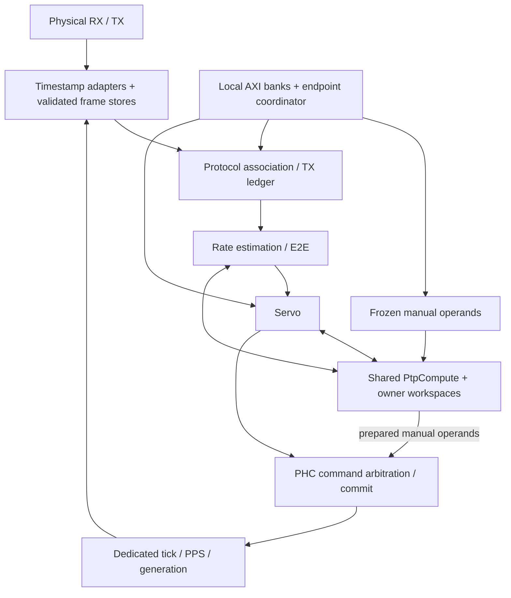

# PTP architecture and design decisions

The implemented endpoint is an autonomous, fixed-source Layer-2 E2E
TimeReceiver with per-message one-/two-step Sync reception. Software configures
and observes it; FPGA logic captures timestamps, associates exchanges, estimates
rate and delay, runs the servo and commits PHC commands.

This guide describes the source architecture reviewed at SURF `68e5dbfaa`
(October 13, 2026). It is the maintained design record, not a hardware accuracy
claim. [Interface contracts](interfaces.md) own exact clock-edge, handshake,
RAM and service bounds; the [register map](register-map.md) owns software
transactions. [Validation and outstanding acceptance](../../docs/plans/ethernet-ptp/README.md)
are tracked separately. Board routes and calibration belong to the consuming
project; [physical-clock integration](physical-clock.md) remains future work.

## Design decisions at a glance

| Choice | Reason and consequence |
| --- | --- |
| Autonomous endpoint with a dedicated PHC tick path | Packet-rate arithmetic can wait for a shared service; counting, PPS and physical capture cannot. Host scheduling never determines a timestamp or servo update. |
| Passive, independently validated wire observation | Keeps each capture with its own bytes before any lossy queue and preserves the existing MAC. It costs duplicate framing/FCS logic; header-key joins after independent loss were rejected. |
| Fixed source and L2 E2E scope | Bounds policy and association state. It does not imply BMCA, VLAN/UDP, Pdelay, one-step transmit or full profile conformance. |
| Raw-tick rate estimation and capture-specific calibration | PHC steering must not feed back into the oscillator estimate or change the units of an earlier capture. E2E needs a qualified rate even before valid path delay exists. |
| One word processor and narrow RAM stores per endpoint | Removes replicated wide arithmetic, muxes and working copies while retaining full precision. Costs bounded scheduling latency, explicit ownership and a larger minimum association window. |
| Physical TX fate retained across logical restart | A queued MAC frame can still reach the wire after timeout or reconfiguration. Freeing its key early risks associating a late completion/response with a new exchange. |
| Registered publication and explicit cancellation edges | Makes payload, validity and lifecycle observable together. Cancellation can veto pending work but cannot retroactively undo a consumed sample or committed clock command. |
| Local register ownership with coordinated commit/snapshot | Each core owns its settings and diagnostics. Frozen candidates and versioned result banks provide atomic transactions without central wide copies. |
| Integer/fixed-point time and checked arithmetic | Keeps epoch differences, correction fields, rounding and overflow explicit. Narrow storage must not reduce public precision or change which measurements are rejected. |
| Numerical time separate from physical clock and application epoch | A valid PHC and a PPS edge do not qualify downstream jitter, oscillator discipline or destination-domain time transfer. |

## Reading map

- [Composition and ownership](#composition-and-ownership)
- [Shared compute, storage and mapping rationale](#shared-compute-and-storage)
- [Compute ownership review and proposed alternatives](#compute-boundary-review)
- [Math inventory by module and division/DSP candidates](#math-inventory-by-module)
- [RX capture and validation](#rx-message-and-capture-boundary),
  [capacity/TLV options](#frame-capacity-and-tlvs) and [queue storage](#rx-queue-storage)
- [TX ledger and physical fate](#tx-ledger-storage)
- [Time and lifecycle](#time-arithmetic-and-lifecycle-contracts)
- [Protocol associations](#protocol-association-storage) and
  [policy, estimator and servo envelope](#port-policy-and-numerical-envelope)
- [Arithmetic units and sequencing](#arithmetic-units-and-sign-conventions)
- [Register transactions](#axi-lite-register-map) and [snapshot CDC](#optional-snapshot-cdc)
- [Physical clock/application boundary](#physical-clock-and-application-boundary)

## Composition and ownership

`EthMacPtpEndpoint` composes the unchanged `EthMacTop`, `PtpPrimaryGuard`, passive
`PtpRxTimestampTap`, passive `PtpTxTimestampTap`, and `PtpEndpoint`. All run in
one continuously running Ethernet/PHC clock domain. Use 125 MHz for full-rate
GMII or 156.25 MHz for XGMII; GMII 10/100 clock enables are unsupported.

The primary stream uses `EMAC_AXIS_CONFIG_C`. The guard reserves all untagged
EtherType `0x88F7` frames for the private PTP producer, draining application
attempts and counting them. It also rejects malformed/short initial SSI beats;
a legal primary frame presents a full first 16-byte beat with SOF. Other frames
retain their payload and sidebands through a registered ready/valid stage.

The port builds a 58-byte Delay_Req on an eight-byte SSI stream.
`PtpEndpoint.TX_AXIS_CONFIG_G` defaults to that format with a direct connection;
`EthMacPtpEndpoint` selects the MAC's native bypass configuration, enabling
an `AxiStreamResize` inside `PtpEndpoint`. Only system reset clears this stage. The
MAC owns padding, preamble, FCS, arbitration and pause. Its redundant RX bypass
is drained at native width: the passive atomic RX frontend supplies protocol
messages independently of hidden MAC CRC/FIFO drops.

The wrapper's `localMac` is authoritative for Ethernet configuration, the PTP
builder and readback. Its least significant octet is first on the wire. The
project must assign a unique deployed address; `MAC_ADDR_INIT_C` is only a
convenience default. Default PTP clock identity inserts `FFFE` into those MAC
octets in EUI-64 form, preserving the configured port number; software may
override clock identity without changing the Ethernet source MAC. A MAC change
restarts acquisition and updates both views coherently.

Delay_Req uses multicast `01:1B:19:00:00:00`, EtherType `0x88F7`, message type 1,
length 44, configured domain/minor version, zero correction/origin timestamp,
local identity, allocated sequence and log interval `0x7F`. Control is zero for
minor version 1 (2019 Layer-2), or one for selected minor version 0 (2008
compatibility). Its
58 meaningful bytes exclude preamble/padding/FCS; SSI SOF is set, final EOFE is
clear and every offered beat remains stable under backpressure. Bypass priority
is at frame boundaries; the TX tap observes actual transmission after MAC pause
or queueing. Tagged frames are outside this contract and require coordinated
classifier, frontend and builder changes.

`PtpEndpoint` structurally composes `PtpProtocolEngine`, `PtpServo`, `PtpPhc`,
`PtpEndpointControl` (formerly `PtpReg`), TX adaptation and the standard SURF
AXI-Lite crossbar. The controller owns global enable/commit/snapshot state,
registered restart/RX flush and IRQ events, plus combinational AXI reset.
Restart consumes the published apply strobe, and IRQ status consumes the
previous event stage; consolidation preserves their register hops. Each functional
core contains
its own AXI-Lite decode, configuration and snapshot storage in its existing
`RegType`/`comb`/`seq` structure. `PtpPhc` also owns manual phase normalization
and final command arbitration. Only shared active limits, measurements and
narrow lifecycle/status signals cross between these cores. All three cores
use their local AXI configuration, with no optional bypass. Measurement
handshakes and port status use package records.

The PHC-local arbiter retains manual/automatic ownership through acknowledgement.
Manual steering requires automatic control disabled; PPS enable is available
in either mode. A disabled servo drains measurements so packet processing and
protocol diagnostics continue under manual PHC ownership. RX overflow/link/
configuration cancellation remains separate from the PHC's own capture-abort
path, preventing a phase step from canceling itself. Held link loss cancels
old work once and permits subsequent frequency-only holdover control.

## Shared compute and storage

`PtpEndpoint` owns one [PtpCompute](rtl/PtpCompute.vhd). Rate estimation, E2E,
servo and manual PHC preparation have persistent workspaces of 64/64/64/16
little-endian 32-bit words. Descriptors address four-word signed128 slots;
add/subtract, multiplication, division, copy, shifts and comparison share the
word datapath. A result acknowledgement releases the descriptor, not the stored
value, so successive operations chain in RAM without reloading wide results.



Arrows show functional flow; sequencers own requests and consume results.
`PtpE2e` and `PtpTxLedger` are children of `PtpProtocolEngine`. The physical taps
belong to `EthMacPtpEndpoint`, outside `PtpEndpoint`. Each instantiated endpoint
has its own processor and PHC; independent port clocks do not share a timing loop.

Sharing only multipliers would leave wide operand/result staging, repeated
conversions and muxes. The selected design therefore stores working values,
protocol tables, configuration and snapshots as addressed words. Normalized
corrected Sync/forward values are reused by rate, history and E2E. Ownership and
valid flags remain registers; reset invalidates them without clearing payload
RAM. Full-width physical captures, public records, held outputs and per-clock
policy caches remain where their interface requires them.

A general-purpose soft CPU was considered but has no demonstrated advantage
here and would add program/boot and worst-case execution obligations. The
implemented processor is a fixed-operation RTL service. Round-robin word/job
arbitration, owner-local cancellation and independent held responses prevent a
stalled client from blocking the others. Waiting for PHC acknowledgement holds
no compute slot, preventing circular waits during command preparation.

The derived minimum association window is **70,347,776 raw ticks**, exposed as
`MinimumAssociationTicks`; the two-second default remains valid at both endpoint
clock rates. The working sustained Sync envelope is 10 Hz, initially advertised
at 8 Hz. This is a deployment/service-demand assumption, not an RX rejection
rule or measured performance. The [service derivation](interfaces.md#shared-service-bound)
includes finite bursts, word movement, arbitration and publication, with explicit
exclusions for future packet arrival and unbounded stalls.

### Compute boundary review

Source review on October 14, 2026, at SURF `4d3439185`, for
[review response item 1](../../docs/plans/ethernet-ptp/acceptance.md#review-response-and-simplification-plan).
The traces below describe the implementation. The alternative interfaces and
prototype remain proposals for the connected endpoint. Subsequent isolated
arithmetic measurements are summarized below; production RTL is unchanged. The review separates **sharing arithmetic hardware** from **placing
algorithm state in a shared, externally addressed workspace**. The current
design does both, but they need not remain coupled.

#### Current transaction and ownership map

`PtpEndpoint` connects four fixed compute owners. `PtpProtocolEngine` drives
owner zero and connects its E2E child to owner one; servo and PHC drive owners
two and three. The interface in [PtpComputePkg](rtl/PtpComputePkg.vhd) has three
transactions: word write/read, operation descriptor/completion, and cancellation.
Operation completion returns flags/tag, not the numerical result: clients must
read result words or name that slot as a later operand. Acknowledging completion
releases the descriptor while retaining stored values.

| Client | Transaction from input to publication | State and lifetime |
| --- | --- | --- |
| Rate: [PtpProtocolEngine](rtl/PtpProtocolEngine.vhd), `RATE_*` | Completed Sync pair -> 48 word uploads -> normalize remote/local times and sum corrections -> reject nonmonotonic samples -> form forward time -> store eight normalized words in history -> establish/check raw-tick anchor span -> divide remote-time delta by raw-tick/phase delta -> qualify/filter ratio -> read forward/ratio and publish one measurement. First-anchor and short-span paths skip rate calculation. | Owner 0 has 64 words. Slots 10/11/12 retain last corrected remote time, rate-anchor remote time and rate-anchor raw ticks. Slot 9 holds the filtered ratio during calculation; `r.ratio` also retains the published ratio and reloads it. Pair/history validity, qualification counters and held measurement live in the protocol engine. |
| E2E: [PtpE2e](rtl/PtpE2e.vhd), `LOAD/PLAN/ISSUE/WAIT/READ` | Protocol selects a history row and uploads its eight normalized words before asserting E2E input valid -> upload remaining operands -> normalize Delay_Resp -> scale raw elapsed ticks by qualified ratio -> apply each nonzero calibration using its own captured increment -> compute/check delay -> read eight result words -> hold the measurement until protocol retirement. | Owner 1 has 64 words, all transaction-local. Protocol pins the selected provenance/input records through result retirement. E2E acknowledges input only after upload; `NORMALIZED_SYNC_G=false` additionally normalizes the Sync itself. |
| Servo: [PtpServo](rtl/PtpServo.vhd), median and forward paths | Delay sample -> two-word local history write -> upload five padded signed128 samples -> nine compare/swap pairs -> read/publish median. Forward sample -> upload forward/ratio before input acknowledgement -> subtract delay/asymmetry -> bootstrap or PI -> clamp/anti-windup -> convert rate or phase -> issue PHC command -> wait for acknowledgement. | Owner 2 has 64 words. Scratch slots are reused between filter/control phases. Slots 10/11 alternate committed and candidate frequency; `frequencyBank` changes only after successful rate-command ACK. Five-sample history, published median, status and command records are local. |
| Manual PHC: [PtpPhc](rtl/PtpPhc.vhd), `PHASE_*` | AXI submission freezes operand bank -> upload four phase words and four constant-divisor words -> one signed division -> read four quotient and two remainder words -> reject quotient outside signed64 -> claim PHC command slot -> commit/ACK. | Owner 3 has 16 words: dividend, divisor, quotient and remainder. Only manual PHASE uses compute; SET, RATE, validity and PPS commands bypass it. Frozen operands and command ownership remain local to PHC. |

For rate, normalized history is published before the new ratio calculation
finishes; the protocol controls when a qualified ratio and selected history may
be used together. These are not four independently fed arithmetic pipelines.
E2E completion and forward measurements share the protocol's publication slot,
and slow servo acceptance propagates back to packet admission.

Cancellation has deliberately different meanings at these boundaries:

| Client | Cancellation and retained state |
| --- | --- |
| Rate | Port invalidation clears pair/history validity, anchors, qualification and pending publication; registered compute cancel invalidates its whole workspace. TX draining and unresolved ledger keys survive. |
| E2E | Registered protocol abort clears the E2E sequencer/output and cancels its whole workspace. The protocol also revokes the selected input/history transaction. |
| Servo | Restart, first observation of port abort, generation change, disable or sample expiry cancel current work. Compute `retain=1` preserves completed slots, including committed frequency; admitted destinations are invalidated. Candidate frequency is distinct from committed frequency. Filter population/tracking reset while retained frequency supports holdover. System reset clears both. |
| Manual PHC | Accepted preparation survives AXI-only reset. There is no wired compute-cancel request for this owner; system reset clears it. The PHC's later admission/commit checks determine command validity. Do not substitute protocol abort for system reset here. |

At the compute service, one queued/active/completed job occupies an owner's
descriptor lifecycle. Admission freezes that workspace and invalidates its
destination/remainder validity. Full cancellation clears all loaded-word bits;
retained cancellation preserves other completed slots. Cancellation wins even
on arithmetic FINISH. A held read can prevent that owner from reusing its
workspace after descriptor acknowledgement. Other owners can still progress.

The arithmetic itself is nonpreemptive. **All host word transfers wait while
any owner's arithmetic operation is active**, even when their own workspace is
otherwise free. Round-robin word/job arbitration applies at idle boundaries.
Thus moving a constant or fetching a median can wait behind an unrelated divide.
Waiting for PHC ACK, however, holds no arithmetic slot. Manual steering is
rejected while automatic control is enabled; the disabled servo can still have
initialization/cancellation traffic. Four-owner stress is a service test, not
evidence that all four production algorithms continuously execute together.

#### Complexity attributable to the boundary

The control algorithm requires bootstrap, elapsed-time integration, anti-windup,
holdover and command acknowledgement regardless of implementation. It does not
inherently require word-upload cursors, slot numbers, descriptor return states,
loaded-word validity or a global retained-cancel protocol.

The servo makes this distinction concrete. Its median path uploads 20 words,
issues nine comparisons and up to 27 copies, then reads four words. A clamp
loads a limit and schedules comparisons, negation and possibly a copy. The
PI path repeatedly uses `loadWords`, `issue`, `readWords` and `clampWords`, with
separate continuation state for each. Splitting the file while retaining those
transactions would leave much of the audit burden intact.

Some serialization belongs to other decisions: configuration-bank reads,
versioned snapshot publication, protocol table scans and packet RAM are not
caused solely by `PtpCompute`. They need not be widened or redesigned to change
the arithmetic interface. Likewise, smaller arithmetic jobs do not remove
protocol backpressure or the need for explicit commit/cancellation semantics.

#### Math inventory by module

October 14 follow-up at the same source: inventory actual arithmetic before
selecting a replacement engine. Counts below are runtime operations on successful
paths, not physical operator counts or measured cycles. All compute descriptors
currently operate on signed128 slots, even when their inputs are much narrower
or a denominator is constant. Copies, loads and stores are transport overhead,
not additional mathematical requirements.

Notation: `RN` rounds nearest with ties away from zero; `TZ` truncates toward
zero. `S16 = 1_000_000_000 * 2^16`, `N = ptpNominalIncrement(CLK_FREQ_G)` is Q32
ns/tick, `R` is the qualified Q48 ns/raw-tick ratio, and `C` is a capture's Q32
PHC increment. Corrections, offsets, forward time and delay use Q16 ns; gains
are Q30 and controller frequency/slew values are Q16 ppb. Products must retain
the existing overflow checks before rounding/narrowing. Algebraic reassociation
can change both intermediate overflow and rounding and is not assumed equivalent.

**PtpProtocolEngine: rate estimator (`RATE_PLAN_S`) and protocol scans.**

| Operation | Inputs / frequency | Optimization candidate |
| --- | --- | --- |
| Normalize remote and local Sync time: `seconds*S16 + subsecondQ16`; sum Sync/Follow_Up corrections, then add to remote time. | Two constant multiplications per accepted Sync; seconds are unsigned48. Wire nanoseconds become Q16 by wiring; correction operands are signed64, summed in signed128. | Constant-coefficient DSP or shift/add conversion; no general multiplier interface is intrinsically needed. Keep epoch arithmetic wide before subtraction. |
| Forward time: local normalized time minus corrected remote time; chronology and anchor updates. | Wide subtraction/comparison and copies per Sync. | Local named values/registered add-subtract; preserve chronology, not just final difference. |
| Estimate rate: `RN(((remoteQ16-anchorQ16)<<35) / deltaRawQ3)`. | One **variable-denominator** divide when the anchor span qualifies; raw tick/phase operands are unsigned67, difference formed in signed128. | Candidate for the remaining shared variable divider. An assumed fixed Sync interval cannot replace measured elapsed ticks. Reciprocal estimation or feedback is a separate precision/convergence decision. |
| Qualify ratio against fixed nominal margin; initialize filter or `filtered += RN((new-filtered)/4)`. | Comparisons, subtraction, rounded shift by 2, addition. Published ratio is unsigned64. | Local arithmetic; the divide by four is already a shift descriptor, not a divide job. |
| Pair/history expiry, nearest-history distance, timeout/interval/scheduler logic. | Modulo64 ages; signed68 Q3 distance/absolute value; comparisons. Existing shared local 32-bit scan ALU sequences table checks. Log-interval scaling and 0.5/1/1.5 scheduling use shifts/adds; LFSR uses XOR. | Retain bounded local scans. Consider DSP add/subtract only with preserved observation edges or an explicit scan-pipeline change. No variable divider is needed here. |

The initial anchor and insufficient-span paths skip rate division. Nominal-rate
margin calculation and default timeout scaling occur at elaboration; they are
not packet-time divide jobs. Normalized history already avoids repeating both
Sync conversions in the production E2E path.

**PtpE2e (`PLAN_S`).**

| Operation | Inputs / frequency | Optimization candidate |
| --- | --- | --- |
| Normalize Delay_Resp time and subtract its correction. | One `seconds*S16` constant multiplication plus add/subtract per exchange. Raw standalone mode adds two Sync-side constant multiplications; production normalized mode omits them. | Same constant time-conversion primitive as rate, potentially reused locally. |
| Elapsed remote time: `RN((deltaRawQ3*R)/2^35)`. | One variable multiplication plus rounded shift. Raw differences may need signed68; `R` carries 64 unsigned bits. The current checked signed128 product can reject extreme inputs. | DSP partial products with explicit high-bit overflow detection. Do not assume every 68-by-64 product fits signed128. |
| RX calibration: `RN(ingressLatencyQ16*R / (rxC<<16))`. TX calibration uses `egressLatencyQ16` and its own captured `txC`. Add each result to elapsed time. | Each nonzero compile-time calibration adds one constant-by-variable multiplication, one **variable-denominator** divide, and one addition. Each zero plane skips that work entirely. | Constant-coefficient DSP multiplication. Explore reciprocal reuse only with the exact captured increment as part of the key; substituting nominal or current increment changes the measurement. |
| Delay: subtract corrected Sync from corrected Delay_Resp, subtract calibrated elapsed, then `RN(value/2)`; compare against zero and max path delay. | Subtractions, rounded shift by 1 and two comparisons. Forward value is copied from normalized input (or calculated in raw mode). | Local add/subtract/shift/compare. Division by two is already a shift job. |

Thus a production E2E exchange uses two multiplications and zero divides with
zero calibration, up to four multiplications and two divides with both planes
nonzero. These counts include the constant Delay_Resp conversion. Calibration
cannot be removed merely because a zero-calibration test configuration is cheap.

**PtpServo: filter and control (`MEDIAN_*`, `BOOT_*`, PI and command states).**

| Operation | Inputs / frequency | Optimization candidate |
| --- | --- | --- |
| Median of up to five delay samples. | Nine compare/swap pairs per accepted delay; sample storage is two words each, padded to signed128 for compute. No multiply or divide. | Local comparator and sample selection/swap, with existing population/sentinel semantics; no global arithmetic engine required. |
| Offset: `forward-filteredDelay-asymmetry`; absolute value, phase-step/lock/unlock comparisons. | Signed128 forward/public offset; configured asymmetry and thresholds are 64-bit encodings. Rate path checks offset fits signed64; large phase steps retain wide input. | Local registered subtraction/compare. Narrow only after the existing range check. |
| Bootstrap frequency: `clamp(RN((R-(N<<16))*1e9/N))`. | One constant multiplication, one **constant-denominator** divide per rate-producing forward update in current RTL, including tracking updates. | First consider skipping this work during tracking: the tracking branch uses committed frequency plus integral correction, not bootstrap. Preserve rejection/cancellation behavior. At 125 MHz `N=2^35`, so retained bootstrap division can be an exact signed rounded shift. |
| Proportional term: `p = clamp(-RN(offset*kp/2^30))`. | Signed offset by 32-bit Q30 gain; one variable multiplication, rounded shift, negation, clamps. | DSP product or a few DSP partial products after width proof; shifts/sign/clamps local. |
| Elapsed interval: `dtQ32 = RN(deltaTicks*N/1e9)`. | Tracking only; one constant multiplication and one **constant-denominator** divide. Ticks are 64-bit; current intermediate is checked signed128. | Exact constant-rational scaling using a DSP coefficient and correction, or specialized constant divider. Preserve rounded Q32 interval before the integral product. |
| Integral increment: `di = -RN((offset*ki)*dtQ32/2^62)`. | Tracking only; two variable multiplications with overflow checks at each product, rounded shift and negation. | Right-size each product from accepted offset/gain/interval bounds. Do not combine products and silently remove a current overflow rejection. |
| Candidate frequency: bootstrap minus `p`, or committed frequency plus `di`; clamp candidate and candidate-plus-`p`, conditional integration, final rate clamp. | Add/subtract/compare/select; no multiply/divide. Committed frequency changes only on successful PHC ACK. | Local named state. Applied +/-200,000 ppb Q16 needs signed35, but +/-400,000 ppb intermediate sums need signed36; this is not a license to narrow the preceding products. |
| Rate command: `RN(ratePpbQ16*N/S16)`. | One constant multiplication and one **constant-denominator** divide for every rate command, including holdover. | Exact constant scaling; a likely DSP-backed conversion primitive. Preserve signed rounding and final signed64 fit check. |
| Phase command: `TZ(-offset/S16)` and signed remainder, then remainder shifted left 16 for PHC Q32. | One **constant-denominator** divide on the large-step path, which bypasses PI. | Exact constant quotient/remainder conversion shared in design with manual PHC. Simple bounded normalization is insufficient for full-range phase operands. |

Current successful tracking-rate path: **six multiplications and three divides**
(bootstrap, interval, rate conversion), plus rounded shifts and local policy.
Bootstrap-rate path: three multiplications and two divides. Holdover rate command:
one multiplication and one divide. The phase path uses one divide. These are
alternative paths, not counts to sum for each sample. Bootstrap arithmetic on the
tracking path appears avoidable from the state/dataflow; this is a source-derived
optimization candidate, not a verified change.

**PtpPhc and physical capture: separate continuous and command-time math.**

| Module/path | Operations | Constraints / candidate |
| --- | --- | --- |
| `PtpPhc` manual PHASE | `TZ(phaseQ16/S16)` and remainder, signed64 quotient fit check; one constant divide. SET/RATE/validity/PPS preparation needs no divide. | Same exact converter as servo phase, with distinct command/reset ownership. Rare requests do not justify a replicated general divider automatically. |
| `PtpPhc` tick/commit | Every clock: raw64 increment, Q32 subsecond addition, second-boundary comparison/subtraction and seconds carry. PHASE adds signed seconds/subseconds and bounded normalization; RATE adds correction to nominal increment. Uses 65--67-bit widened arithmetic and epoch checks. | No multiply or divide on the tick path. Keep independent of packet service; DSP placement/pipelining must preserve edge semantics and close feedback timing. |
| `PtpRxTimestampAdapter` via `ptpRxCapture`, reused for RX/TX | Capture byte phase `floor(C*lane/8)` (64-by-3 unsigned product), add calibration/phase, normalize one second carry/borrow and check epoch. GMII phase is zero; XGMII supports the decoded byte phase. | Small phase selector/shift-add may beat a general multiplier. This is capture-edge work; a multi-cycle DSP replacement needs explicit byte/capture alignment. |
| Capture calibration constants | Split generic latency into seconds and subsecond remainder using `/ S16` and `rem S16`. | Elaboration-time constants in current callers, not runtime dividers. Keep this distinction from E2E's runtime calibration-unit conversion. |
| `PtpTxLedger` | Shared 65-bit age/chronology subtraction, modulo64 limit comparison, sequence/pointer increments and saturating diagnostics. | No multiplication/division needed. Preserve live-expiry observation edge and physical-key lifetime. |
| RX validator / Delay_Req observer / guard / banks / endpoint control | CRC XOR networks, length/address arithmetic, counters, comparisons and bank selection; wrappers primarily connect blocks. | No general numerical multiplier/divider requirement. Address indexing, constant modulo and CRC are not candidates for the shared numerical service. |

**The arithmetic implementations themselves.** `PtpMath` performs bit-serial
shift/add multiplication and restoring division over 128 iterations; it does
not contain an inferred `a*b` multiplier. Replicating it therefore replicates
wide state/add-subtract machinery, not a DSP-oriented multiplier by construction.
`PtpCompute` uses one inferred unsigned32-by-32 partial-product expression,
a 32-bit carry/borrow ALU and RAM scratch; signed128 multiplication assembles
partial products, while division sequences trial subtraction across words.
Its copies, arbitrary shifts and comparisons share the same processor. Neither
interface establishes the number of mapped DSPs; inspect synthesis hierarchy.

#### Division reduction and DSP priorities

There are **eight runtime divide descriptor sites**: rate one, E2E two, servo
four, manual PHC one. Five have constant denominators (all servo/manual sites).
Only rate estimation and the two optional calibration planes require variable
denominators in the current equations. This strongly favors specialization
before choosing how many general-purpose math engines to instantiate.

At 125 MHz, `N=34_359_738_368=2^35`; at 156.25 MHz,
`N=27_487_790_694` (rounded Q32), not a power of two. A shift-only bootstrap
implementation therefore needs a generic-specific branch. For the other
constant divisions, investigate multiply-high by a precomputed reciprocal plus
bounded correction. Prove quotient/remainder and signed rounding over the
accepted input range; a rounded reciprocal multiply alone is not automatically
bit-exact. Do not replace encoded `N` with ideal `1e9/CLK_FREQ_G` when that changes
intermediate rounding. Preserve checked128-bit PHASE submission before any arithmetic narrowing.

Prioritize candidates in this order:

1. Prove the tracking bootstrap result is unnecessary, including error policy;
   bypassing it could remove one multiply/divide and its loads/clamps per update.
2. Specify exact constant converters for interval, rate command and phase
   quotient/remainder; specialize power-of-two bootstrap. Share converter logic
   where useful without sharing long-lived controller state.
3. Derive accepted operand bounds for proportional/integral and elapsed-time
   products, including out-of-envelope rejection. Compare DSP-backed direct or
   limb-serial multiplication with the current generic engines. Packet cadence
   leaves room for a small reused local DSP datapath; throughput is still to be
   checked under the supported burst/service envelope.
4. Evaluate one shared variable divider for the rate and nonzero-calibration
   cases. Preserve capture-specific divisors. A reciprocal cache must handle
   changing rates, exactness and invalidation; it is not a free substitution.
5. Move median, clamps and simple comparisons local. Consider DSP add/subtract
   where registered stages have timing budget, then compare the entire control
   path, not just an isolated operator.

Checked-out SURF candidates include [DspPreSubMult](../../dsp/generic/fixed/DspPreSubMult.vhd),
[DspAddSub](../../dsp/generic/fixed/DspAddSub.vhd) (width limited to 48), and
[SfixedMult](../../dsp/xilinx/fixed/SfixedMult.vhd). Their width, signedness,
latency, overflow and reset contracts need adaptation to PTP; a DSP-friendly
name does not establish a compatible replacement. Existing parent-project
`firmware/benchmarks/ptp-arithmetic/README.md` reports successful LUT-to-DSP
tradeoffs for selected add/compare operators, with longer delays than native
carry chains at 64--67 bits. That supports DSP use in suitable registered stages,
not an unconditional DSP directive over PHC/capture control.

The consuming project's October 14 follow-on experiment now records a
per-operation width schedule, exact reciprocal/correction proof, serial-converter
invariant and matched routed fixtures in
`firmware/benchmarks/ptp-constant-divide/README.md` and `specification.md`.
Serial constant converters use fewer LUTs than the exact reciprocal candidates;
SECOND sharing includes a measured two-owner wrapper. A positive80-bit-divisor,
quotient-only PtpMath adapter costs less than retaining the full signed interface.
Wide single-cycle products fail setup and need internal pipeline boundaries or
reused narrower DSP products. These are isolated measurements at 156.25 MHz,
not a connected endpoint improvement.

The [prototype sequence](../../docs/plans/ethernet-ptp/acceptance.md#arithmetic-prototype-sequence)
selects local arithmetic with shared SECOND and variable division as its starting
boundary. Manual PHASE's proposed signed96 admission retains four 32-bit submission
words so hardware can detect a high-word mismatch; servo phase retains128 bits.
Bootstrap may move to the nonintegrating branch only after accounting for stale
changing tracking during arithmetic. The consuming-project connected study now tests matched servo slices, shared
SECOND/manual lifetime and E2E/rate publication through real PHC ticks/ACKs.
The first local PI implementation failed timing through combined clamps and
anti-windup; the revised prototype registers these equations. Keep the selected
boundary and implement the complete conversion in one pass, with final endpoint
validation and no intermediate approval checkpoints. Whole-harness resource results and endpoint acceptance remain
necessary; isolated savings do not imply an endpoint reduction. No production
division elimination, width reduction, register behavior or service floor changes
in this experiment.

#### Alternative boundaries

| Option | Concrete boundary | Expected benefit and cost to measure |
| --- | --- | --- |
| A: retain the word processor | Keep addressed workspaces and the existing protocol; clarify slot layouts, equations and filter/control responsibilities. | Lowest migration risk and retains current storage sharing. Word traffic, global memory blocking and retained cancellation remain. Documentation alone will not remove the sequencing burden. |
| B: local state, shared multiply/divide | Each functional block owns named algorithm values and local add/subtract/compare/fixed-shift/clamp operations. Only complete multiply/divide requests cross the shared boundary. | Removes cross-module workspace lifetimes and most small-operation scheduling. Costs wider operand/result selection, local registers or RAM, and local arithmetic. Requests/results still need arbitration and cancellation. Resource and timing benefit are unmeasured. |
| C: local state and local arithmetic engine | Same value-level interface as B, with a private multi-cycle multiply/divide engine per functional block. Each block can reuse its own operators; this does not require a combinational expression-sized datapath. | Removes inter-client arbitration and bounds latency locally. Replicates expensive operators; may cost substantially more LUTs/registers/DSPs. Dedicated engines do not by themselves simplify a client that retains word-level microprogramming. |

**Candidate after arithmetic specialization: B, with C as a backend comparison.** The
architectural hypothesis is that algorithm state should be owned by the block
that interprets it, while arithmetic sharing remains a measured implementation
choice. Local storage may still use RAM and local arithmetic may still be
multi-cycle. Do not restore wide replicated table stores as a side effect.

A proposed value-level service has these obligations:

- Request: operation (`MUL`/`DIV`), two signed128 operands and division rounding
  selection, held with valid until accepted. Initially permit one outstanding
  request per client. Owner identity is structural; no public slot addresses or
  persistent algorithm memory cross the boundary.
- Response: signed128 result, truncating division remainder and error, held
  stable until consumed. Preserve current wrapped-product/overflow behavior,
  divide-by-zero and signed-minimum handling, and nearest/ties-away semantics.
  Local rounded shifts must preserve the same numerical contract too.
- Arbitration: bounded fair admission with capacity reserved for the result.
  A stalled result consumer must not retain the shared arithmetic unit; use
  per-client held result storage or equivalent reservation. Include the wide
  response storage and operand muxes in area comparisons.
- Cancellation: owner-local cancel wins over admission and result delivery on
  that edge, removes queued/active/held work, and cannot affect other owners.
  Do not accept replacement work until the old operation cannot publish into
  it. Preserve existing registered propagation at client boundaries; there is
  no `retain` operation because committed algorithm state is local.
- Commit: servo keeps separate local candidate/committed frequency and updates
  the committed value only on successful PHC ACK. Arithmetic completion never
  commits controller state. Manual preparation and PHC commit retain their
  different reset/abort policies.

The existing [PtpMath](rtl/PtpMath.vhd) already offers full-value multiply/divide,
rounding, remainder, ready/valid and cancellation. It is a useful candidate
backend, not a selected replacement: it has no multi-client arbitration and its
earlier implementation resource figures do not establish today's total cost.
Its contract and focused tests should be reused where applicable before creating
another arithmetic primitive. Keep general floating point and feedback-rate
algorithm changes out of this comparison so structural and numerical effects
remain distinguishable.

#### Smallest representative prototype and decision evidence

The consuming project's initial prototype now exercises the
**servo forward-update path through PHC rate acknowledgement**:
offset formation, bootstrap, proportional/integral terms, clamps/anti-windup,
rate conversion and local candidate/committed frequency. Feed a known filtered
delay and frozen settings; keep the same independent PI oracle. Include holdover
and cancellation before/after command admission. This exercises the expensive
operations and the persistent-state problem together. A median-only extraction
would be a useful later simplification but would not test this central tradeoff.
Its six focused numerical/lifecycle tests pass at both endpoint clocks; new
epoch-normalize and shared-divider fixtures also pass isolated tests. These
results are recorded in the consuming project's benchmark guide. Matched
complete-harness resource/timing measurements are next.
Phase-command preparation, median implementation and production migration remain
outside this initial slice and require their own follow-through.

Use the same proposed request/response interface with a shared service and a
private backend, plus the current servo/compute implementation as baseline.
Drive competing synthetic arithmetic clients for the service comparison, and
label those loads separately from reachable endpoint traffic. The prototype
must use RTL arithmetic and a real PHC command path for lifecycle comparison;
a Python-only model cannot assess the ownership change. Adapt existing fixtures
without embedding a second control algorithm in the VHDL wrapper.

| Question | Required comparison before production choice |
| --- | --- |
| Numerical and lifecycle equivalence | Reuse `test_ptp_servo.py::numerical_control` scenarios and its rational oracle at both endpoint clocks: bootstrap, tracking, fractional terms, both limit signs, integral overflow, anti-windup, backpressure and holdover. Compare ordered accepted samples/commands and retained state, not cycle-identical completion. Sweep cancel around service and PHC admission/ACK; allow different arithmetic latency while preserving the PHC commit contract. |
| Actual service cost | Record request counts by operation, word-transfer counts for A, waiting versus execution cycles, and sample-to-command/ACK latency. Exercise unloaded and competing service, held responses and cancellation. Endpoint queue/expiry measurements from review item 3 remain necessary before selecting a new association floor. |
| Reviewability | Show the equations beside named values/stages, count distinct ownership/handshake mechanisms and identify cancellation paths. Require removal of public workspace addresses/loaded-word management from the candidate servo. Fewer states alone is not success. |
| Resource/timing cost | Compare complete tested harnesses at the same FPGA, tool version, constraints, reset and I/O registration. Report LUT/FF/BRAM/DSP and timing, counting shared services once. A simplified arithmetic slice is not directly comparable to the full existing servo; include matching filter/config/publication logic or isolate identical boundaries in both. |
| Integrated acceptance | Before broad migration, account for remaining rate/E2E/manual clients, their shared-service storage and arbitration. A transitional endpoint containing both compute engines may grow; it is not the final architecture's area estimate. Require a matched connected implementation and re-derived bounds before claiming an endpoint improvement. |

Hard requirements are unchanged numerical/lifecycle behavior, continued PHC
tick/capture independence, bounded progress under stated loads and meeting the
selected clock constraints. Some resource growth is acceptable to simplify
ownership, but no numerical LUT allowance has been agreed. Present measured
resource deltas and fit margin with the architectural simplification before
selecting B or C; do not assume the previous LUT minimum is the objective.

The [earlier area evidence](../../docs/plans/ethernet-ptp/history/verification.md#area-and-timing-evidence)
mixes storage, arithmetic, tools and configurations across milestones. It does
not isolate the cost of reversing this boundary. Existing matched arbiter
savings establish that its implementation mattered, not that global workspace
ownership is the best long-term design. Current bounds are analytical and this
source review adds no endpoint latency measurements. The subsequent isolated
experiments establish operator costs and latencies; use the connected prototype
and its focused baseline comparison to confirm the proposed sharing boundaries.

### Mapping and timing choices

Deeper protocol pair/history, ledger, protocol/servo configuration and protocol
publication stores select block RAM. Smaller banks retain distributed RAM.
Changing geometry to word access removes wide staging; simply changing a very
wide, shallow RAM's style would retain that cost and waste block RAM capacity.
The [bank contract](interfaces.md#configuration-and-snapshots) preserves read
latency, initialization, copy and snapshot ownership across mappings.

Protocol pair/history row checks share a separate 32-bit ALU so overlapping
scans have bounded arbitration without adding shared-compute jobs. Ledger live
expiry checks retain local arithmetic because their observation edge matters.
Compute memory eligibility is evaluated at constant owner indices before grant
rotation: the earlier nested runtime owner/address selection created a large
mux. The cursor advances only on a taken grant; simply replacing it with
`ArbiterPkg` selection would neither remove eligibility cost nor preserve that
rule under the memory/job interlock.

Native inferred add/subtract is retained on the critical wide paths. Matched
KU040 experiments favored it over handwritten carry-select/carry-save forms;
DSP versions reduced LUTs but lengthened those operators. Streaming TLV validation
uses payload-run skipping and parallel fixed-lane header checks to avoid a serial
variable-byte chain without adding a capture/admission edge. These are selected
implementation choices, not portable device-wide performance guarantees.

The quotient-based raw-rate estimator remains. Feedback estimation was studied,
but changing convergence/filtering and rate qualification would affect E2E, while
removing its divide would leave other divider clients in place. Floating-point
servo arithmetic is also deferred; epoch differences should still be formed in
integer/fixed point before any future conversion. See the
[rate-estimator study](../../docs/plans/ethernet-ptp/history/design-studies.md#arithmetic-alternatives)
and [floating-point study](../../docs/plans/ethernet-ptp/history/design-studies.md#arithmetic-alternatives).

### Storage inventory

This is source geometry, not synthesized utilization. Primitive depth rounds up
to a power of two; inference and constant pruning require build-host evidence.

| Owner | Addressed payload storage per endpoint |
| --- | --- |
| Shared compute | 208 persistent + 26 scratch words; 256x32 physical RAM. |
| Protocol pair/history | Four 20-word pair rows and four 25-word history rows; each RAM is 128x32. History includes eight normalized words per sample. |
| TX ledger | Four 22-word rows; 128x32 RAM. Depth generic retains 1–255 logical slots. |
| Servo median | Five two-word history samples in 16x32 RAM; padded sorting scratch uses compute slots. |
| Local configuration | Three banks of 48 protocol, 34 servo and 10 PHC operand words, including address-map holes; physical RAMs are 256x32, 128x32 and 32x32. |
| Immutable result snapshots | Protocol records have 12 Announce body/metadata and 20 exchange words; servo records have 4 offset, 4 median and 2 rate words. Five versions per record require 256x32 and 64x32 physical RAMs. |
| Changing-scalar snapshots | Two banks of 7 protocol counter, 10 PHC and 1 servo words; scalar cohorts are latched together before copying. |
| RX stream | Eight 64x8 lane RAMs at depth four, a separate 8x293 capture RAM and a narrow bank/length descriptor FIFO. Five frame banks include the active physical frame. |
| Dedicated TX stream | Eight 8x8 lane RAMs, separate 4x293 capture RAM and a narrow descriptor FIFO. Three frame banks preserve two logical completed entries. |

## RX message and capture boundary

A passive adapter binds capture and bytes at the first destination-MAC octet,
before any lossy queue. `PtpRxFrontend` validates the complete frame and publishes
one atomic decoded-message/capture record; the redundant MAC bypass is always
drained, including during logical restart. Aggregate MAC CRC/FIFO status is
diagnostic and cannot select or invalidate frontend records.

| Alternative | Identity guarantee | Cost and decision |
| --- | --- | --- |
| Metadata through an opt-in receive MAC | Capture and frame remain one transaction only if every importer, pipeline, filter, FIFO, and reset carries or discards both. | Viable, but changes several existing MAC boundaries or creates maintained siblings. Prefer for a future general timestamp API. |
| Passive validated RX frontend | The producer owns frame bytes and capture before the first lossy queue. No later packet lookup exists. | Selected. Duplicates FCS/framing validation, but confines new logic to PtpCore and preserves the public MAC. |
| Header key plus aggregate drop flush | No complete frame-local loss identity; CRC rejection and retained FIFO data break the join. | Rejected by the real-MAC counterexamples. More table entries or key bits do not repair it. |

Inspection supports the boundary choice: `EthMacRxImport` exposes AXI packets
and aggregate status, without frame-local capture metadata; its GMII/XGMII
leaves perform physical import and CRC. `EthMacRx` then passes traffic through
additional processing before `EthMacRxFifo`. Existing `TUSER` fields already
have SOF/error meanings. Adding a parallel FIFO at any one of those boundaries
would require proving identical admission, loss, and reset behavior again.

`PtpRxTimestampTap` structurally composes `PtpRxTimestampAdapter` and
`PtpRxFrontend` without added state or latency. The adapter handles GMII/XGMII
normalization; `PtpTxTimestampTap` reuses the adapter and a dedicated
`PtpDelayReqObserver` for separate TX completion. There is no combined
RX/TX timestamp-tap entity or separate RX timestamp/frame join.

| Boundary | Contract |
| --- | --- |
| Adapter to frontend | Eight-byte AXI/SSI format, contiguous low-byte keep, SOF/EOFE and last; a capture sidecar is meaningful on SOF. No ready: every valid beat is consumed. GMII contributes one byte, XGMII up to eight; termination after a full word may use a zero-byte final beat. |
| SOF capture | Q16 time, raw ticks/eighth-cycle phase, generation, active increment, validity/error from the same frame. Time-invalid observations can still bootstrap acquisition. |
| Frontend to protocol engine | One `PtpRxMessageType` valid/ready channel for Sync, Follow_Up, Delay_Resp and Announce, with capture, RX epoch, header and fixed body. No independent capture queue or raw RX port. |
| Protocol TX/completion | Delay_Req stream and keyed wire completion remain distinct, subject to reserved-key lifetime and exclusive primary-traffic rules. |

Sidecar and SOF share every enable/reset. Normalization/CRC sustain eight bytes
per cycle at XGMII line rate, including minimum gaps. GMII has phase zero;
XGMII normalizes `(startLane + 8)` byte times into ticks plus eighth-cycle phase.
RX and TX both retain that phase: ignoring lane-4 versus lane-0 differences can
bias nominal 10G delay by 1.6 ns. Capture arithmetic scales with the active PHC
increment and normalizes seconds carry/borrow; epoch underflow/overflow marks
an invalid capture. Direct capture at the message point avoids extrapolating
across a PHC command edge.

### Validation and bounded storage

The adapter rejects invalid preamble/SFD, illegal XGMII start lanes/control
sequences, and GMII error indication, and reports any in-frame error through
EOFE. A physical error is sticky until termination. Missing termination cannot
grow storage: byte counters saturate and the frame remains rejected until
resynchronization. A nested SOF invalidates the partial frame and the nested
candidate; recovery is permitted at a subsequent clean SOF.

The frontend owns these structural checks:

- Complete frame length of 64 through `MAX_FRAME_G` bytes, destination MAC
  through FCS; the default maximum is 1518. Jumbo and tagged PTP are outside
  this contract.
- Ethernet FCS across the complete frame, including legal padding. Nothing is
  queued before the final CRC result and framing status are known.
- Outer EtherType `88 F7`, major version 2 with any minor version, and a supported
  RX message type. The byte-order convention remains distinct from `x"F788"`
  in the MAC bypass generic.
- `messageLength` covers the fixed body (44/44/54/64 bytes respectively), fits
  the received frame, and is at most `MAX_FRAME_G - 18` (1500 by default). Padding beyond that length is
  excluded from PTP decode, but included in CRC.
- Optional TLVs walk exactly to `messageLength`; reject odd value lengths,
  partial headers and values extending beyond it. Structurally valid unknown TLVs are skipped.
  Profile-specific TLV semantics and conformance fixtures remain a parser
  qualification task; the model checks boundary lengths, not full IEEE conformance.

`PtpProtocolEngine` owns configured destination/source/domain/transport-specific
policy, flag legality, valid nanoseconds, requesting-port identity, Announce
semantics, timeouts, and Sync/Follow_Up transaction matching. Keep structural
parsing and mutable protocol policy separate. Configuration changes abort all
in-flight frontend work through the common generation contract, including a
frame that began before the change and terminates afterward.

The wire key identifies a protocol exchange, not a physical frame. Two valid
same-key Sync copies produce two internally consistent records. Protocol
duplicate/replay policy must still prevent reusing completed exchange keys and
reject conflicting live content; this design does not prove which of two
conflicting, CRC-valid Follow_Up messages a sender intended. No oracle wire ID
is carried in the interface or used by the reference model.

Storage is bounded independently of frame termination: 65 useful bytes in a
70-byte sparse layout,
saturating length counters, CRC and streaming TLV state, one SOF capture and a
configured complete-record queue (default four). The Python oracle holds four
trailing FCS bytes; RTL instead proves the declared body ends before the FCS.
The legacy 744-bit diagnostic packing gives 2,976 data bits for four records,
but omits capture increment/error and is not a lossless transport or device-area
estimate. See the [lossless FIFO implementation](#rx-queue-storage).

A completion finding the queue full **before the edge** discards the completion
and whole queue, advances RX epoch and increments overflow even if ready is high.
Malformed/unsupported frames do not enqueue and cannot cause queue overflow.
Otherwise the old head may retire before a valid completion enqueues; new records
do not fall through on arrival. Restart/generation changes discard partial and
queued work. RX overflow never steps the PHC or releases unknown TX wire keys.

The [registered timing contract](interfaces.md#registered-lifecycle-and-queue-boundaries)
is authoritative: a detection-edge old-head transfer can precede publication of
abort, and the consumer cancels pending work when that registered event arrives.
This supersedes the original reference model's immediate-abort timing. Pipeline
capture, completion, generation and abort together; an independent reset or CDC
would need coordinated invalidation before admitting new work. The current
physical producer boundary has no CDC.

### Frame capacity and TLVs

`MAX_FRAME_G` bounds the complete frame, including Ethernet header and FCS.
Its default is 1518 and its supported range is 82–1518 bytes. The narrow counters
and TLV offsets derive from this capacity; the fixed-field stores do not retain
an entire maximum-length frame. `EthMacPtpEndpoint`, `GigEthPtp` and the GTH
composition expose it to both observers. GTY/copper wrappers currently retain
the defaults rather than exposing these generics.

`TLV_EN_G=true` is the default: structurally valid unknown TLVs are skipped.
False removes the suffix walker and requires each supported message's exact
fixed-body `messageLength`; legal Ethernet padding remains allowed. This is an
implemented restricted mode, not equivalent interoperability. A master appending
a TLV to Sync/Follow_Up/Delay_Resp would lose those measurements. Announce TLV
rejection loses metadata; `announceValid` itself does not gate servo enable.
A deployment must establish that its profile/master traffic permits the restriction.

The KCU105 area study selected 128-byte capacity with TLVs enabled. The 82-byte
minimum gave worse mapped area and less message headroom; smaller counters did
not produce monotonically lower whole-design LUT counts. That board selection
is not the reusable default, and support for structural TLV skipping does not
implement TLV semantics or White Rabbit. Selection evidence is in the
[capacity/TLV experiment](../../docs/plans/ethernet-ptp/history/verification.md#capacity-and-arbiter-follow-up).

## RX queue storage

`PtpRxFrontend` writes 65 useful fixed-field bytes in a sparse 70-byte layout
through eight independent byte lanes. The eight-byte Ethernet source/EtherType
gap is removed without changing stored bytes' modulo-eight lanes; remaining
reserved positions are neither written nor decoded. A beat writes at most one
byte per lane, including a row crossing. Nine groups per physical bank preserve
the previous compact layout's RAM depth for every logical queue depth; the
uncompacted 78-byte experiment is not the retained layout.
CRC, lengths, TLV progress and small common-header fields stay in the stream
validator; unused prefix bytes and TLV payload are not retained. Physical SOF
capture metadata is written once to a separate bank. The store has one extra
active-frame bank beyond the exact logical queue capacity (default four).

A synchronous SURF FWFT FIFO carries bank/length descriptors after complete
validation. Logical occupancy includes descriptor pipeline, decoder and held
head; extra primitive locations do not add capacity. The decoder streams eight
wire positions per clock into the sole public record. With G=ceil((40+fixedBodyBytes)/8),
EOF at N produces registered valid at N+G+4 and first transfer at N+G+5.
A queued next record takes G+2 clocks after the preceding head transfer. G is
7 for Sync/Follow_Up, 8 for Delay_Resp and 9 for Announce. These rates fit their
minimum wire spacing. Dedicated minimum-IFG GMII/XGMII bursts test continuous
capture and exact capacity with a held prior head.

`PtpDelayReqObserver` is the dedicated TX validator: only 13 key bytes and the
complete capture are stored, with two logical entries and a two-group decoder.
Its descriptor carries only the bank index; the 13-byte decode length and 44-byte
fixed PTP body are constants. Identity/version errors become sticky at their
wire bytes, while rejection counting and admission still occur at physical EOF.
It validates actual post-MAC framing, FCS, Delay_Req type, length and legal TLVs. PHC generation
changes and capture arithmetic errors cannot erase physical completion identity;
physical reset/flush retains its distinct meaning. Logical restart never proves
an unknown queued TX frame vanished.

Reset/flush invalidates ownership and registered FIFO state without clearing RAM.
Full-before-edge overflow flushes the entire queue and publishes the existing
abort/epoch event. Invalid frames overwrite only the current uncommitted bank.
The public message and capture stay atomic and stable under backpressure. The
809-bit pack/unpack utilities retain their public verification layout but no
longer define the physical descriptor FIFO width. Resource mapping and timing
still require matched Vivado evidence; simulation does not measure LUT savings.

## TX ledger storage

`PtpTxLedger` stores each entry in 22 addressed 32-bit words of synchronous
`SimpleDualPortRam`. Sequence/domain, generation, identity, creation/wire/response
ages, remote timestamp/correction and physical capture fields have fixed word
locations. Four ownership flags per slot remain in registers. Only selected
scan fields and the final held sample are staged. Distributed and block RAM
use the same one-cycle synchronous interface; depth remains 1–255, default four.

A shared word scan reads/updates 22 fields, then retires the row. A pass takes
`45*DEPTH_G+2` clocks; accepted allocation adds 22 writes. A request arriving
mid-pass can wait for the following pass. Maintenance continues while a sample
is held. Expiry is checked against actual ticks when its age words are consumed;
serialization never refreshes capture or creation time. At publication the
wire lifetime is checked again. Timeout visibility can lag by one pass, and
short standalone lifetime settings can expire before processing finishes.

Each scan observes at most one wire record and one response. Both producers
assert valid independently of ready and retain their entire record through the
end-of-scan handshake, including unmatched records. Inputs arriving after START
wait for the next scan; publication and reclamation wait until those pending
records have been checked, so a late-arriving duplicate cannot be bypassed.
`wireReady` is connected through `txMessageReady` on
`PtpProtocolEngine` and `PtpEndpoint` to the TX tap's existing completion queue.
`responseReady` lets the protocol engine retain its staged response, applying
RX backpressure while that stage is occupied. Response acceptance remains a
registered pulse after the response **handshake**, with its log interval retained
for the following protocol edge. It no longer means acceptance one edge after
valid first appears. External instantiations of these low-level entities must
connect the new ready outputs and honor this contract; MAC/PHY wrapper ports
and the software register ABI are unchanged.

At each row, timeout retirement precedes wire handling, then response handling,
then sample publication. Duplicate wire observations renew quarantine before
reclamation and cannot overwrite an already published output. Matching duplicate
responses compare their original timestamp/correction without refreshing age.
Selected words assemble directly into the sole held sample before the row can be
reused. Raw capture ticks and generation are reconstructed from matching entry
fields, and error is zero because error/generation failures prevent selection.
No timestamp precision is discarded. Writes are registered; overlapping reads
and writes address different rows. Allocation writes drain before the next read,
including at depth one, avoiding same-address read/write assumptions.

Logical restart retires all ownership flags and cancels response eligibility and
the output, while the physical completion still drains through the scan. Unknown
TX ownership is never released by logical restart or timeout. Only confirmed MAC
reset clears all slots and starts network-lifetime quarantine. System reset
requires that confirmation again before admission. RAM contents are not cleared;
a fresh allocation writes the entire row before setting up later reads. An old
registered write may finish on a reset edge but cannot regain valid ownership.

## Time, arithmetic and lifecycle contracts

- PHC time is seconds48/nanoseconds32/fraction32. Captures retain Q16 fraction,
  generation32, unsteered ticks64, eighth-cycle phase, and the exact active Q32
  increment. The existing RX `toSlv()` layout remains 744 bits and omits
  capture increment/error; it is a legacy diagnostic/test packing, not a complete
  transport for endpoint records or a CDC interface.
- The timestamp plane is the first destination-MAC octet, with XGMII lane
  phase applied. Ingress is subtracted and egress added. Both are signed Q16
  **local PHC nanoseconds**, supplied by build-time latency generics. Egress
  excludes the single
  most-negative 64-bit value because the shared ingress adapter must negate it.
  E2E converts each latency to master-time units using that capture's increment
  and the qualified master-time/raw-tick ratio. A PHC rate change between t2 and
  t3 therefore cannot silently change the calibration plane.
- `PtpCompute` shares exact signed128 operations between rate, E2E, servo and
  manual PHC preparation. Word-serial work has variable arbitration latency;
  division can round nearest with ties away from zero while its remainder
  follows truncation toward zero. Each client retains its own workspace and
  cancellation ownership. `PtpMath` is a standalone leaf, outside production.
- PHC command acceptance latches an immutable operand; commit is the following
  edge. SET specifies commit-edge time; PHASE applies after normal advancement;
  RATE changes the next increment. A discontinuity clears validity, suppresses
  PPS and captures, and advances generation. Invalid/stale commands acknowledge
  with error. Valid monotonic time rejects absolute sets and negative phase
  steps. Epoch/generation/tick exhaustion faults closed and requires system reset.
- A TX key is reserved before the first stream beat. Four ledger entries retain
  sequence/domain/identity/generation and physical fate. Responses and physical
  completion may arrive at the ledger in either order. Timeout or logical restart
  retires a request but cannot free an unknown wire fate. Known completions retain
  the key through `PACKET_LIFETIME_G`; a duplicate restarts that quarantine.
  Admission requires explicit MAC reset confirmation plus startup quarantine.
  Only confirmed physical reset can release an unknown fate. This bounded design
  can intentionally stop requesting when the MAC never resolves its queued work.
- Packet lifetime is an integration assumption about the maximum surviving
  network response lifetime. Set it conservatively; finite key reuse cannot
  protect against arbitrarily delayed/replayed traffic outside that bound.
- Port reset/configuration changes preserve the PHC and drain an already presented
  TX frame. System reset must reach the entire MAC/resize/endpoint pipeline.
  `regRst` cancels AXI responses only: configuration, accepted manual commands,
  PHC time and physical TX reservations survive.

## Protocol association storage

`PtpProtocolEngine` keeps four pairing rows of 20x32 words and four history
rows of 25x32 words. Both inferred `SimpleDualPortRam` instances support
`"distributed"` and `"block"` through their existing generics. Ownership/mode
flags remain in registers; reset/abort invalidate ownership without clearing RAM.

Pair scans read sequence and creation ticks, retaining the original inclusive
age limit and first-slot tie rule. Selection prefers the existing key, then
first free/expired row, then oldest completed row. Only a matching duplicate
Follow_Up reads its comparison fields. RX holds its record through field writes
and selected-sample publication. New scans wait until writes drain; duplicate
and overflow retirement retain keys until replacement or expiry. Scan-start
ticks govern table expiry; final packet capture-age checks remain live.

History first scans ticks/phase/generation and chooses the nearest eligible
Sync on either side of TX. Strict distance comparison retains the first physical
slot on ties. The 68-bit signed distance exactly represents the difference of
full 64-bit ticks plus three phase bits. Only the chosen sample is fetched into
the existing held E2E producer record. Eight additional words stream its previously
computed forward and corrected remote Sync values directly into E2E's private
workspace. No timestamp reconversion or full-row scan register is required.

An append writes raw provenance from the held rate producer, then normalized
words directly from the rate workspace. The row becomes valid only after its
last registered write drains. Lookup pins the table, excluding append/pair
admission until the selected words transfer. E2E retains its input ownership
through result retirement. Completed E2E output takes priority over a new pair
scan, including under continuing rejected traffic. Local scan and shared-service
latencies are included in the [service bound](interfaces.md#shared-service-bound).

## Port policy and numerical envelope

The fixed source accepts multicast destination `01:1B:19:00:00:00`, configured
sourcePortIdentity/domain, majorSdoId (formerly transportSpecific) zero, PTP
major version 2 with any minor version, one-step or two-step Sync, Follow_Up,
Delay_Resp and Announce. The non-isolated domain ignores minorSdoId;
messageTypeSpecific and received controlField are ignored. Reserved flag bits
(`0x9880`) are excluded from policy checks. Remaining flags and canonical timestamp checks
follow structural/FCS validation. There is no BMCA, one-step transmit insertion, UDP,
VLAN, Pdelay, security extension, or automatic upstream selection.

Four bounded associations select the mode independently for each Sync. After
masking reserved bits, flags `0x0000` select one-step: nanoseconds must be below 1,000,000,000, and the
Sync's originTimestamp and sign-extended correction complete the sample with
its own physical capture. Flags `0x0200` select two-step: Sync and
Follow_Up may arrive in either order, the Sync body is non-authoritative, and
the sample uses Follow_Up's preciseOriginTimestamp plus the widened signed
sum of both corrections. All 48 seconds bits and Q16 correction bits survive.
Other non-reserved Sync flags are rejected before association updates.

A one-step Sync colliding with a retained Follow_Up retires the association
without a sample. Follow_Up after a one-step Sync is rejected and counted
without changing its timestamp, correction, age or completion state. Conflicting
two-step Follow_Up and duplicate physical Sync (including a different step mode)
invalidate the association. Retired entries cannot complete again. A later
packet cannot revoke an already consumed measurement. Completed slots may
retire, while unfinished slots cannot be overwritten. Retention/expiry and
chronology checks bound replay protection; sequence wrap is not a session ID.
Mode state flushes with the existing associations on restart, source/configuration
changes, RX abort/epoch invalidation and PHC generation changes; AXI-only reset
preserves it. Distinct sequence IDs can alternate modes without reconfiguration. The private mode bit is qualified by `syncSeen`;
`followSeen` indicates an actual Follow_Up. Completion requires an unretired Sync
and either one-step mode or its Follow_Up; the unused one-step Follow_Up correction
is zero. Masked flags and canonical one-step nanoseconds are checked before slot
allocation/update, so malformed traffic cannot contaminate a retained association.
These collision rules are conservative implementation policy, not a claim that
IEEE 1588 mandates this exact handling. Completion follows full frame validation
and available processing capacity; RX waits while rate processing or a measurement
stalls, and later collisions cannot revoke consumed samples.

The correctionField encoding `0x7fffffffffffffff` is an overflow indication
(IEEE 1588-2019 13.3.2.9), not a finite correction. The local receiver policy
retires the affected Sync/Follow_Up key, including when the overflowing half
arrives first. Finite duplicates cannot revive that retained key. A matching
Delay_Resp with this encoding retires its request without accepting its advertised
interval; unresolved TX ownership and the normal quarantine remain intact.
Identity/domain/provenance checks precede retirement, so foreign traffic cannot
invalidate an unrelated request. Already consumed measurements are not revoked.
Other signed values, including `-1` and both finite wire bounds, remain arithmetic
inputs; existing chronological and path-delay validity checks still apply.

Both receive modes share the existing registered measurement,
backpressure and child-cancellation contracts. Corrected remote time
and raw capture time must both advance. Four completed Syncs supply the nearest
eligible t2 for an actual t3. E2E computes a delay only with a fresh, qualified
rate ratio and matching-generation complete timestamps; negative/excessive path
delay and arithmetic errors are rejected before publication.

The rate estimator uses corrected master elapsed time over raw local tick/phase
elapsed time, independent of PHC validity or steering. It requires two qualified
intervals after a configurable minimum span, bounds oscillator deviation to
±200 ppm, and applies a quarter-weight IIR after the first estimate. Only an
accepted interval renews ratio freshness.

Delay_Req intervals use a seeded nonzero LFSR and a bounded three-point schedule
(0.5, 1, 1.5 times the effective mean). Only a matched Delay_Resp can update the
advertised minimum interval; the slower local setting wins. Log intervals
−10 through +22 are decoded, `0x7F` uses fallback, and other values count a
rejection and use fallback. Known Sync/Announce intervals give three-period
receipt timeouts, capped by configured `SyncTimeout` (twice that for Announce).
A configured-source grandmaster or PTP-timescale change cancels old acquisition. Announce metadata
is exposed, including all 30 body octets; UTC/leap flags never step the PHC.

The three-point schedule is a known departure from IEEE 1588-2019
9.5.11.2(c)(1)'s default multicast uniform distribution. The selected sdoId=000
also reserves domains 128–255, which configuration does not yet prohibit.
Those departures and configured-port/profile requirements remain in the [specification audit](../../tests/ethernet/PtpCore/specification-coverage.md#remaining-normative-work).

The servo uses the median of only populated delay samples (up to five), then
local-minus-master offset = forward − filteredDelay − asymmetry. While invalid,
an allowed large phase correction can acquire the epoch. Otherwise a qualified
rate command establishes validity, including the no-step case. The PI loop uses
raw elapsed time, Q2.30 gains, Q16 ppb frequency/slew/final clamps, conditional
integration, and a bumpless initial frequency estimate. Only acknowledged rate
commands update the last good frequency. Stale or canceled work cannot publish
an automatic command. Holdover removes phase slew, preserves frequency, and
expires validity after a raw-tick age limit. A servo fault requires system reset.

Default gains are Kp = 0.25 ppb/ns and Ki = 0.0625 ppb/(ns·s); frequency/slew/final
limits are 100,000/50,000/150,000 ppb. Default delay/source/sample age limits are
frequency-derived: Delay_Req 1 s, Sync timeout 3 s, association 2 s, delay age 4 s,
holdover 64 s, exchange 2 s, minimum rate span 0.5 s, ratio age 4 s, and sample
interval 1/64–2 s. Step threshold is 20 µs; lock is eight samples within 100 ns;
unlock is three beyond 1 µs. Qualification counters retain progress in the
neutral hysteresis band and reset when the opposite threshold is crossed.
Maximum path delay is 1 ms.

The shared word processor requires an association window of at least
70,347,776 raw ticks, advertised by `MinimumAssociationTicks`. Its
[finite-burst derivation](interfaces.md#shared-service-bound) includes
movement, arbitration, computation and publication. Original capture ages are
unchanged. The configurable actuator cap remains 200,000 ppb and still requires
an explicit control/actuator rationale and qualification, independently of the
±200 ppm oscillator envelope and default 150,000 ppb total correction limit.

Model sweeps and accelerated endpoint fixtures exercise different envelopes;
neither establishes hardware accuracy or arbitrary-jitter stability. See the
[recorded model envelope](../../docs/plans/ethernet-ptp/history/verification.md#recorded-servo-model-envelope)
and [acceptance backlog](../../docs/plans/ethernet-ptp/acceptance.md#outstanding-acceptance).

## Arithmetic units and sign conventions

The Q32 PHC nominal increment represents 8 ns exactly at 125 MHz; its 6.4 ns
representation at 156.25 MHz has less than 0.02 ppb nominal rate error. Q16-only
increment rounding would be approximately 1 ppm without residual arithmetic.
Captured correction arithmetic uses Q16 nanoseconds; gains use unsigned Q2.30
(values below 4), with signed128 checked intermediates and nearest rounding,
ties away from zero where selected. Parser log-interval acceptance is not a
claim that one gain set tracks the entire range.

For equal-rate clocks, the explanatory E2E equations are:

```text
forward = t2 - (t1 + cSync)
reverse = (t4 - cDelay) - t3
meanDelay = (forward + reverse) / 2
localMinusMaster = forward - meanDelay - delayAsymmetry
rateAddendQ32 = round(nominalAddendQ32 * rateCommandPpbQ16
                     / (1_000_000_000 * 2^16))
```

Here `t1`/`cSync` use the selected receive-mode origin and correction; `t2` is
local Sync RX, `t3` local Delay_Req TX and `t4` remote Delay_Resp receive time.
Positive local-minus-master offset calls for negative phase/frequency correction.
`delayAsymmetry` means half the forward-minus-reverse physical path difference;
it is distinct from ingress/egress calibration. The implemented E2E uses the
qualified master-time/raw-tick ratio and each capture's calibration conversion,
not an equal-rate assumption. The uncorrected error is approximately half the
oscillator error times RX-to-TX separation: 100 ppm over 10 ms gives 500 ns.
Bootstrap therefore estimates rate independently of already-valid path delay.
Do not constrain the individual cross-clock differences to a network-delay
range before their potentially large epoch offsets cancel.

### E2E arithmetic sequencing

`PtpE2e` sequences its operations through the endpoint-owned `PtpCompute`.
Production history supplies normalized corrected Sync and forward words; the
standalone leaf can normalize a raw Sync through the same service. Remote
Delay_Resp conversion, elapsed tick/phase scaling, calibration and final equations
share that processor. Epoch/correction additions preserve modulo signed128;
products and calibration division retain checked overflow and exact rounding.
Both calibration planes use their own captured increment; zero planes omit
their work. Zero ratio/increment and generation mismatch remain errors.

The producer holds input records until word upload acknowledgement. Intermediate
values remain in persistent RAM slots and chain without wide result reloads.
Only the public output record holds the complete result. Cancellation invalidates
this owner's workspace and output, independently of other clients. Service time
is variable under arbitration and covered by the common bound; the former
private-engine 136/396/656-cycle timings no longer apply.

### PHC increment and phase normalization

The ordinary PHC tick uses the registered `status.increment`, initialized to
nominal and replaced only by a valid RATE command. RATE admission still
precedes commit by one edge. The commit edge advances with the old increment
and publishes the new increment beside that timestamp for subsequent intervals.
Rejected commands preserve the active increment. SET/PHASE, rollover, capture
inhibition, validity and PPS ordering are unchanged.

Manual PHASE freezes software operand words, then submits exact signed128
division by `1_000_000_000 * 2^16` to owner three of the shared processor.
Quotients truncate toward zero, remainders retain the dividend sign, and the
PHC rejects quotients that do not fit signed64. Later shadow writes and AXI-only
reset cannot change an accepted command. Automatic phase preparation runs through
the servo's compute owner before presenting the same normalized PHC command.
No processor operation predicts a future counter value; commit checks use the
local PHC state at the defined commit edge.

`PtpMath` remains a separately tested reusable leaf, with its original divisor
width contract. It is no longer instantiated anywhere in the production PTP
hierarchy. Its earlier resource figures describe the previous implementation.

### Servo arithmetic and filter sequencing

`PtpServo` uses shared-service descriptors for bootstrap, proportional and
integral arithmetic, six possible clamp calls, anti-windup and command conversion.
Shifts retain nearest ties away from zero at 30 and 62 bits. Overflow rejection,
unsigned32 gains and signed128 intermediate semantics remain unchanged. Rare
configuration values load from the active word bank; per-clock policy/timers
remain cached. Candidate and committed frequency occupy alternating RAM slots;
only successful PHC acknowledgement switches the committed pointer. ACK waiting
releases the compute engine so PHC preparation cannot deadlock behind the servo.

Delay history uses five signed64 samples in local word RAM. Twenty workspace
words hold a padded sorting copy; nine comparisons and at most 27 RAM copies
implement the same sorting network. Four result words stream into the sole
publication staging record. Median and population publish atomically, retaining
lower-median startup, duplicates, signed64 maximum and circular replacement.
Input backpressure spans sorting; no nine-clock filter interval is claimed.

Admitted delay refreshes its age timestamp; forward work waits for sorting.
Abort/restart, generation change and stale work cancel immediately, clearing
population and replacement ownership while retaining the prior median payload.
AXI reset preserves active work. Snapshot capture on median publication includes
the previous pre-edge value; capture on the next edge includes the new value.
See the [service contract](interfaces.md#shared-service-bound) for bounds.

## AXI-Lite register map

The [register map](register-map.md) defines the implemented four-bank ABI,
PyRogue hierarchy, commit/snapshot completion semantics, strobes and the current development layout.
`AXIL_BASE_ADDR_G` sets the aligned 16 KiB base on the endpoint/MAC composition;
the crossbar receives full addresses without local address stripping.

Configuration is stored in local shadows, frozen and validated by coordinated
commit, then applied by all banks on one edge. An accepted commit returns OKAY
before its result is known; software polls completion and checks ConfigError.
One snapshot strobe captures all local diagnostic banks with a common sequence.
AXI-only reset cancels bus responses but preserves accepted operations and active
state. See the [ownership record](register-map.md#register-ownership) for implementation and
verification details.

IRQ bits remain PHC fault, discontinuity, command error and servo fault. The last
exchange remains diagnostic after restart; compare its generation and sequences
before treating it as current. Local-MAC changes restart acquisition and rederive
the EUI-64 identity unless override is active, preserving the configured port
number. Calibration remains elaboration-time.

Static register-schema checks compare software fields with local RTL decode,
including overlap and bank bounds. They do not establish live Rogue transport
behavior; runtime and hardware acceptance remain separate.

## Optional snapshot CDC

`PtpPhcRead` is a separately instantiated request/response snapshot mailbox using
SURF asynchronous FIFOs and reset synchronizers. It is not a continuously
advancing replica, and it is not implicitly connected to the endpoint's local
AXI snapshots. Either read or PHC reset cancels both mailbox directions; a read
reset never resets the clock itself. Requests survive a stopped peer clock after
reset recovery: each FIFO write waits for acknowledgement rather than assuming
that deasserted full proves the peer domain is ready. Consumers accept only
`readValid` responses in their current reset session.


## Physical clock and application boundary

The exported PHC time/status, applied increment, PPS and servo state describe
numerical time in the endpoint clock domain. A waveform generator must use the
applied increment, not a computed servo diagnostic that may precede command ACK.
A destination clock domain needs coherent transfer and explicit rate conversion;
a snapshot mailbox is not a continuously advancing, latency-compensated clock.

External PLL/VCXO cleanup, physical actuator ownership, epoch transfer and event
scheduling remain separate design work. Clock-health, PTP synchronization and
application timing validity need independent qualification. The
[physical-clock requirements](physical-clock.md) retain the proposed reference,
recovery and measurement contracts without claiming an implemented actuator.

## Validation and evolution

[Current status and acceptance](../../docs/plans/ethernet-ptp/README.md) distinguish
passing source revisions, focused follow-ups, synthesis-only measurements and
routed board results. Historical private engines, width savings and area budgets
are not current resource claims; the
[width audit](../../docs/plans/ethernet-ptp/history/decisions.md#preserve-numerical-semantics-before-narrowing-hardware)
retains useful range proofs with their original implementation context.
Halving LUT use was motivation, not an acceptance threshold. Shared MAC/checksum
changes, feedback rate estimation and floating-point servo work remain deferred.
Update this guide and the interface/register contracts when behavior changes;
append measured outcomes to history and keep unfinished acceptance in its owner.
