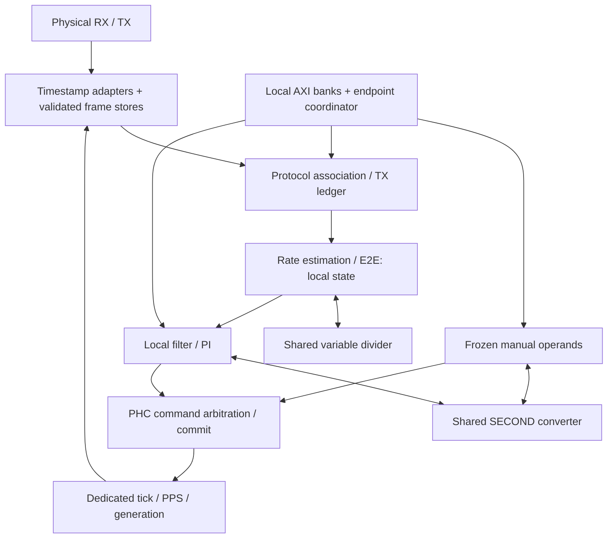

# PTP architecture and design decisions

The implemented endpoint is an autonomous, fixed-source Layer-2 E2E
TimeReceiver with per-message one-/two-step Sync reception. Software configures
and observes it; FPGA logic captures timestamps, associates exchanges, estimates
rate and delay, runs the servo and commits PHC commands.

This guide includes the October 15 arithmetic conversion and retains the
explicitly dated October 14 compute-boundary review as design history. It is the maintained design record, not a hardware accuracy
claim. [Interface contracts](interfaces.md) own exact clock-edge, handshake,
RAM and service bounds; the [register map](register-map.md) owns software
transactions. [Validation and outstanding acceptance](../../docs/plans/ethernet-ptp/README.md)
are tracked separately. Board routes and calibration belong to the consuming
project; [physical-clock integration](physical-clock.md) remains future work.

## Design decisions at a glance

| Choice | Reason and consequence |
| --- | --- |
| Autonomous endpoint with a dedicated PHC tick path | Packet-rate arithmetic can wait for a shared service; counting, PPS and physical capture cannot. Host scheduling never determines a timestamp or servo update. |
| Passive, independently validated wire observation | Keeps each capture with its own bytes before any lossy queue and preserves the existing MAC. It costs duplicate framing/FCS logic; header-key joins after independent loss were rejected. |
| Fixed source and L2 E2E scope | Bounds policy and association state. It does not imply BMCA, VLAN/UDP, Pdelay, one-step transmit or full profile conformance. |
| Raw-tick rate estimation and capture-specific calibration | PHC steering must not feed back into the oscillator estimate or change the units of an earlier capture. E2E needs a qualified rate even before valid path delay exists. |
| Local arithmetic state with two narrowly shared services | SECOND conversion is shared by servo/manual PHC and variable division by rate/E2E. Registered local operations replace descriptors and operand workspaces; the existing association floor remains until the complete replacement bound is validated. |
| Physical TX fate retained across logical restart | A queued MAC frame can still reach the wire after timeout or reconfiguration. Freeing its key early risks associating a late completion/response with a new exchange. |
| Registered publication and explicit cancellation edges | Makes payload, validity and lifecycle observable together. Cancellation can veto pending work but cannot retroactively undo a consumed sample or committed clock command. |
| Local register ownership with coordinated commit/snapshot | Each core owns its settings and diagnostics. Frozen candidates and versioned result banks provide atomic transactions without central wide copies. |
| Integer/fixed-point time and checked arithmetic | Keeps epoch differences, correction fields, rounding and overflow explicit. Narrow storage must not reduce public precision or change which measurements are rejected. |
| Numerical time separate from physical clock and application epoch | A valid PHC and a PPS edge do not qualify downstream jitter, oscillator discipline or destination-domain time transfer. |

## Reading map

- [Composition and ownership](#composition-and-ownership)
- [Shared compute, storage and mapping rationale](#shared-compute-and-storage)
- [Compute ownership and selected boundary](#compute-boundary-review)
- [Math inventory by module](#math-inventory-by-module)
- [RX capture and validation](#rx-message-and-capture-boundary),
  [capacity/TLV options](#frame-capacity-and-tlvs) and [queue storage](#rx-queue-storage)
- [TX ledger and physical fate](#tx-ledger-storage)
- [Time and lifecycle](#time-arithmetic-and-lifecycle-contracts)
- [Protocol associations](#protocol-association-storage) and
  [policy, estimator and servo envelope](#port-policy-and-numerical-envelope)
- [Arithmetic units and sequencing](#arithmetic-units-and-sign-conventions)
- [Register transactions](#axi-lite-register-map) and [snapshot CDC](#optional-snapshot-cdc)
- [Physical clock/application boundary](#physical-clock-and-application-boundary)

## Composition and ownership

`EthMacPtpEndpoint` composes the unchanged `EthMacTop`, `PtpPrimaryGuard`, passive
`PtpRxTimestampTap`, passive `PtpTxTimestampTap`, and `PtpEndpoint`. All run in
one continuously running Ethernet/PHC clock domain. Use 125 MHz for full-rate
GMII or 156.25 MHz for XGMII; GMII 10/100 clock enables are unsupported.

The primary stream uses `EMAC_AXIS_CONFIG_C`. The guard reserves all untagged
EtherType `0x88F7` frames for the private PTP producer, draining application
attempts and counting them. It also rejects malformed/short initial SSI beats;
a legal primary frame presents a full first 16-byte beat with SOF. Other frames
retain their payload and sidebands through a registered ready/valid stage.

`PtpProtocolEngine` is a structural coordinator with no additional state or
pipeline stage. Its internal owners are:

| Owner | State and responsibilities | Boundary |
| --- | --- | --- |
| `PtpProtocolReg` | AXI decoding, frozen candidate validation, active configuration, MAC-derived identity and snapshot/publication banks | Active configuration, same-edge identity-change indication, registered diagnostic word writes/commits |
| `PtpPortPolicy` | Identity/domain/capture admission, Announce metadata, Sync/Announce receipt deadlines and lifecycle causes | Same-edge admission/cancel decisions; registered status, lifecycle and child abort |
| `PtpSyncFlow` | Admission arbitration, response holding, rate/E2E sequencing and measurement diagnostics | Pair completion, history append/lookup transactions, measurements and diagnostic publication transactions |
| `PtpSyncPair` (flow child) | Pair RAM, expiry/replacement, Sync/Follow_Up semantics, duplicate retirement and completed Sync sample | Held RX record in; completion with optional sample out; held row comparisons to scan service |
| `PtpSyncHistory` (flow child) | History RAM, atomic append/commit, nearest eligible sample lookup and normalized E2E upload | Held rate result to append; retained Delay sample to lookup; selected sample and word stream out |
| `PtpTableScan` (flow child) | Round-robin row arbitration and one word-serial age/distance ALU | Two held requests and owner-specific completion; no table-state access |
| `PtpDelayReqTx` | Interval/minimum-interval state, seeded jitter, reservation requests, frozen frame and beat progression | Ledger reservation handshake and AXI stream |
| `PtpTxLedger` | Wire keys, physical completion/response matching and unresolved transmission lifetimes | Existing allocation, completion, response and sample interfaces |

The initial flow extraction still coupled four state machines in one large
owner. Pair and history now own their table state independently; explicit held
row-comparison transactions preserve the shared scan ALU without sharing their
private FSM state. The flow retains one rate/measurement coordination machine.
History owns both lookup and append sequencing, committing only after the last
registered RAM write drains. A pair completion carries an optional sample:
rejected or incomplete pairs still acknowledge the RX record. The selected Sync
and E2E records remain with their table owners until the coordinator permits
replacement, avoiding duplicate payload registers or extra handshake stages.

Diagnostic serialization stays with `PtpSyncFlow`: Announce uploads directly
from the held RX producer, and exchange
uploads from retained E2E operands. Moving those serializers into register
management would require payload copies or a new reservation interface. The
register owner instead accepts explicit registered writes and commits through
`PtpPublicationType`; snapshots retain their original pre-edge capture behavior.

`PtpPortPolicy` consumes current-edge Sync admission, accepted rate-sample and
Announce admission events from the flow owner. Its decisions depend on retained
policy state and registered flow capacity, not those events, so cancellation
does not form a combinational feedback loop. The engine combines independently
registered policy/measurement status fields without resampling them. Logical
restart still preserves TX drain and ledger ownership. This decomposition is
for ownership and maintainability; it claims no area or timing improvement.

The transmitter builds a 58-byte Delay_Req on an eight-byte SSI stream.
`PtpEndpoint.TX_AXIS_CONFIG_G` defaults to that format with a direct connection;
`EthMacPtpEndpoint` selects the MAC's native bypass configuration, enabling
an `AxiStreamResize` inside `PtpEndpoint`. Only system reset clears this stage. The
MAC owns padding, preamble, FCS, arbitration and pause. Its redundant RX bypass
is drained at native width: the passive atomic RX frontend supplies protocol
messages independently of hidden MAC CRC/FIFO drops.

The wrapper's `localMac` is authoritative for Ethernet configuration, the PTP
builder and readback. Its least significant octet is first on the wire. The
project must assign a unique deployed address; `MAC_ADDR_INIT_C` is only a
convenience default. Default PTP clock identity inserts `FFFE` into those MAC
octets in EUI-64 form, preserving the configured port number; software may
override clock identity without changing the Ethernet source MAC. A MAC change
restarts acquisition and updates both views coherently.

Delay_Req uses multicast `01:1B:19:00:00:00`, EtherType `0x88F7`, message type 1,
length 44, configured domain/minor version, zero correction/origin timestamp,
local identity, allocated sequence and log interval `0x7F`. Control is zero for
minor version 1 (2019 Layer-2), or one for selected minor version 0 (2008
compatibility). Its
58 meaningful bytes exclude preamble/padding/FCS; SSI SOF is set, final EOFE is
clear and every offered beat remains stable under backpressure. Bypass priority
is at frame boundaries; the TX tap observes actual transmission after MAC pause
or queueing. Tagged frames are outside this contract and require coordinated
classifier, frontend and builder changes.

`PtpEndpoint` structurally composes `PtpProtocolEngine`, `PtpServo`, `PtpPhc`,
`PtpEndpointControl` (formerly `PtpReg`), TX adaptation and the standard SURF
AXI-Lite crossbar. The controller owns global enable/commit/snapshot state,
registered restart/RX flush and IRQ events, plus combinational AXI reset.
Restart consumes the published apply strobe, and IRQ status consumes the
previous event stage; consolidation preserves their register hops. Each functional
core owns its AXI-Lite decode, configuration and snapshot storage. Protocol
management lives in `PtpProtocolReg`; PHC and servo retain their local
`RegType`/`comb`/`seq` structures. `PtpPhc` also owns manual phase normalization
and final command arbitration. Only shared active limits, measurements and
narrow lifecycle/status signals cross between these cores. All three cores
use their local AXI configuration, with no optional bypass. Measurement
handshakes and port status use package records.

The PHC-local arbiter retains manual/automatic ownership through acknowledgement.
Manual steering requires automatic control disabled; PPS enable is available
in either mode. A disabled servo drains measurements so packet processing and
protocol diagnostics continue under manual PHC ownership. RX overflow/link/
configuration cancellation remains separate from the PHC's own capture-abort
path, preventing a phase step from canceling itself. Held link loss cancels
old work once and permits subsequent frequency-only holdover control.

## Shared compute and storage

`PtpEndpoint` owns one [PtpSecondService](rtl/PtpSecondService.vhd) for servo
and manual PHC conversion, and one [PtpVariableDivide](rtl/PtpVariableDivide.vhd)
for rate estimation and E2E calibration. Each has two owners, round-robin
admission, independently held responses and owner-local cancellation. There is
no shared descriptor engine or addressed operand workspace. `PtpCompute`, its
package and its legacy-only fixtures are deleted; Git history preserves them.



`PtpRateEstimator`, `PtpE2e` and `PtpTxLedger` are children of
`PtpProtocolEngine`. Each endpoint has its own services and PHC; independent
port clocks do not share a timing loop. The physical taps belong to
`EthMacPtpEndpoint`, outside `PtpEndpoint`.

Epoch normalization, checked products, shifts, additions and clamps operate on
named local state. E2E uses the registered `PtpTreeProduct`; PI reuses the serial
`PtpLimbProduct`. The servo has local BILLION/NOMINAL converters and separate
filter/PI children. Protocol tables, configuration and snapshot word banks keep
their existing ownership; removing arithmetic workspaces does not remove these
stores. Waiting for PHC acknowledgement holds no arithmetic service.

The retained minimum association window is **70,347,776 raw ticks**, exposed as
`MinimumAssociationTicks`; the two-second default remains valid at both endpoint
clock rates. The working sustained Sync envelope is 10 Hz, initially advertised
at 8 Hz. This is a deployment assumption, not an RX rejection rule or measured
performance. The [service-bound record](interfaces.md#shared-service-bound)
preserves the original floor derivation; a complete replacement bound and
endpoint validation remain open.

### Compute boundary review

The October 14 review of SURF `4d3439185` found that shared word storage made
algorithm code manage slot addresses, operand transfers, descriptor return states
and cancellation lifetimes. The implemented replacement keeps named algorithm
state local and shares only two expensive fixed operations. The
[decision history](../../docs/plans/ethernet-ptp/history/decisions.md#fixed-function-arithmetic-architecture)
records the rejected boundaries; [measured evidence](../../docs/plans/ethernet-ptp/history/arithmetic.md)
records the area premium and timing results. No legacy compute copy is retained.

| Owner | Local responsibility | Shared request | Publication/commit |
| --- | --- | --- | --- |
| `PtpRateEstimator` | Normalize corrected Sync time; track chronology, anchor and qualified ratio | Positive-divisor rate quotient | Hold completion until protocol history/publication consumes it; only an accepted estimate refreshes ratio age. |
| `PtpE2e` | Capture operands; epoch differences; checked elapsed/calibration products; delay/offset | Sequence nonzero RX/TX calibration divisions | Hold one result with its validity/error and generation context. |
| `PtpServo` and filter/PI children | Median, acquisition, PI/bootstrap/holdover; candidate versus committed state | SECOND for phase normalization | Hold PHC command; commit frequency/history only on successful ACK. |
| `PtpPhc` | Four-word manual admission; live epoch check; tick/PPS and command arbitration | SECOND for manual PHASE preparation | Validate again at commit; preserve distinct early rejection and late fault. |

Waiting for PHC ACK reserves no arithmetic service. Each service has independent
per-owner result storage and cancellation. Filter history, estimator anchors,
protocol associations and publication state retain their own lifetimes. Shorter
arithmetic latency does not make these other ownership rules unnecessary.

#### Math inventory by module

| Module | Operations and selected implementation |
| --- | --- |
| `PtpEpochNormalize` | Factored seconds48-to-Q16 conversion with a 48×21 product, fixed shift and subsecond add. |
| `PtpRateEstimator` | Widened correction sum, epoch normalization, chronological/span checks, shared variable quotient and local ratio qualification/filtering. |
| `PtpE2e` | Local epoch differences and registered signed68×unsigned64 product tree; check full-product overflow before elapsed rounding; shared positive-divisor calibration quotients. |
| `PtpServoFilter` | Median/sample-history selection independent of PHC command lifetime. |
| `PtpServoPi` | Reused signed96×unsigned95 limb product, rounded shifts, local BILLION/NOMINAL converters, registered clamp/anti-windup equations. |
| `PtpServo` | Phase acquisition through SECOND; candidate/command/ACK sequencing, configuration and snapshots. |
| `PtpPhc` | Dedicated counting/PPS and live command application; shared SECOND preparation only. |
| Protocol tables and TX ledger | Word-oriented scans, native adds/comparisons and raw-age checks; separate from arithmetic services. |

[Primitive contracts](interfaces.md#arithmetic-primitive-contracts) define width,
rounding and manual PHASE admission. Native add/subtract stays local where DSP
mapping worsened the measured path. Serial constant conversion saves resources;
125 MHz NOMINAL has an exact power-of-two bypass. E2E requires actual captured
increments for calibration; operator-installed RATE values cannot be replaced by
an assumed nominal denominator. Zero calibration planes skip their arithmetic.

The full endpoint service proof and endpoint/real-MAC lifecycle checks remain in
[acceptance](../../docs/plans/ethernet-ptp/acceptance.md#arithmetic-prototype-sequence).
Keep the retained association floor until those obligations justify changing it.

### Mapping and timing choices

Deeper protocol pair/history, ledger, protocol/servo configuration and protocol
publication stores select block RAM. Smaller banks retain distributed RAM.
Changing geometry to word access removes wide staging; simply changing a very
wide, shallow RAM's style would retain that cost and waste block RAM capacity.
The [bank contract](interfaces.md#configuration-and-snapshots) preserves read
latency, initialization, copy and snapshot ownership across mappings.

Protocol pair/history row checks share a separate 32-bit ALU so overlapping
scans have bounded arbitration without using the arithmetic services. Ledger live
expiry checks retain local arithmetic because their observation edge matters.
Native inferred add/subtract is retained on the critical wide paths. Matched
KU040 experiments favored it over handwritten carry-select/carry-save forms;
DSP versions reduced LUTs but lengthened those operators. Streaming TLV validation
uses payload-run skipping and parallel fixed-lane header checks to avoid a serial
variable-byte chain without adding a capture/admission edge. These are selected
implementation choices, not portable device-wide performance guarantees.

The quotient-based raw-rate estimator remains. Feedback estimation was studied,
but changing convergence/filtering and rate qualification would affect E2E, while
removing its divide would leave other divider clients in place. Floating-point
servo arithmetic is also deferred; epoch differences should still be formed in
integer/fixed point before any future conversion. See the
[rate-estimator study](../../docs/plans/ethernet-ptp/history/design-studies.md#arithmetic-alternatives)
and [floating-point study](../../docs/plans/ethernet-ptp/history/design-studies.md#arithmetic-alternatives).

### Storage inventory

This is source geometry, not synthesized utilization. Primitive depth rounds up
to a power of two; inference and constant pruning require build-host evidence.

| Owner | Addressed payload storage per endpoint |
| --- | --- |
| Protocol pair/history | Four 20-word pair rows and four 25-word history rows; each RAM is 128x32. History includes eight normalized words per sample. |
| TX ledger | Four 22-word rows; 128x32 RAM. Depth generic retains 1–255 logical slots. |
| Servo median | Five signed64 samples and a padded sorting copy in local registers; no arithmetic workspace RAM. |
| Local configuration | Three banks of 48 protocol, 34 servo and 10 PHC operand words, including address-map holes; physical RAMs are 256x32, 128x32 and 32x32. |
| Immutable result snapshots | Protocol records have 12 Announce body/metadata and 20 exchange words; servo records have 4 offset, 4 median and 2 rate words. Five versions per record require 256x32 and 64x32 physical RAMs. |
| Changing-scalar snapshots | Two banks of 7 protocol counter, 10 PHC and 1 servo words; scalar cohorts are latched together before copying. |
| RX stream | Eight 64x8 lane RAMs at depth four, a separate 8x293 capture RAM and a narrow bank/length descriptor FIFO. Five frame banks include the active physical frame. |
| Dedicated TX stream | Eight 8x8 lane RAMs, separate 4x293 capture RAM and a narrow descriptor FIFO. Three frame banks preserve two logical completed entries. |

## RX message and capture boundary

A passive adapter binds capture and bytes at the first destination-MAC octet,
before any lossy queue. `PtpRxFrontend` validates the complete frame and publishes
one atomic decoded-message/capture record; the redundant MAC bypass is always
drained, including during logical restart. Aggregate MAC CRC/FIFO status is
diagnostic and cannot select or invalidate frontend records.

| Alternative | Identity guarantee | Cost and decision |
| --- | --- | --- |
| Metadata through an opt-in receive MAC | Capture and frame remain one transaction only if every importer, pipeline, filter, FIFO, and reset carries or discards both. | Viable, but changes several existing MAC boundaries or creates maintained siblings. Prefer for a future general timestamp API. |
| Passive validated RX frontend | The producer owns frame bytes and capture before the first lossy queue. No later packet lookup exists. | Selected. Duplicates FCS/framing validation, but confines new logic to PtpCore and preserves the public MAC. |
| Header key plus aggregate drop flush | No complete frame-local loss identity; CRC rejection and retained FIFO data break the join. | Rejected by the real-MAC counterexamples. More table entries or key bits do not repair it. |

Inspection supports the boundary choice: `EthMacRxImport` exposes AXI packets
and aggregate status, without frame-local capture metadata; its GMII/XGMII
leaves perform physical import and CRC. `EthMacRx` then passes traffic through
additional processing before `EthMacRxFifo`. Existing `TUSER` fields already
have SOF/error meanings. Adding a parallel FIFO at any one of those boundaries
would require proving identical admission, loss, and reset behavior again.

`PtpRxTimestampTap` structurally composes `PtpRxTimestampAdapter` and
`PtpRxFrontend` without added state or latency. The adapter handles GMII/XGMII
normalization; `PtpTxTimestampTap` reuses the adapter and a dedicated
`PtpDelayReqObserver` for separate TX completion. There is no combined
RX/TX timestamp-tap entity or separate RX timestamp/frame join.

| Boundary | Contract |
| --- | --- |
| Adapter to frontend | Eight-byte AXI/SSI format, contiguous low-byte keep, SOF/EOFE and last; a capture sidecar is meaningful on SOF. No ready: every valid beat is consumed. GMII contributes one byte, XGMII up to eight; termination after a full word may use a zero-byte final beat. |
| SOF capture | Q16 time, raw ticks/eighth-cycle phase, generation, active increment, validity/error from the same frame. Time-invalid observations can still bootstrap acquisition. |
| Frontend to protocol engine | One `PtpRxMessageType` valid/ready channel for Sync, Follow_Up, Delay_Resp and Announce, with capture, RX epoch, header and fixed body. No independent capture queue or raw RX port. |
| Protocol TX/completion | Delay_Req stream and keyed wire completion remain distinct, subject to reserved-key lifetime and exclusive primary-traffic rules. |

Sidecar and SOF share every enable/reset. Normalization/CRC sustain eight bytes
per cycle at XGMII line rate, including minimum gaps. GMII has phase zero;
XGMII normalizes `(startLane + 8)` byte times into ticks plus eighth-cycle phase.
RX and TX both retain that phase: ignoring lane-4 versus lane-0 differences can
bias nominal 10G delay by 1.6 ns. Capture arithmetic scales with the active PHC
increment and normalizes seconds carry/borrow; epoch underflow/overflow marks
an invalid capture. Direct capture at the message point avoids extrapolating
across a PHC command edge.

### Validation and bounded storage

The adapter rejects invalid preamble/SFD, illegal XGMII start lanes/control
sequences, and GMII error indication, and reports any in-frame error through
EOFE. A physical error is sticky until termination. Missing termination cannot
grow storage: byte counters saturate and the frame remains rejected until
resynchronization. A nested SOF invalidates the partial frame and the nested
candidate; recovery is permitted at a subsequent clean SOF.

The frontend owns these structural checks:

- Complete frame length of 64 through `MAX_FRAME_G` bytes, destination MAC
  through FCS; the default maximum is 1518. Jumbo and tagged PTP are outside
  this contract.
- Ethernet FCS across the complete frame, including legal padding. Nothing is
  queued before the final CRC result and framing status are known.
- Outer EtherType `88 F7`, major version 2 with any minor version, and a supported
  RX message type. The byte-order convention remains distinct from `x"F788"`
  in the MAC bypass generic.
- `messageLength` covers the fixed body (44/44/54/64 bytes respectively), fits
  the received frame, and is at most `MAX_FRAME_G - 18` (1500 by default). Padding beyond that length is
  excluded from PTP decode, but included in CRC.
- Optional TLVs walk exactly to `messageLength`; reject odd value lengths,
  partial headers and values extending beyond it. Structurally valid unknown TLVs are skipped.
  Profile-specific TLV semantics and conformance fixtures remain a parser
  qualification task; the model checks boundary lengths, not full IEEE conformance.

The `PtpProtocolEngine` composition owns configured identity/domain policy,
flag legality, valid nanoseconds, requesting-port identity, Announce semantics,
timeouts and Sync/Follow_Up transaction matching through its policy, pairing,
flow and ledger children. Keep structural
parsing and mutable protocol policy separate. Configuration changes abort all
in-flight frontend work through the common generation contract, including a
frame that began before the change and terminates afterward.

The wire key identifies a protocol exchange, not a physical frame. Two valid
same-key Sync copies produce two internally consistent records. Protocol
duplicate/replay policy must still prevent reusing completed exchange keys and
reject conflicting live content; this design does not prove which of two
conflicting, CRC-valid Follow_Up messages a sender intended. No oracle wire ID
is carried in the interface or used by the reference model.

Storage is bounded independently of frame termination: 65 useful bytes in a
70-byte sparse layout,
saturating length counters, CRC and streaming TLV state, one SOF capture and a
configured complete-record queue (default four). The Python oracle holds four
trailing FCS bytes; RTL instead proves the declared body ends before the FCS.
The legacy 744-bit diagnostic packing gives 2,976 data bits for four records,
but omits capture increment/error and is not a lossless transport or device-area
estimate. See the [lossless FIFO implementation](#rx-queue-storage).

A completion finding the queue full **before the edge** discards the completion
and whole queue, advances RX epoch and increments overflow even if ready is high.
Malformed/unsupported frames do not enqueue and cannot cause queue overflow.
Otherwise the old head may retire before a valid completion enqueues; new records
do not fall through on arrival. Restart/generation changes discard partial and
queued work. RX overflow never steps the PHC or releases unknown TX wire keys.

The [registered timing contract](interfaces.md#registered-lifecycle-and-queue-boundaries)
is authoritative: a detection-edge old-head transfer can precede publication of
abort, and the consumer cancels pending work when that registered event arrives.
This supersedes the original reference model's immediate-abort timing. Pipeline
capture, completion, generation and abort together; an independent reset or CDC
would need coordinated invalidation before admitting new work. The current
physical producer boundary has no CDC.

### Frame capacity and TLVs

`MAX_FRAME_G` bounds the complete frame, including Ethernet header and FCS.
Its default is 1518 and its supported range is 82–1518 bytes. The narrow counters
and TLV offsets derive from this capacity; the fixed-field stores do not retain
an entire maximum-length frame. `EthMacPtpEndpoint`, `GigEthPtp` and the GTH
composition expose it to both observers. GTY/copper wrappers currently retain
the defaults rather than exposing these generics.

`TLV_EN_G=true` is the default: structurally valid unknown TLVs are skipped.
False removes the suffix walker and requires each supported message's exact
fixed-body `messageLength`; legal Ethernet padding remains allowed. This is an
implemented restricted mode, not equivalent interoperability. A master appending
a TLV to Sync/Follow_Up/Delay_Resp would lose those measurements. Announce TLV
rejection loses metadata; `announceValid` itself does not gate servo enable.
A deployment must establish that its profile/master traffic permits the restriction.

The KCU105 area study selected 128-byte capacity with TLVs enabled. The 82-byte
minimum gave worse mapped area and less message headroom; smaller counters did
not produce monotonically lower whole-design LUT counts. That board selection
is not the reusable default, and support for structural TLV skipping does not
implement TLV semantics or White Rabbit. Selection evidence is in the
[capacity/TLV experiment](../../docs/plans/ethernet-ptp/history/verification.md#capacity-and-arbiter-follow-up).

## RX queue storage

`PtpRxFrontend` writes 65 useful fixed-field bytes in a sparse 70-byte layout
through eight independent byte lanes. The eight-byte Ethernet source/EtherType
gap is removed without changing stored bytes' modulo-eight lanes; remaining
reserved positions are neither written nor decoded. A beat writes at most one
byte per lane, including a row crossing. Nine groups per physical bank preserve
the previous compact layout's RAM depth for every logical queue depth; the
uncompacted 78-byte experiment is not the retained layout.
CRC, lengths, TLV progress and small common-header fields stay in the stream
validator; unused prefix bytes and TLV payload are not retained. Physical SOF
capture metadata is written once to a separate bank. The store has one extra
active-frame bank beyond the exact logical queue capacity (default four).

A synchronous SURF FWFT FIFO carries bank/length descriptors after complete
validation. Logical occupancy includes descriptor pipeline, decoder and held
head; extra primitive locations do not add capacity. The decoder streams eight
wire positions per clock into the sole public record. With G=ceil((40+fixedBodyBytes)/8),
EOF at N produces registered valid at N+G+4 and first transfer at N+G+5.
A queued next record takes G+2 clocks after the preceding head transfer. G is
7 for Sync/Follow_Up, 8 for Delay_Resp and 9 for Announce. These rates fit their
minimum wire spacing. Dedicated minimum-IFG GMII/XGMII bursts test continuous
capture and exact capacity with a held prior head.

`PtpDelayReqObserver` is the dedicated TX validator: only 13 key bytes and the
complete capture are stored, with two logical entries and a two-group decoder.
Its descriptor carries only the bank index; the 13-byte decode length and 44-byte
fixed PTP body are constants. Identity/version errors become sticky at their
wire bytes, while rejection counting and admission still occur at physical EOF.
It validates actual post-MAC framing, FCS, Delay_Req type, length and legal TLVs. PHC generation
changes and capture arithmetic errors cannot erase physical completion identity;
physical reset/flush retains its distinct meaning. Logical restart never proves
an unknown queued TX frame vanished.

Reset/flush invalidates ownership and registered FIFO state without clearing RAM.
Full-before-edge overflow flushes the entire queue and publishes the existing
abort/epoch event. Invalid frames overwrite only the current uncommitted bank.
The public message and capture stay atomic and stable under backpressure. The
809-bit pack/unpack utilities retain their public verification layout but no
longer define the physical descriptor FIFO width. Resource mapping and timing
still require matched Vivado evidence; simulation does not measure LUT savings.

## TX ledger storage

`PtpTxLedger` stores each entry in 22 addressed 32-bit words of synchronous
`SimpleDualPortRam`. Sequence/domain, generation, identity, creation/wire/response
ages, remote timestamp/correction and physical capture fields have fixed word
locations. Four ownership flags per slot remain in registers. Only selected
scan fields and the final held sample are staged. Distributed and block RAM
use the same one-cycle synchronous interface; depth remains 1–255, default four.

A shared word scan reads/updates 22 fields, then retires the row. A pass takes
`45*DEPTH_G+2` clocks; accepted allocation adds 22 writes. A request arriving
mid-pass can wait for the following pass. Maintenance continues while a sample
is held. Expiry is checked against actual ticks when its age words are consumed;
serialization never refreshes capture or creation time. At publication the
wire lifetime is checked again. Timeout visibility can lag by one pass, and
short standalone lifetime settings can expire before processing finishes.

Each scan observes at most one wire record and one response. Both producers
assert valid independently of ready and retain their entire record through the
end-of-scan handshake, including unmatched records. Inputs arriving after START
wait for the next scan; publication and reclamation wait until those pending
records have been checked, so a late-arriving duplicate cannot be bypassed.
`wireReady` is connected through `txMessageReady` on
`PtpProtocolEngine` and `PtpEndpoint` to the TX tap's existing completion queue.
`responseReady` lets the protocol engine retain its staged response, applying
RX backpressure while that stage is occupied. Response acceptance remains a
registered pulse after the response **handshake**, with its log interval retained
for the following protocol edge. It no longer means acceptance one edge after
valid first appears. External instantiations of these low-level entities must
connect the new ready outputs and honor this contract; MAC/PHY wrapper ports
and the software register ABI are unchanged.

At each row, timeout retirement precedes wire handling, then response handling,
then sample publication. Duplicate wire observations renew quarantine before
reclamation and cannot overwrite an already published output. Matching duplicate
responses compare their original timestamp/correction without refreshing age.
Selected words assemble directly into the sole held sample before the row can be
reused. Raw capture ticks and generation are reconstructed from matching entry
fields, and error is zero because error/generation failures prevent selection.
No timestamp precision is discarded. Writes are registered; overlapping reads
and writes address different rows. Allocation writes drain before the next read,
including at depth one, avoiding same-address read/write assumptions.

Logical restart retires all ownership flags and cancels response eligibility and
the output, while the physical completion still drains through the scan. Unknown
TX ownership is never released by logical restart or timeout. Only confirmed MAC
reset clears all slots and starts network-lifetime quarantine. System reset
requires that confirmation again before admission. RAM contents are not cleared;
a fresh allocation writes the entire row before setting up later reads. An old
registered write may finish on a reset edge but cannot regain valid ownership.

## Time, arithmetic and lifecycle contracts

- PHC time is seconds48/nanoseconds32/fraction32. Captures retain Q16 fraction,
  generation32, unsteered ticks64, eighth-cycle phase, and the exact active Q32
  increment. The existing RX `toSlv()` layout remains 744 bits and omits
  capture increment/error; it is a legacy diagnostic/test packing, not a complete
  transport for endpoint records or a CDC interface.
- The timestamp plane is the first destination-MAC octet, with XGMII lane
  phase applied. Ingress is subtracted and egress added. Both are signed Q16
  **local PHC nanoseconds**, supplied by build-time latency generics. Egress
  excludes the single
  most-negative 64-bit value because the shared ingress adapter must negate it.
  E2E converts each latency to master-time units using that capture's increment
  and the qualified master-time/raw-tick ratio. A PHC rate change between t2 and
  t3 therefore cannot silently change the calibration plane.
- Local arithmetic leaves and the two shared services retain exact signed128
  intermediate contracts. Division rounds nearest with ties away from zero
  where requested; constant-converter remainders follow truncation toward zero.
  `PtpMath` supplies the shared variable divider's restoring core. Cancellation
  and held-response ownership remain per client.
- PHC command acceptance latches an immutable operand; commit is the following
  edge. SET specifies commit-edge time; PHASE applies after normal advancement;
  RATE changes the next increment. A discontinuity clears validity, suppresses
  PPS and captures, and advances generation. Invalid/stale commands acknowledge
  with error. Valid monotonic time rejects absolute sets and negative phase
  steps. Epoch/generation/tick exhaustion faults closed and requires system reset.
- A TX key is reserved before the first stream beat. Four ledger entries retain
  sequence/domain/identity/generation and physical fate. Responses and physical
  completion may arrive at the ledger in either order. Timeout or logical restart
  retires a request but cannot free an unknown wire fate. Known completions retain
  the key through `PACKET_LIFETIME_G`; a duplicate restarts that quarantine.
  Admission requires explicit MAC reset confirmation plus startup quarantine.
  Only confirmed physical reset can release an unknown fate. This bounded design
  can intentionally stop requesting when the MAC never resolves its queued work.
- Packet lifetime is an integration assumption about the maximum surviving
  network response lifetime. Set it conservatively; finite key reuse cannot
  protect against arbitrarily delayed/replayed traffic outside that bound.
- Port reset/configuration changes preserve the PHC and drain an already presented
  TX frame. System reset must reach the entire MAC/resize/endpoint pipeline.
  `regRst` cancels AXI responses only: configuration, accepted manual commands,
  PHC time and physical TX reservations survive.

## Protocol association storage

`PtpSyncPair` keeps four pairing rows of 20x32 words; `PtpSyncHistory`
keeps four history rows of 25x32 words. Both inferred `SimpleDualPortRam` instances support
`"distributed"` and `"block"` through their existing generics. Ownership/mode
flags remain in registers; reset/abort invalidate ownership without clearing RAM.

Pair scans read sequence and creation ticks, retaining the original inclusive
age limit and first-slot tie rule. Selection prefers the existing key, then
first free/expired row, then oldest completed row. Only a matching duplicate
Follow_Up reads its comparison fields. RX holds its record through field writes
and selected-sample publication. New scans wait until writes drain; duplicate
and overflow retirement retain keys until replacement or expiry. Scan-start
ticks govern table expiry; final packet capture-age checks remain live.

History first scans ticks/phase/generation and chooses the nearest eligible
Sync on either side of TX. Strict distance comparison retains the first physical
slot on ties. The 68-bit signed distance exactly represents the difference of
full 64-bit ticks plus three phase bits. Only the chosen sample is fetched into
the existing held E2E producer record. Eight additional words stream its previously
computed forward and corrected remote Sync values directly into E2E's private
workspace. No timestamp reconversion or full-row scan register is required.

An append writes raw provenance from the held rate producer, then normalized
words directly from the rate workspace. The row becomes valid only after its
last registered write drains. Lookup pins the table, deferring append writes and excluding new pair
admission until the selected words transfer. E2E retains its input ownership
through result retirement. Completed E2E output takes priority over a new pair
scan, including under continuing rejected traffic. Local scan and shared-service
latencies are included in the [service bound](interfaces.md#shared-service-bound).

## Port policy and numerical envelope

The fixed source accepts multicast destination `01:1B:19:00:00:00`, configured
sourcePortIdentity/domain, majorSdoId (formerly transportSpecific) zero, PTP
major version 2 with any minor version, one-step or two-step Sync, Follow_Up,
Delay_Resp and Announce. The non-isolated domain ignores minorSdoId;
messageTypeSpecific and received controlField are ignored. Reserved flag bits
(`0x9880`) are excluded from policy checks. Remaining flags and canonical timestamp checks
follow structural/FCS validation. There is no BMCA, one-step transmit insertion, UDP,
VLAN, Pdelay, security extension, or automatic upstream selection.

Four bounded associations select the mode independently for each Sync. After
masking reserved bits, flags `0x0000` select one-step: nanoseconds must be below 1,000,000,000, and the
Sync's originTimestamp and sign-extended correction complete the sample with
its own physical capture. Flags `0x0200` select two-step: Sync and
Follow_Up may arrive in either order, the Sync body is non-authoritative, and
the sample uses Follow_Up's preciseOriginTimestamp plus the widened signed
sum of both corrections. All 48 seconds bits and Q16 correction bits survive.
Other non-reserved Sync flags are rejected before association updates.

A one-step Sync colliding with a retained Follow_Up retires the association
without a sample. Follow_Up after a one-step Sync is rejected and counted
without changing its timestamp, correction, age or completion state. Conflicting
two-step Follow_Up and duplicate physical Sync (including a different step mode)
invalidate the association. Retired entries cannot complete again. A later
packet cannot revoke an already consumed measurement. Completed slots may
retire, while unfinished slots cannot be overwritten. Retention/expiry and
chronology checks bound replay protection; sequence wrap is not a session ID.
Mode state flushes with the existing associations on restart, source/configuration
changes, RX abort/epoch invalidation and PHC generation changes; AXI-only reset
preserves it. Distinct sequence IDs can alternate modes without reconfiguration. The private mode bit is qualified by `syncSeen`;
`followSeen` indicates an actual Follow_Up. Completion requires an unretired Sync
and either one-step mode or its Follow_Up; the unused one-step Follow_Up correction
is zero. Masked flags and canonical one-step nanoseconds are checked before slot
allocation/update, so malformed traffic cannot contaminate a retained association.
These collision rules are conservative implementation policy, not a claim that
IEEE 1588 mandates this exact handling. Completion follows full frame validation
and available processing capacity; RX waits while rate processing or a measurement
stalls, and later collisions cannot revoke consumed samples.

The correctionField encoding `0x7fffffffffffffff` is an overflow indication
(IEEE 1588-2019 13.3.2.9), not a finite correction. The local receiver policy
retires the affected Sync/Follow_Up key, including when the overflowing half
arrives first. Finite duplicates cannot revive that retained key. A matching
Delay_Resp with this encoding retires its request without accepting its advertised
interval; unresolved TX ownership and the normal quarantine remain intact.
Identity/domain/provenance checks precede retirement, so foreign traffic cannot
invalidate an unrelated request. Already consumed measurements are not revoked.
Other signed values, including `-1` and both finite wire bounds, remain arithmetic
inputs; existing chronological and path-delay validity checks still apply.

Both receive modes share the existing registered measurement,
backpressure and child-cancellation contracts. Corrected remote time
and raw capture time must both advance. Four completed Syncs supply the nearest
eligible t2 for an actual t3. E2E computes a delay only with a fresh, qualified
rate ratio and matching-generation complete timestamps; negative/excessive path
delay and arithmetic errors are rejected before publication.

The rate estimator uses corrected master elapsed time over raw local tick/phase
elapsed time, independent of PHC validity or steering. It requires two qualified
intervals after a configurable minimum span, bounds oscillator deviation to
±200 ppm, and applies a quarter-weight IIR after the first estimate. Only an
accepted interval renews ratio freshness.

Delay_Req intervals use a seeded nonzero LFSR and a bounded three-point schedule
(0.5, 1, 1.5 times the effective mean). Only a matched Delay_Resp can update the
advertised minimum interval; the slower local setting wins. Log intervals
−10 through +22 are decoded, `0x7F` uses fallback, and other values count a
rejection and use fallback. Known Sync/Announce intervals give three-period
receipt timeouts, capped by configured `SyncTimeout` (twice that for Announce).
A configured-source grandmaster or PTP-timescale change cancels old acquisition. Announce metadata
is exposed, including all 30 body octets; UTC/leap flags never step the PHC.

The schedule selects half/one/one-and-a-half intervals for low LFSR bits
`00`/(`01` or `10`)/`11`. Enumerating the implemented recurrence from seed 1
returns after 65,535 nonzero states: `00` occurs 16,383 times and the other
patterns 16,384 times each. For an even tick interval the cycle mean is
1.00000763 times that interval. Draws are correlated, not independent; equal
seeds and aligned starts can produce correlated traffic across endpoints.
Deployment qualification must include aggregate master load and actual wire
spacing. The shift/add arithmetic avoids a general runtime multiply, but no
matched area comparison with a uniform implementation has established savings.

The three-point schedule is a known departure from IEEE 1588-2019
9.5.11.2(c)(1)'s default multicast uniform distribution. A strict expected-failure
acceptance test exposes that departure. The working plan is to retain this
schedule for controlled deployments, subject to master/load and timing-error
qualification; it is not a claim of conformance to the default distribution.
Reconsider it if deployment scale, interoperability, measured accuracy or a
required profile makes the departure unacceptable. For the selected non-isolated sdoId=000, candidate
configuration rejects reserved domains 128–255 and accepts 0–127. Boundary
tests preserve the active configuration after rejected candidates.
The scheduler and configured-port/profile requirements remain in the [specification audit](../../tests/ethernet/PtpCore/specification-coverage.md#remaining-normative-work).

The servo uses the median of only populated delay samples (up to five), then
local-minus-master offset = forward − filteredDelay − asymmetry. While invalid,
an allowed large phase correction can acquire the epoch. Otherwise a qualified
rate command establishes validity, including the no-step case. The PI loop uses
raw elapsed time, Q2.30 gains, Q16 ppb frequency/slew/final clamps, conditional
integration, and a bumpless initial frequency estimate. Only acknowledged rate
commands update the last good frequency. Stale or canceled work cannot publish
an automatic command. Holdover removes phase slew, preserves frequency, and
expires validity after a raw-tick age limit. A servo fault requires system reset.

Default gains are Kp = 0.25 ppb/ns and Ki = 0.0625 ppb/(ns·s); frequency/slew/final
limits are 100,000/50,000/150,000 ppb. Default delay/source/sample age limits are
frequency-derived: Delay_Req 1 s, Sync timeout 3 s, association 2 s, delay age 4 s,
holdover 64 s, exchange 2 s, minimum rate span 0.5 s, ratio age 4 s, and sample
interval 1/64–2 s. Step threshold is 20 µs; lock is eight samples within 100 ns;
unlock is three beyond 1 µs. Qualification counters retain progress in the
neutral hysteresis band and reset when the opposite threshold is crossed.
Maximum path delay is 1 ms.

The shared word processor requires an association window of at least
70,347,776 raw ticks, advertised by `MinimumAssociationTicks`. Its
[finite-burst derivation](interfaces.md#shared-service-bound) includes
movement, arbitration, computation and publication. Original capture ages are
unchanged. The configurable actuator cap remains 200,000 ppb and still requires
an explicit control/actuator rationale and qualification, independently of the
±200 ppm oscillator envelope and default 150,000 ppb total correction limit.

Model sweeps and accelerated endpoint fixtures exercise different envelopes;
neither establishes hardware accuracy or arbitrary-jitter stability. See the
[recorded model envelope](../../docs/plans/ethernet-ptp/history/verification.md#recorded-servo-model-envelope)
and [acceptance backlog](../../docs/plans/ethernet-ptp/acceptance.md#outstanding-acceptance).

## Arithmetic units and sign conventions

The Q32 PHC nominal increment represents 8 ns exactly at 125 MHz; its 6.4 ns
representation at 156.25 MHz has less than 0.02 ppb nominal rate error. Q16-only
increment rounding would be approximately 1 ppm without residual arithmetic.
Captured correction arithmetic uses Q16 nanoseconds; gains use unsigned Q2.30
(values below 4), with signed128 checked intermediates and nearest rounding,
ties away from zero where selected. Parser log-interval acceptance is not a
claim that one gain set tracks the entire range.

For equal-rate clocks, the explanatory E2E equations are:

```text
forward = t2 - (t1 + cSync)
reverse = (t4 - cDelay) - t3
meanDelay = (forward + reverse) / 2
localMinusMaster = forward - meanDelay - delayAsymmetry
rateAddendQ32 = round(nominalAddendQ32 * rateCommandPpbQ16
                     / (1_000_000_000 * 2^16))
```

Here `t1`/`cSync` use the selected receive-mode origin and correction; `t2` is
local Sync RX, `t3` local Delay_Req TX and `t4` remote Delay_Resp receive time.
Positive local-minus-master offset calls for negative phase/frequency correction.
`delayAsymmetry` means half the forward-minus-reverse physical path difference;
it is distinct from ingress/egress calibration. The implemented E2E uses the
qualified master-time/raw-tick ratio and each capture's calibration conversion,
not an equal-rate assumption. The uncorrected error is approximately half the
oscillator error times RX-to-TX separation: 100 ppm over 10 ms gives 500 ns.
Bootstrap therefore estimates rate independently of already-valid path delay.
After normalization, the corresponding error term is approximately half the
residual fractional rate-ratio error times that separation. A 1 s separation
requires 2 ppb residual error to limit this term to 1 ns, or 0.2 ppb for 100 ps;
these are component budgets, not measured PPS performance or RMS guarantees.
Use the selected Sync capture and actual Delay_Req transmit capture, rather
than substituting the interval between successive requests. A small locked PHC
offset does not itself establish the accuracy of the raw-clock rate estimate.
Do not constrain the individual cross-clock differences to a network-delay
range before their potentially large epoch offsets cancel.

### E2E arithmetic sequencing

`PtpE2e` uses a local epoch normalizer and product pipeline, with the
endpoint-owned variable divider for calibration. Production history supplies
normalized corrected Sync and forward words; the standalone leaf can normalize
a raw Sync locally. Epoch/correction additions preserve modulo signed128;
products and calibration division retain checked overflow and exact rounding.
Both calibration planes use their own captured increment; zero planes omit
their work. Zero ratio/increment and generation mismatch remain errors.

The producer holds input records until acceptance; E2E captures all operands
before releasing it. Intermediate values remain local. Cancellation invalidates
this transaction and its divider ownership independently of the rate client.
Service time depends on arbitration; the old word-serial timings do not apply.

### PHC increment and phase normalization

The ordinary PHC tick uses the registered `status.increment`, initialized to
nominal and replaced only by a valid RATE command. RATE admission still
precedes commit by one edge. The commit edge advances with the old increment
and publishes the new increment beside that timestamp for subsequent intervals.
Rejected commands preserve the active increment. SET/PHASE, rollover, capture
inhibition, validity and PPS ordering are unchanged.

Manual PHASE freezes software operand words, then submits exact signed128
division by `1_000_000_000 * 2^16` to owner three of the shared processor.
Quotients truncate toward zero, remainders retain the dividend sign, and the
PHC rejects quotients that do not fit signed64. Later shadow writes and AXI-only
reset cannot change an accepted command. Automatic phase preparation runs through
the servo's compute owner before presenting the same normalized PHC command.
No processor operation predicts a future counter value; commit checks use the
local PHC state at the defined commit edge.

`PtpMath` remains a separately tested reusable leaf, with its original divisor
width contract. It is no longer instantiated anywhere in the production PTP
hierarchy. Its earlier resource figures describe the previous implementation.

### Servo arithmetic and filter sequencing

`PtpServo` composes `PtpServoFilter` and `PtpServoPi`. PI uses named local
state, a reused product, registered clamp/anti-windup stages, local constant
converters and shared SECOND conversion for commands. Shifts retain nearest
ties away from zero at 30 and 62 bits. Overflow rejection, unsigned32 gains and
signed128 intermediate semantics remain unchanged. Applied configuration is
read from the active record. Candidate frequency becomes committed frequency
only after successful PHC acknowledgement; ACK waiting holds no shared service.

Delay history keeps five signed64 samples in registers. One comparator sequences
the nine-pair sorting network over a padded local copy. Median and population
publish together, retaining lower-median startup, duplicates, signed64 maximum
and circular replacement. The parent streams the result into its publication
bank and tracks filter/PI ownership until each child returns idle.

Admitted delay refreshes its age timestamp; forward work waits for sorting.
Abort/restart, generation change and stale work cancel immediately, clearing
population and replacement ownership while retaining the prior median payload.
AXI reset preserves active work. Snapshot capture on median publication includes
the previous pre-edge value; capture on the next edge includes the new value.
See the [service contract](interfaces.md#shared-service-bound) for bounds.

## AXI-Lite register map

The [register map](register-map.md) defines the implemented four-bank ABI,
PyRogue hierarchy, commit/snapshot completion semantics, strobes and the current development layout.
`AXIL_BASE_ADDR_G` sets the aligned 16 KiB base on the endpoint/MAC composition;
the crossbar receives full addresses without local address stripping.

Configuration is stored in local shadows, frozen and validated by coordinated
commit, then applied by all banks on one edge. An accepted commit returns OKAY
before its result is known; software polls completion and checks ConfigError.
One snapshot strobe captures all local diagnostic banks with a common sequence.
AXI-only reset cancels bus responses but preserves accepted operations and active
state. See the [ownership record](register-map.md#register-ownership) for implementation and
verification details.

IRQ bits remain PHC fault, discontinuity, command error and servo fault. The last
exchange remains diagnostic after restart; compare its generation and sequences
before treating it as current. Local-MAC changes restart acquisition and rederive
the EUI-64 identity unless override is active, preserving the configured port
number. Calibration remains elaboration-time.

Static register-schema checks compare software fields with local RTL decode,
including overlap and bank bounds. They do not establish live Rogue transport
behavior; runtime and hardware acceptance remain separate.

## Optional snapshot CDC

`PtpPhcRead` is a separately instantiated request/response snapshot mailbox using
SURF asynchronous FIFOs and reset synchronizers. It is not a continuously
advancing replica, and it is not implicitly connected to the endpoint's local
AXI snapshots. Either read or PHC reset cancels both mailbox directions; a read
reset never resets the clock itself. Requests survive a stopped peer clock after
reset recovery: each FIFO write waits for acknowledgement rather than assuming
that deasserted full proves the peer domain is ready. Consumers accept only
`readResult.valid` responses in their current reset session.


## Physical clock and application boundary

The exported PHC time/status, applied increment, PPS and servo state describe
numerical time in the endpoint clock domain. A waveform generator must use the
applied increment, not a computed servo diagnostic that may precede command ACK.
A destination clock domain needs coherent transfer and explicit rate conversion;
a snapshot mailbox is not a continuously advancing, latency-compensated clock.

External PLL/VCXO cleanup, physical actuator ownership, epoch transfer and event
scheduling remain separate design work. Clock-health, PTP synchronization and
application timing validity need independent qualification. The
[physical-clock requirements](physical-clock.md) retain the proposed reference,
recovery and measurement contracts without claiming an implemented actuator.

## Validation and evolution

[Current status and acceptance](../../docs/plans/ethernet-ptp/README.md) distinguish
passing source revisions, focused follow-ups, synthesis-only measurements and
routed board results. Historical private engines, width savings and area budgets
are not current resource claims; the
[width audit](../../docs/plans/ethernet-ptp/history/decisions.md#preserve-numerical-semantics-before-narrowing-hardware)
retains useful range proofs with their original implementation context.
Halving LUT use was motivation, not an acceptance threshold. Shared MAC/checksum
changes, feedback rate estimation and floating-point servo work remain deferred.
Update this guide and the interface/register contracts when behavior changes;
append measured outcomes to history and keep unfinished acceptance in its owner.
